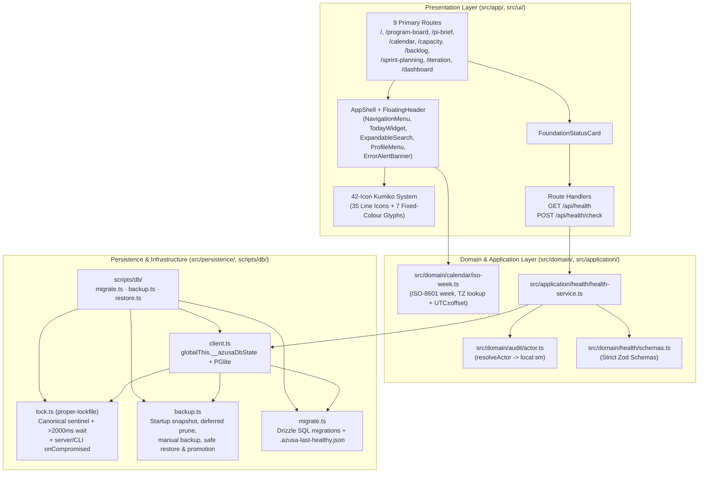

# Implementation Plan: Application Foundation (F001)

Operator decision (2026-11-21): use clock color `#A65307` from the v2 prototype. The v2 prototype overrides the base handoff's stale token table; the change also corrects clock-text contrast on the page background.

**Branch**: `001-application-foundations` | **Date**: 2026-11-20 (Regenerated against Feature Brief v0.2, Handoff v2, Data Model v0.6, and Roadmap v0.2) | **Spec**: [spec.md](./spec.md)  
**Input**: Feature specification `/specs/001-application-foundations/spec.md` and Feature Brief `/docs/features/001-application-foundations.md` (v0.2)

---

## Summary

Establish the local-first Azusa application foundation (`F001`) as a single strict-TypeScript Next.js 15 (App Router) application bound to `127.0.0.1` with clear presentation, domain/application, and persistence boundaries. Integrate embedded **PGlite** with **Drizzle ORM** backed by persistent local filesystem storage, protected across processes by **`proper-lockfile`** using per-directory canonical sentinels (`<parent(dir)>/<basename(dir)>.azusa-lock`), an empty `.lock/` folder invariant, a `> 2000ms` post-acquisition heartbeat wait across **every** lock holder (`server`, `db:migrate`, `db:backup`, `db:restore`), graceful `onCompromised` handlers for server (`503`) and CLI (cleanup/rollback + exit `1`), and a once-per-process `globalThis.__azusaDbState` singleton. Provide reusable UUIDv4 + UTC timestamp (`$onUpdate`) + `"local:sm"` audit columns (`app_metadata` only), atomic pre-migration startup backup with deferred 10-snapshot retention pruning, non-mutating SHA-256-verified manual backup, and disjoint-path CLI restore with staged `.restore-tmp-<uuid>` verification and recoverable active promotion preserving `db-replaced-<timestamp>` intact on disk.

Implement the approved Handoff v2 visual language: warm-light palette and semantic tokens, locally bundled `@fontsource` typography (`Zen Kaku Gothic New`, `IBM Plex Sans`, `IBM Plex Mono`), the complete **42-icon Kumiko set** (35 `currentColor` line icons + 7 fixed-colour glyphs: `warning` + 6 status/commitment badges), top-right radial-masked `asanoha` lattice, sticky single-row floating header (`60px` logo disclosure menu with **9 primary destinations** across `PI`, `Capacity`, `Sprint`, `Insights`; right-aligned viewer-local Today widget immediately before Search with `visibility: hidden` overlap protection below `1100px`; expandable search; `"SM"` profile dropdown displaying `"Scrum Master"` / `"No ART or team configured"` and a disabled non-navigating `Settings` placeholder — **no `/settings` route in F001**), 9 route placeholders with **Roadmap v0.2 (`M0`–`M4`, `F004`–`F019`)** badges, Foundation Status Card, error alert banner, deterministic quality gates, and Constitution Principle VI documentation aligned with **Data Model v0.6**.

---

## Technical Context

- **Language / Runtime**: TypeScript 5.x (`strict: true`, `noUncheckedIndexedAccess: true`), Node.js 22.12+ (22.x), 24.x, or 26+
- **Framework**: Next.js 15 (App Router), React 19, bound to `127.0.0.1`, `NEXT_TELEMETRY_DISABLED=1`, `serverExternalPackages: ['@electric-sql/pglite']`, `distDir: process.env.AZUSA_NEXT_DIST_DIR || '.next'`
- **Styling & Fonts**: Tailwind CSS + CSS custom properties (`src/app/globals.css`), `@fontsource/zen-kaku-gothic-new`, `@fontsource/ibm-plex-sans`, `@fontsource/ibm-plex-mono`
- **Storage & Locking**: Embedded PGlite (`.azusa/data/db` default, configurable via `AZUSA_DB_DIR`), Drizzle ORM + Drizzle Kit, `proper-lockfile` (`<parent(dir)>/<basename(dir)>.azusa-lock`), local atomic directory backups (`.azusa/data/backups` default, configurable via `AZUSA_BACKUP_DIR`)
- **Validation & Testing**: Zod, ESLint, Prettier, Vitest (`passWithNoTests: true`), Playwright (`port 3100`, `reuseExistingServer: false`, `.next-playwright`, `.azusa/test-playwright/`), `@axe-core/playwright`
- **Visual-Fidelity Mode**: **`Mixed`**
  - **Prototype Reference**: `docs/handoffs/azusa-handoff-v2.zip` (`AZUSA_HANDOFF.md`, `AZUSA_HANDOFF_UPDATE_2026-11-20.md`, `prototype/Main.dc.html`, `prototype/LeaveCalendar.dc.html`, `prototype/TeamBacklog.dc.html`, `prototype/TeamIterationPlan.dc.html`, `prototype/Icons.dc.html`, `icons/icons.json` [42 icons], `icons/svg/*.svg`, `assets/azusa-logo.png`, `assets/azusa-logo-256.png`, `screenshots/01–15`).
  - **Planned Deviations (`D1`–`D6`)**:
    - **D1**: Replace hardcoded `#FFFFFF` divider stroke in `delivery-flow` with `stroke="var(--kumiko-surface, #FFFFFF)"` (`AZUSA_HANDOFF_UPDATE_2026-11-20.md` §15).
    - **D2**: Bundle fonts locally via `@fontsource` instead of Google Fonts CDN (Constitution Principle IV).
    - **D3**: Today widget displays `"No active PI · No active Sprint"` and single viewer-local clock (`HHMMh ZONE`, fixed-offset lookup + `UTC±offset`, never `GMT`, full UTC fallback on invalid IDs) instead of hardcoded sample PI/Sprint and 3 team clocks (Feature Brief v0.2 §3.6, AC05).
    - **D4**: All 9 primary routes render standardized honest placeholders with Roadmap v0.2 badges (`M0`–`M4`, `F004`–`F019`), `asanoha` mark, and Foundation Status Card instead of sample boards/charts (Feature Brief v0.2 §3.5, AC04).
    - **D5**: Disclosure `<nav>` semantics (`aria-expanded`, `aria-controls`, `aria-current="page"`), right-aligned in-flow `TodayWidget` before Search matching Handoff v2 (`align-items: flex-end`, operator decision 2026-11-23), disabled non-navigating `Settings` item inside the profile dropdown with visible `aria-describedby`-linked helper text (no `/settings` route in F001 per Clarification Q1), `:focus-visible` outlines (`2px solid #E07F24`), sticky single-row header hiding `TodayWidget` via `visibility: hidden` when expanded search would overlap `< 1100px`, and `role="alert"` error banner (Constitution Principle VII, Clarifications Q1 & CF5).
    - **D6**: Omit prototype's sample header context breadcrumb (`Payments ART › Palawan › PI-2027.1`) until `F002`, and display `"Scrum Master"` / `"No ART or team configured"` in the profile dropdown header (keeping `local:sm` internal-only for audit per Clarification Q2).

---

## Constitution Compliance Note

- **Principle I (Local-First Single-User)**: Runs 100% locally on `127.0.0.1` with embedded PGlite, local fonts, and zero cloud/auth/telemetry requirements.
- **Principle II (Prototype Fidelity)**: Declares `Mixed` fidelity referencing `docs/handoffs/azusa-handoff-v2.zip`; all 6 deviations (`D1`–`D6`) are explicitly justified and operator-accepted.
- **Principle III (Domain Integrity & Data Model v0.6)**: F001 creates zero business-domain tables and codifies **Data Model v0.6** in `docs/architecture/domain-model.md`, keeping `PlanVersion` (`F012`), `PICommitment` (`F012`), `SprintCommitment` (`F013`), `SprintClosure`/`Actuals` (`F015`), and `StateChange` (`F014`) distinct, preserving the 3 Sprint lifecycle date concepts (`scheduled`, `effective`, `recorded_at`), and enforcing pure single-source domain rules in `src/domain/` (`actor.ts`, `iso-week.ts`, `schemas.ts`) with zero screen-level duplication.
- **Principle IV (Dependencies, Persistence & Recovery)**: Every dependency (`next`, `react`, `react-dom`, `@electric-sql/pglite`, `drizzle-orm`, `drizzle-kit`, `proper-lockfile`, `zod`, `@fontsource/*`, `tailwindcss`, `eslint`, `prettier`, `vitest`, `@playwright/test`, `@axe-core/playwright`, `tsx`) is open-source, actively maintained, justified, and runs 100% locally. Explicit Drizzle SQL migrations, Zod validation, `proper-lockfile` locking with `> 2000ms` heartbeat grace wait and `onCompromised` handlers, deferred-prune atomic startup backups, and safe recoverable CLI restore are all designed in.
- **Principle V (Deterministic Testing)**: Fixed timezone/clock Playwright harness on dedicated port `3100` (`reuseExistingServer: false`), isolated temp storage for all unit/integration tests, and full quality-gate scripts.
- **Principle VI (Documentation as a First-Class Deliverable)**: Creates and aligns `README.md`, `docs/REPO_MAP.md`, `CHANGELOG.md`, `docs/architecture/overview.md`, `docs/architecture/domain-model.md` (Data Model v0.6), `docs/architecture/data-dictionary.md` (F001 structures only), `docs/architecture/decisions/0001-local-first-nextjs-pglite-foundation.md`, and `docs/operations/database-and-recovery.md`. F001's roadmap badges follow `docs/feature-roadmap.md` v0.2 (`M0`–`M4`, `F001`–`F019`, currently `Proposed`, where its line 35 brief name `AZUSA_F001_APPLICATION_FOUNDATION_v0.2.md` maps to `docs/features/001-application-foundations.md`); `F001` remains unchecked in `docs/feature-roadmap.md` until conformance review and explicit operator UAT acceptance.
- **Principle VII (Accessibility)**: Disclosure navigation, keyboard operability, `:focus-visible` outlines, mutual exclusion of header overlays, `role="timer"` / `role="alert"` landmarks, and zero `@axe-core/playwright` violations.

---

## Architecture



### Layer Rules
1. **`src/domain/`**: Pure TypeScript functions and Zod schemas only. Must NOT import `next/*`, `react`, `@electric-sql/pglite`, `drizzle-orm`, `proper-lockfile`, or `node:fs`.
2. **`src/application/`**: Orchestrates domain rules and persistence services (`health-service.ts`). Must NOT import React or UI components.
3. **`src/persistence/`**: Encapsulates race-safe cross-process locking (`lock.ts`), PGlite singleton (`client.ts`), Drizzle schemas (`schema/`), SQL migrations (`migrate.ts`), and atomic backup/restore/promotion (`backup.ts`).
4. **`src/ui/` & `src/app/`**: Renders the Azusa shell, 42 Kumiko icons, Today widget, profile dropdown, 9 placeholder views, and API Route Handlers.

---

## Data Flow

### 1. Startup, Cross-Process Lock, Heartbeat Wait, Pre-Migration Backup & Deferred Pruning
1. On first server request or CLI `db:migrate`, `ensureDatabaseInitialized()` checks `globalThis.__azusaDbState` (running **at most once per process** and caching both `'healthy'` and `'error'` outcomes).
2. **Lock Acquisition & Heartbeat Grace Wait (`src/persistence/lock.ts`)**:
   - Acquires exclusive lock via `proper-lockfile` (`retries: 0, stale: 10000, update: 2000, realpath: false`) on `<parent(dir)>/<basename(dir)>.azusa-lock`, keeping `<sentinel>.lock/` strictly empty (optional non-authoritative diagnostics in `<dir>.azusa-owner.json`).
   - **Every lock holder** (`server`, `db:migrate`, `db:backup`, `db:restore`) waits just over one heartbeat interval (`> 2000ms`, e.g., `2100ms`) after acquiring the lock to confirm the heartbeat succeeded and `onCompromised` has not fired before opening PGlite or reading, copying, or modifying the database folder.
   - Custom `onCompromised` handler: closes PGlite, caches `status: 'error'` (`stage: 'init'`), and returns `503` (server); or aborts immediately, cleans up `.tmp-*`/`.restore-tmp-*`, rolls back any active promotion underway (`db-replaced-<timestamp>` → `activeDbDir`), logs to stderr, and exits `1` (CLI).
   - Sibling restore targets lock their own sentinel (`<parent(targetDir)>/<basename(targetDir)>.azusa-lock`), decoupled from `activeDbDir`.
3. **Interrupted Promotion Recovery (`src/persistence/backup.ts`)**: Inspects `<parent(dbDir)>/.azusa-promote-journal.json`. If `dbDir` is missing `PG_VERSION` (or fails verification) while `db-replaced-<timestamp>` is valid, rolls back `db-replaced-<timestamp>` to `dbDir` and deletes the journal; if `dbDir` is already healthy, deletes only the leftover journal while **preserving `db-replaced-<timestamp>`**.
4. **Atomic Pre-Migration Backup (`src/persistence/backup.ts`)**: If `PG_VERSION` is absent → skips (`skipped_cold_start`). If `PG_VERSION` exists without `.azusa-last-healthy.json` → skips snapshotting the unverified cluster (`skipped_unverified`) and skips pruning. If both exist → copies `dbDir` to `<backupDir>/.tmp-<backupId>`, writes `manifest.json`, and renames to `<backupId>` **without pruning yet**. Any backup error cleans up `.tmp-*`, releases the lock, halts **before** opening PGlite, and caches `status: 'error'` (`stage: 'backup'`).
5. **Mount, Migrate & Deferred Pruning (`src/persistence/migrate.ts`)**: Removes `.azusa-last-healthy.json`, opens `new PGlite(dbDir)`, applies pending SQL migrations, upserts `'foundation.init'` with UUIDv4 and `"local:sm"`, writes `.azusa-last-healthy.json`, and **only then** runs `pruneCompletedStartupBackups(backupDir, 10)` (never pruning `-manual` backups).

### 2. Foundation Status Card & Diagnostic Write Flow
1. All 9 placeholder routes load initial health via `getFoundationHealth()`.
2. If `health.status === 'error'`, `AppShell` renders `<ErrorAlertBanner role="alert" />` with stage, message, and recovery hint.
3. Clicking **"Record diagnostic check"** sends `POST /api/health/check` with `{ note }`, validated by strict `DiagnosticCheckRequestSchema` (rejecting `actor` or unknown keys), upserts `'diagnostic.last_check'` with UUIDv4 and `$onUpdate` UTC timestamp, and returns `201 Created` (or `503`/`500` on error).

### 3. Today Widget, Single-Row Header Overlap-Hiding & Profile Dropdown Flow
1. `TodayWidget` renders a fixed-height `tabular-nums` placeholder on SSR; on mount it reads the browser's IANA timezone via `Intl.DateTimeFormat().resolvedOptions().timeZone` (falling back to `undefined` → `'UTC'` only if discovery throws or returns an invalid zone) and calls `getTodayWidgetModel(now, browserTimeZone)` so date, ISO week, and clock all reflect the viewer's local timezone (zero hydration mismatch or layout shift), refreshing every `15000ms`. Invalid/missing timezone IDs compute **both** clock time (`HHMMh`) and zone badge (`'UTC'`) in `UTC`.
2. `FloatingHeader` (`position: sticky; top: 0; z-index: 20` with fade backdrop) stays single-row at `1440px`, `1024px`, and `768px` with `TodayWidget` in normal flow on the right immediately before Search, both rows right-aligned (`align-items: flex-end`). When `ExpandableSearch` expands (`280px`) below `1100px`, `TodayWidget` sets `visibility: hidden` (`pointer-events: none`) and restores `visibility: visible` on collapse.
3. `NavigationMenu` (`290px`, 9 links across `PI`, `Capacity`, `Sprint`, `Insights`) and `ProfileMenu` (`250px`, `"Scrum Master"` / `"No ART or team configured"` + disabled `Settings` item) are mutually exclusive; opening one closes the other, and `Escape` closes the active overlay and restores trigger focus.

---

## Project Structure

```text
src/
├── app/
│   ├── globals.css                     # Tailwind CSS + Azusa v2 design tokens + :focus-visible
│   ├── layout.tsx                      # Local @fontsource imports + AppShell
│   ├── page.tsx                        # /                  (Team PI board — M1 · F009)
│   ├── program-board/page.tsx          # /program-board     (ART program board — M4 · F019)
│   ├── pi-brief/page.tsx               # /pi-brief          (Team PI brief — M1 · F011)
│   ├── calendar/page.tsx               # /calendar          (Team calendar — M0 · F005)
│   ├── capacity/page.tsx               # /capacity          (Capacity planner — M0 · F004)
│   ├── backlog/page.tsx                # /backlog           (Team backlog — M1 · F008)
│   ├── sprint-planning/page.tsx        # /sprint-planning   (Sprint planning — M2 · F013)
│   ├── iteration/page.tsx              # /iteration         (Iteration board — M2 · F014)
│   ├── dashboard/page.tsx              # /dashboard         (Team dashboard — M3 · F017)
│   └── api/health/
│       ├── route.ts                    # GET /api/health
│       └── check/route.ts              # POST /api/health/check
├── ui/
│   ├── icons/
│   │   ├── kumiko-icons.ts             # All 42 Kumiko SVG definitions (35 line + 7 fixed-colour glyphs)
│   │   └── KumikoIcon.tsx              # Reusable Kumiko icon & badge component (D1 seam fix)
│   ├── shell/
│   │   ├── nav-config.ts               # 9 primary destinations, 4 groups, Roadmap v0.2 badges
│   │   ├── AsanohaBackground.tsx       # Top-right radial-masked 28×48.5 SVG lattice
│   │   ├── NavigationMenu.tsx          # 60px logo disclosure button + 290px 9-item nav dropdown
│   │   ├── TodayWidget.tsx             # Viewer-local date, CWww.d, unconfigured PI/Sprint, clock
│   │   ├── ExpandableSearch.tsx        # 40px -> 280px search shell interaction
│   │   ├── ProfileMenu.tsx             # 40px "SM" button + 250px dropdown (disabled Settings)
│   │   ├── FloatingHeader.tsx          # Single-row header coordinating overlays & <1100px hiding
│   │   ├── ErrorAlertBanner.tsx        # role="alert" DB/backup/migration failure banner
│   │   ├── FoundationStatusCard.tsx    # Compact DB/migration/backup status + diagnostic check
│   │   ├── PlaceholderScreen.tsx       # Standardized placeholder view for all 9 routes
│   │   └── AppShell.tsx                # Root shell layout
├── domain/
│   ├── audit/actor.ts                  # resolveActor() -> "local:sm"
│   ├── calendar/iso-week.ts            # ISO-8601 week, TZ normalization, lookup + UTC±offset
│   └── health/schemas.ts               # Strict Zod schemas
├── application/
│   └── health/health-service.ts        # getFoundationHealth(), recordDiagnosticCheck()
└── persistence/
    ├── schema/{common.ts,app-metadata.ts,index.ts}
    ├── migrations/0000_foundation_init.sql
    ├── lock.ts                         # proper-lockfile (<dir>.azusa-lock, empty .lock, >2000ms wait)
    ├── backup.ts                       # Startup backup, deferred prune, manual backup, safe restore
    ├── migrate.ts                      # Configurable Drizzle migrator + .azusa-last-healthy.json
    └── client.ts                       # globalThis.__azusaDbState singleton + PGlite
scripts/
├── db/{migrate.ts,backup.ts,restore.ts}
└── test/start-playwright-server.ts     # Pre-seeded port 3100 Playwright bootstrap
```

*(Note: No `src/app/settings/page.tsx` route is created in F001 per Clarification Q1.)*

---

## Risks and Tradeoffs

| Risk | Impact | Mitigation |
|---|---|---|
| **Concurrent server/CLI access, stale-lock takeover races & lost locks** | Concurrent PGlite opens could corrupt local storage; `proper-lockfile` default `onCompromised` throws an uncaught crash. | Per-directory canonical sentinels (`<parent(dir)>/<basename(dir)>.azusa-lock`), strictly empty `.lock/` directory, `> 2000ms` heartbeat wait across **every** lock holder before touching DB files, and custom `onCompromised` handlers for server (`503`) and CLI (cleanup/rollback + exit `1`). |
| **10-second stale window under heavy I/O** | Extremely slow blocking I/O stalling the event loop for `> 10s` could let another process treat the lock as stale. | Acceptable for single-user F001 cluster size; documented explicitly in `docs/operations/database-and-recovery.md` along with the `2000ms` heartbeat interval. |
| **Failed startups evicting good backups** | Repeated page loads or crash loops against a corrupt DB could replace all 10 good backups with corrupt copies. | Once-per-process startup state (`globalThis.__azusaDbState`), `.azusa-last-healthy.json` gate, and deferred pruning only after mount and migrations succeed. |
| **Accidental overwrite of active DB during restore** | Overwriting `.azusa/data/db` without undo loses recent data. | Disjoint/Windows-normalized path refusal, staged `.restore-tmp-<uuid>` verification, and journaled `--force-overwrite-active` swap that **preserves `db-replaced-<timestamp>` intact on disk** with automatic rollback/startup recovery. |
| **Next.js WASM bundling & HMR reloads** | Bundling PGlite fails to resolve `.wasm`/`.data`; HMR opens duplicate connections. | `serverExternalPackages: ['@electric-sql/pglite']` in `next.config.ts` and `globalThis.__azusaDbState` singleton. |
| **SSR hydration mismatch on viewer-local clock** | Server timezone/time differs from browser clock. | Fixed-height SSR placeholder populated on client mount with `tabular-nums`, avoiding mismatch and CLS. |

---

## Validation Approach

1. **Deterministic Unit Tests (`tests/unit/` via `npm run test:run`)**:
   - `actor.test.ts`: Default `"local:sm"`, whitespace fallback, env override, explicit internal override.
   - `iso-week.test.ts`: ISO-8601 week year boundaries, Sundays (`d=7`), legacy aliases (`Asia/Calcutta`, `US/Central`), fixed-offset lookup (`PHT`/`IST`/`JST`/`SGT`/`UTC`), `UTC±offset` (`America/Chicago`, `Europe/London`, half-hour zones — never `GMT`), invalid/missing timezone ID computing **both** clock time and `'UTC'` badge, and `"No active PI · No active Sprint"`.
   - `schemas.test.ts`: Strict `DiagnosticCheckRequestSchema` rejecting `actor`/unknown keys, UUID/timestamp validation, `BackupManifestSchema`, `HealthResponseSchema`.
   - `icons.test.ts`: Verifies all 42 Kumiko icon keys from `icons/icons.json` exist, **all 42 render inside the shared `<svg>` wrapper** (`fill="none"`, `stroke="currentColor"`, `stroke-width="1.75"`, `stroke-linejoin="miter"`, `stroke-miterlimit="10"`, `stroke-linecap="butt"`), the 7 fixed-colour glyphs (`warning` + 6 badges) keep their fixed colours through inner `<path>` attributes (explicitly asserting `commit-buffer` inherits `fill="none"` and `1.75px` dashed stroke, and `flag-missed`/`flag-aging`/`commit-committed`/`warning` have no unintended black fills), and `delivery-flow` uses `var(--kumiko-surface, #FFFFFF)`.
   - `docs-completeness.test.ts`: Verifies all required Constitution Principle VI documentation artifacts exist, contain no `TBD`/`TODO`, link cleanly from `README.md`, and align with Roadmap v0.2 (`F001`–`F019`, leaving `F001`–`F019` unchecked until UAT).
2. **Persistence, Locking, Migration & Backup/Restore Integration Tests (`tests/integration/` via `npm run test:run`)**:
   - `persistence-restart.test.ts`: Restart durability (`AC07`, `SC-002`), `$onUpdate` timestamp refresh, and real `init`-stage failure on corrupted cluster.
   - `migration-upgrade.test.ts`: Isolated `migrationsFolder` fresh init, incremental upgrade preserving 100% of records (`SC-003`), and invalid migration error surfacing (`stage: 'migration'`, `.azusa-last-healthy.json` absent).
   - `backup-restore.test.ts`:
     - Cold-start backup skip; startup backup + non-mutating SHA-256-verified manual backup; byte-for-byte SHA-256 active-DB preservation during staging restore (`SC-004`) and full record field verification (`AC08`).
     - Deferred pruning, 10-snapshot retention (same-ms `-01-startup` suffix, `.tmp-*` cleanup, `-manual` preservation), and non-eviction of 10 good backups across repeated failed startups/restarts.
     - Lock lifecycle & contention: clean release + immediate re-acquisition, `SIGKILL` recovery, stale-lock fixture `>= 2000ms` with `>= 4` racing child processes (winning child holds lock until all contenders try, losers halt without writing), sibling restore while server holds active lock without `ELOCKED`, contention between two concurrent restores to the same target, and malformed lock fail-closed.
     - **Lost-lock simulation**: Deleting `<sentinel>.lock` or altering its `mtime` verifies: (a) server closes PGlite, `/api/health` and `/api/health/check` return `503` with `stage: 'init'`; (b) `db:backup` removes `.tmp-*` and exits `1`; (c) `db:restore` removes `.restore-tmp-*` during staging or rolls `db-replaced-<timestamp>` back to `activeDbDir` during active promotion and exits `1`; (d) any lock holder losing the lock during the `> 2000ms` heartbeat wait aborts before opening PGlite or touching the DB folder.
     - Path safety refusals (active DB without flag, Windows case/slash variants, parent/child overlaps, populated target, corrupted backup) and active promotion rollback + interrupted startup recovery **preserving `db-replaced-<timestamp>`** on healthy DB.
     - Cross-platform backup failure simulation (regular file at `backupDir` path → `stage: 'backup'`).
3. **Visual-Fidelity Tier-1 Suite (`tests/visual/shell-fidelity.spec.ts` via `npm run test:visual`)**:
   - Runs against `http://127.0.0.1:3100` (`reuseExistingServer: false`, `.next-playwright`, pre-seeded `.azusa/test-playwright/`, `Asia/Manila`, frozen clock `2026-11-08T11:30:00.000Z`).
   - Verifies Azusa tokens, local fonts, sticky header (`position: sticky; top: 0px`), right-aligned `TodayWidget` bounding box immediately before Search, bounding boxes (`60px` logo, `290px` nav menu, `250px` profile menu, `40px`→`280px` search, `40px` `"SM"` badge, `80%` `asanoha` lattice), absence of header context breadcrumb, 42-icon rendering, and single-row header non-overlap across `1440px`, `1024px`, and `768px` (including `TodayWidget` `visibility: hidden` when search expands `< 1100px` and `visibility: visible` on collapse).
4. **End-to-End Smoke & Accessibility Suite (`tests/e2e/foundation-smoke.spec.ts` via `npm run test:e2e`)**:
   - **US1 & SC-005**: Zero external network requests; keyboard-only operation across logo menu, all 9 primary routes (`PI`, `Capacity`, `Sprint`, `Insights` — confirming `Settings` is absent from logo menu), search control, and profile dropdown (`"Scrum Master"`, `"No ART or team configured"`, disabled non-navigating `Settings` placeholder, mutual exclusion); `@axe-core/playwright` zero-violation scans on `/` (default, logo menu open, profile menu open, expanded search) and representative routes; Roadmap v0.2 badges verified on all 9 routes.
   - **US2**: Deterministic Today widget assertions verifying browser timezone forwarding: both `2026-11-08T11:30:00.000Z` in `Asia/Manila` (`2026/11/08 · CW45.7 | No active PI · No active Sprint`, `1930h PHT`) AND a UTC-date-crossing instant (`2026-11-08T18:30:00.000Z` in `Asia/Manila` → `2026/11/09 · CW46.1`, `0230h PHT`, proving browser timezone is forwarded for date, ISO week, and clock rather than defaulting to UTC).
   - **US3**: Diagnostic write (`POST /api/health/check` → `201`), reload persistence, and fault-injected `init`/`migration`/`backup` `503` + `<ErrorAlertBanner role="alert" />`.
   - **US4**: Pre-seeded `.azusa/test-playwright/db` produces real `backup-*-startup` (`backupCount: 1`) on boot; safe sibling `restoreBackup()` into `.azusa/test-playwright/restored` succeeds while server runs and leaves `.azusa/test-playwright/db` untouched.

---

## Affected Areas

### Files / Components to Be Inspected (Read-Only Reference)
- `.specify/memory/constitution.md`
- `docs/features/001-application-foundations.md` (v0.2)
- `docs/feature-roadmap.md` (v0.2)
- `docs/handoffs/azusa-handoff-v2.zip` (`AZUSA_HANDOFF.md`, `AZUSA_HANDOFF_UPDATE_2026-11-20.md`, `docs/azusa-data-model.md` v0.6, `docs/azusa-sprint-planning-decisions.md`, `docs/azusa-work-item-view.md`, `prototype/*.dc.html`, `icons/icons.json`, `icons/svg/*.svg`, `assets/azusa-logo*.png`)
- `specs/001-application-foundations/spec.md`

### Files / Components to Be Created or Modified
- **Config & Assets**: `package.json`, `package-lock.json`, `tsconfig.json`, `next.config.ts`, `postcss.config.mjs`, `eslint.config.mjs`, `.prettierrc`, `.gitignore`, `vitest.config.mts`, `playwright.config.ts`, `drizzle.config.ts`, `public/assets/azusa-logo.png`, `public/assets/azusa-logo-256.png`
- **Domain & Application**: `src/domain/audit/actor.ts`, `src/domain/calendar/iso-week.ts`, `src/domain/health/schemas.ts`, `src/application/health/health-service.ts`
- **Persistence & Scripts**: `src/persistence/schema/{common.ts,app-metadata.ts,index.ts}`, `src/persistence/migrations/0000_foundation_init.sql` (+ `meta/_journal.json`), `src/persistence/{lock.ts,backup.ts,migrate.ts,client.ts}`, `scripts/db/{migrate.ts,backup.ts,restore.ts}`, `scripts/test/start-playwright-server.ts`
- **UI & Routes**: `src/app/globals.css`, `src/app/layout.tsx`, `src/app/page.tsx`, `src/app/{program-board,pi-brief,calendar,capacity,backlog,sprint-planning,iteration,dashboard}/page.tsx`, `src/app/api/health/{route.ts,check/route.ts}`, `src/ui/icons/{kumiko-icons.ts,KumikoIcon.tsx}`, `src/ui/shell/{nav-config.ts,AsanohaBackground.tsx,NavigationMenu.tsx,TodayWidget.tsx,ExpandableSearch.tsx,ProfileMenu.tsx,FloatingHeader.tsx,ErrorAlertBanner.tsx,FoundationStatusCard.tsx,PlaceholderScreen.tsx,AppShell.tsx}`
- **Documentation**: `README.md`, `CHANGELOG.md`, `docs/REPO_MAP.md`, `docs/architecture/{overview.md,domain-model.md,data-dictionary.md}`, `docs/architecture/decisions/0001-local-first-nextjs-pglite-foundation.md`, `docs/operations/database-and-recovery.md` *(note: `docs/feature-roadmap.md` `F001` checkbox is only updated post-UAT)*

### Tests to Be Added
- `tests/unit/{actor.test.ts,iso-week.test.ts,schemas.test.ts,icons.test.ts,docs-completeness.test.ts}`
- `tests/integration/{persistence-restart.test.ts,migration-upgrade.test.ts,backup-restore.test.ts}`
- `tests/visual/shell-fidelity.spec.ts`
- `tests/e2e/foundation-smoke.spec.ts`

### Explicitly Out of Scope
- Any `/settings` route (`src/app/settings/`) or Settings configuration UI
- Header ART/Team/PI context breadcrumb switchers (`F002`)
- Domain tables, APIs, or functional screens for `F002`–`F019` (`M0`–`M4`)
- Search indexing/queries, Better Auth/RBAC, interactive backup/restore UI, or porting `.dc.html` runtime
