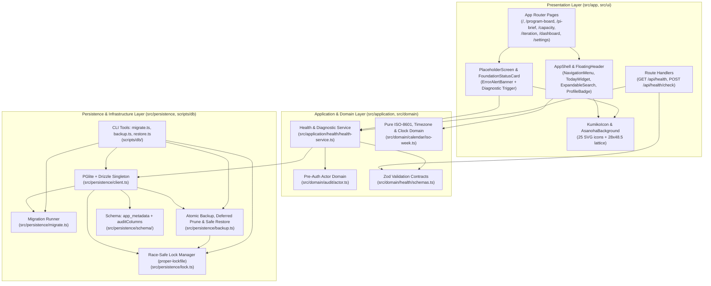

# Implementation Plan: Application Foundation (F001)

**Branch**: `001-application-foundations` | **Date**: 2026-11-08 | **Spec**: [spec.md](./spec.md)  
**Input**: Feature specification from `/specs/001-application-foundations/spec.md` and Feature Brief `/docs/features/001-application-foundations.md`

---

## Summary

Establish the local-first Azusa application foundation (`F001`) as a single strict-TypeScript Next.js (App Router) application bound to `127.0.0.1` with clear presentation, domain/application, and persistence boundaries. Integrate embedded **PGlite** with **Drizzle ORM** backed by persistent local filesystem storage, protected across processes by **`proper-lockfile`** (`<parent(dbDir)>/<basename(dbDir)>.azusa-lock`) and within the server process by a once-per-process `globalThis.__azusaDbState` singleton, with standard UUIDv4 + UTC timestamp (auto-updated `updated_at`) + `"local:sm"` actor audit columns, atomic pre-migration directory backup-on-start (at most once per process, with 10-snapshot retention pruning deferred until after PGlite mounts and migrations succeed), and a safe disjoint-path CLI restore workflow with staged pre-swap verification and recoverable `db-replaced-<timestamp>` active promotion. Implement the approved Azusa design system tokens, locally bundled `@fontsource` typography (`Zen Kaku Gothic New`, `IBM Plex Sans`, `IBM Plex Mono`), the 25-icon **Kumiko line** SVG component set, the top-right radial-masked `asanoha` lattice background, the single-row floating header shell (60px logo disclosure navigation dropdown, viewer-local Today widget with ISO-8601 week, fixed-offset lookup table + `UTC±offset` fallback, and unconfigured PI/Sprint placeholder that sets `visibility: hidden` when expanded search would overlap below `1100px`, expandable search control, `"SM"` profile badge), and explicit placeholder views across all 7 navigation destinations with roadmap milestone badges (`docs/feature-roadmap.md`), a foundation health status card, and an error alert banner. Deliver deterministic unit, integration, visual-fidelity (`test:visual`), and Playwright E2E + `@axe-core/playwright` smoke tests alongside the complete Constitution Principle VI documentation suite.

---

## Technical Context

**Language/Version**: TypeScript 5.x (`strict: true`, `noUncheckedIndexedAccess: true`) on Node.js 20+ LTS  
**Primary Dependencies**: Next.js 15 (App Router), React 19, `@electric-sql/pglite`, `drizzle-orm`, `drizzle-kit`, `proper-lockfile`, `zod`, `tailwindcss`, `@fontsource/zen-kaku-gothic-new`, `@fontsource/ibm-plex-sans`, `@fontsource/ibm-plex-mono`, `@axe-core/playwright`  
**Storage**: Local filesystem PostgreSQL via embedded PGlite (`.azusa/data/db` default, configurable via `AZUSA_DB_DIR`), cross-process lock via `proper-lockfile` (`<parent(AZUSA_DB_DIR)>/<basename(AZUSA_DB_DIR)>.azusa-lock`), and atomic local directory snapshots (`.azusa/data/backups` default, configurable via `AZUSA_BACKUP_DIR`)  
**Testing**: Vitest (unit + PGlite/filesystem/child-process-lock/backup/promotion integration tests) and Playwright (`test:visual` Tier-1 geometry/style/non-overlap checks + `test:e2e` browser smoke & `@axe-core/playwright` accessibility tests on port `3100` with `reuseExistingServer: false`, `.next-playwright`, pre-seeded `.azusa/test-playwright/` storage, and frozen clock)  
**Target Platform**: Local developer workstation (Windows / macOS / Linux; modern evergreen desktop/narrow browser viewports `1440px`, `1024px`, `768px`)  
**Project Type**: Local-first single-project web application (`Next.js` full-stack bound to `127.0.0.1` with CLI database operations)  
**Performance Goals**: Instant local page transitions (`< 100ms` shell interaction); Today widget clock refresh every `15s` with zero layout shift (`tabular-nums`); startup backup + migration verification `< 2s` on local SSD  
**Constraints**: 100% local runtime operation; zero hosted services, cloud databases, external font CDNs, telemetry (`NEXT_TELEMETRY_DISABLED=1`), or paid APIs; CLI backup/migrate/active-restore enforce race-safe exclusive database ownership; safe restore must never silently overwrite the active database, overlapping paths, or populated directories  
**Scale/Scope**: Single operator (`local:sm`) in M0, 7 top-level shell routes with placeholder views, 1 infrastructure table (`app_metadata`), 25 Kumiko line icons, 8 required repository documentation deliverables  
**Prototype / Design Reference**: `docs/handoffs/azusa-handoff-v1.zip` (`AZUSA_HANDOFF.md`, `docs/azusa-data-model.md` v0.4, `prototype/Main.dc.html`, `prototype/Settings.dc.html`, `prototype/Icons.dc.html`, `icons/icons.json`, `icons/svg/*.svg`, `assets/azusa-logo.png`, `screenshots/01-team-pi-board.png`, `screenshots/01b-team-pi-board-menu-open.png`, `screenshots/07-settings-locations-holidays.png`, `screenshots/08-icon-set.png`)  
**Visual-Fidelity Mode**: `Mixed` — **Visual-fidelity** for the application shell (single-row floating header, 60px logo button, 290px navigation dropdown, Today widget, 40px → 280px expandable search control, 40px `"SM"` profile badge, page title row, top-right `asanoha` SVG lattice, and 25 Kumiko line icons); **Functional-only / Intentional Placeholder** for the unimplemented route bodies, foundation health status card, and error alert banner.

---

## Visual-Fidelity Mode & Planned Prototype Deviations (Constitution Principle II)

Under Constitution Principle II, `docs/handoffs/azusa-handoff-v1.zip` is the binding visual and interaction reference for the F001 shell and icon system. All planned deviations from the prototype are documented below with their specific reasons and were accepted by the operator during Specification/Planning Clarification (`2026-11-08`):

| # | Surface / Component | Prototype Reference | Planned Deviation in F001 | Specific Reason & Operator Acceptance |
|---|---|---|---|---|
| **D1** | **Header & Navigation Icons** | `prototype/Main.dc.html#L35-L42`, `prototype/Settings.dc.html#L29-L36` | Replace temporary generic stroke SVGs in the navigation menu and search button with the 25 **Kumiko line** icons (`icons/icons.json`, `prototype/Icons.dc.html#L26-L36`), and use `stroke="var(--kumiko-surface, #FFFFFF)"` on the `delivery-flow` divider path (`M12 12L19.79 7.5`). | Explicitly required by Feature Brief §2.3 and `AZUSA_HANDOFF.md` §15 (*"the icons are designed but not yet applied to the screens"* and *"delivery-flow's white divider shows as a seam on non-white backgrounds"*). |
| **D2** | **Font Delivery** | `prototype/Main.dc.html#L11-L12`, `prototype/Icons.dc.html#L11-L12` | Load `Zen Kaku Gothic New`, `IBM Plex Sans`, and `IBM Plex Mono` from local `@fontsource` packages instead of `https://fonts.googleapis.com`. | Required by Constitution Principle IV (local operation without external network dependencies), Feature Brief §2.3, and `AZUSA_HANDOFF.md` §14.3. |
| **D3** | **Today Widget Content (Unconfigured PI/Sprint & Single Local Clock)** | `prototype/Main.dc.html#L25-L30`, `L155-L180` | Render `YYYY/MM/DD · CWww.d \| No active PI · No active Sprint` on Line 1 (instead of hardcoded `PI-2027.1 · Sprint 2706`), render only the viewer's local timezone clock `HHMMh ZONE` in `#C2650E` on Line 2 (using the fixed-offset lookup table `PHT`/`IST`/`JST`/`SGT`/`UTC` and `UTC±offset` fallback via `Intl` `shortOffset` with `GMT` replaced by `UTC`, never `GMT`), and set `aria-label="Current date, calendar week, PI and sprint status, and local time"`. | Required by Feature Brief §2.3 (*"Until ART and calendar configuration is implemented, the today widget must not invent an active PI or Sprint"*), `AC03`, and Operator Clarifications Q1 & OD2 (`2026-11-08`). |
| **D4** | **Route Body Content & Standardized Title Rows (Placeholder Views + Foundation Status Card)** | `prototype/Main.dc.html#L46-L139`, `prototype/Settings.dc.html#L40-L100` | Render a standardized page title row (`Zen Kaku Gothic New` `28px`) and structured placeholder panel (using the Kumiko `asanoha` mark, target milestone/feature badge from `docs/feature-roadmap.md`, non-operational notice, and compact Foundation Status Card) across `/`, `/program-board`, `/pi-brief`, `/capacity`, `/iteration`, `/dashboard`, and `/settings` instead of static sample boards/charts/holiday grids. | Required by Feature Brief §2.3 & `AC02` (*"Unimplemented destinations must be clearly identified as unavailable or placeholders. Future functionality is not presented as operational"*) and Operator Clarifications Q2, Q3 & OD3 (`2026-11-08`). |
| **D5** | **Disclosure Navigation Semantics, Focus Indicators, Expanded-Search Overlap Hiding & Error Alert Banner** | `prototype/Main.dc.html#L24-L43` | Wrap the logo button and dropdown in `<nav aria-label="Primary navigation">` with disclosure button semantics (`aria-expanded`, `aria-controls`) and `<a aria-current="page">` links (supporting both `Tab` and `ArrowUp`/`ArrowDown` with zero axe violations); add `:focus-visible` outlines (`2px solid #E07F24`, `outline-offset: 2px`) with `border: 0` at rest; keep the single-row header at all widths while setting `visibility: hidden` on `TodayWidget` when search is expanded below `1100px` (restoring `visibility: visible` on collapse); render a top alert banner (`role="alert"`) when DB init/migration/backup fails. | Required by Constitution Principle VII, Feature Brief §2.2 & §2.3, `AC05`, `AC08`, `SC-005`, and Operator Clarifications OD1 & OD4 (`2026-11-08`). |

---

## Constitution Check

*GATE: Evaluated before Phase 0 research and re-verified after Phase 1 design and review remediations (`C1`–`C14`, `M1`–`M3`, `m1`–`m6`). All gates PASS.*

- [x] **I. Purpose & Scope** — Scoped strictly to local-first foundations for Azusa; introduces no monetization, cloud hosting, portfolio management, or enterprise auth complexity.
- [x] **II. Spec-Driven / Prototype Fidelity** — Visual-Fidelity Mode declared as `Mixed`; single-row header shell, typography, colors, `asanoha` lattice, and Kumiko icons match `azusa-handoff-v1.zip`; all 5 deviations (`D1`–`D5`) are justified and operator-accepted.
- [x] **III. Domain & Historical Integrity** — Core date/ISO-week/timezone and actor resolution rules reside in pure `src/domain/` modules; `docs/architecture/domain-model.md` codifies the strict separation between `PlanVersion`, `PICommitment`, `SprintCommitment`, `SprintClosure`/`Actuals`, and `StateChange`, plus the 3 Sprint lifecycle date concepts.
- [x] **IV. Architecture & Data Safety** — Enforces clean `ui` / `domain`+`application` / `persistence` boundaries; runs 100% locally on PGlite + Drizzle bound to `127.0.0.1`; enforces race-safe cross-process exclusive ownership via `proper-lockfile`; uses explicit SQL migrations, Zod validation, atomic pre-migration startup backups (at most once per process, with 10-snapshot retention pruning deferred until after PGlite mounts and migrations succeed), safe disjoint-path CLI restore with pre-swap verification and recoverable `db-replaced-<timestamp>` active promotion, and visible UI/API error handling. Every dependency is justified below.
- [x] **V. Deterministic Testing** — Verifiable tests planned for ISO-8601 week/timezone edge cases (`UTC±offset` fallback, invalid ID fallback), Zod validation, PGlite restart durability, real `init`-stage failure and migration failure surfacing, child-process lock contention and stale-lock takeover races, deferred backup pruning (proving failed startups never evict good backups), safe restore disjoint/populated/case-insensitive refusal, recoverable active promotion rollback and startup recovery, SHA-256 byte-for-byte active directory preservation (`SC-004`), Tier-1 `test:visual` geometry/non-overlap, and Playwright E2E + `@axe-core/playwright` smoke tests on port `3100` (`reuseExistingServer: false`) with pre-seeded isolated storage and frozen clock.
- [x] **VI. Documentation** — Explicitly creates/updates all 8 required artifacts (`README.md`, `docs/REPO_MAP.md`, `CHANGELOG.md`, `docs/architecture/overview.md`, `docs/architecture/domain-model.md`, `docs/architecture/data-dictionary.md`, `docs/architecture/decisions/`, `docs/operations/`).
- [x] **VII. UX & Accessibility** — Follows Azusa visual language; keyboard-operable disclosure navigation menu and search control (`Tab`, `Enter`/`Space`, `Escape`, `ArrowDown`/`ArrowUp`/`Home`/`End`), `:focus-visible` states, zero axe-core violations, single-row header with `visibility: hidden` on `TodayWidget` when expanded search would overlap below `1100px`, and non-color-only status indicators on the Foundation Status Card and error alerts.

---

## Constitution Compliance Note

### 1. Domain-Integrity Impact (Principle III)
- F001 establishes the architectural and documentation guardrails for Principle III in `docs/architecture/domain-model.md` and `docs/architecture/overview.md` without creating premature domain tables:
  - **Plan Versions (`PlanVersion` — `F010`)**, **PI Commitments (`PICommitment` via `Start PI` — `F013`)**, **Sprint Commitments (`SprintCommitment` via `Start Sprint` — `F015`)**, and **Actuals (`SprintClosure` via `Close Sprint` — `F017`)** are defined as distinct domain concepts and never conflated.
  - Commitment records are immutable once established; subsequent replanning or manual `vN` plan snapshots never overwrite prior commitments.
  - Sprint lifecycle events preserve three separate timestamps/dates: **Scheduled dates** (ART cadence ± 1-working-day Team offset in `F002`), **Effective lifecycle dates** (SM date picker in `F015`/`F017`), and **Action timestamps** (`recorded_at`).
  - Workflow transitions are designed to record immutable `StateChange` (`item`, `from_state`, `to_state`, `at`, `by`) audit events (`F014`).
- At the persistence layer, F001 implements reusable identity (`id` UUIDv4 via `crypto.randomUUID()`) and provenance (`created_at`, auto-updated `updated_at`, and `created_by`/`updated_by` defaulting to `"local:sm"`) plumbing in `src/persistence/schema/common.ts` so every future domain entity is traceable from creation.

### 2. Authoritative Domain Rules (Principle III & IV)
- Temporal calculations for the Today widget (`formatLocalDate`, `computeIsoCalendarWeek`, `formatViewerClock`, `normalizeTimeZone`, `resolveTimeZoneAbbreviation`) live in a single pure TypeScript domain module (`src/domain/calendar/iso-week.ts`) rather than inline component logic.
- Pre-authentication actor resolution (`resolveActor`) and metadata payload validation (`AppMetadataValueSchema`, `HealthResponseSchema`, `DiagnosticCheckRequestSchema`) live in `src/domain/` and `src/application/` so UI components and CLI scripts share one authoritative implementation.

### 3. Dependency Justification (Principle IV)

All dependencies introduced in F001 are established, actively maintained, open-source packages that run 100% locally with no paid APIs or external network calls:

| Package | License | Role in F001 | Local-Only & Maintenance Justification |
|---|---|---|---|
| `next` / `react` / `react-dom` | MIT | Application framework & UI rendering | Explicitly selected in Feature Brief §2.1 and `AZUSA_HANDOFF.md` §16. Runs locally on `127.0.0.1` via `next dev` / `next start` with `NEXT_TELEMETRY_DISABLED=1`. |
| `typescript` | Apache-2.0 | Strict static typing (`strict: true`) | Explicitly required by Feature Brief §2.1 and `AZUSA_HANDOFF.md` §16. |
| `@electric-sql/pglite` | Apache-2.0 | Embedded WASM PostgreSQL engine | Explicitly required by Feature Brief §2.2 and `AZUSA_HANDOFF.md` §16. Stores data on local filesystem without an external DB server. |
| `drizzle-orm` / `drizzle-kit` | Apache-2.0 | Type-safe SQL ORM & migration generator | Explicitly required by Feature Brief §2.2 and `AZUSA_HANDOFF.md` §16. First-class `drizzle-orm/pglite` driver support. |
| `proper-lockfile` / `@types/proper-lockfile` | MIT | Race-safe cross-process filesystem locking | Required by `C1`/`M2` and aligned with Constitution Principle IV (*prefer established open-source libraries over custom implementations*). Uses atomic OS `mkdir` primitives, `mtime` heartbeats, and race-safe stale-lock reclamation. |
| `zod` | MIT | Runtime schema validation | Explicitly required by Feature Brief §2.1 and `AZUSA_HANDOFF.md` §16. Validates API payloads, DB metadata JSON, and backup manifests. |
| `tailwindcss` / `@tailwindcss/postcss` | MIT | Utility CSS & token integration | Confirmed in Planning Clarification PC2; standard foundation for `shadcn/ui` in `F019`. |
| `@fontsource/zen-kaku-gothic-new`, `@fontsource/ibm-plex-sans`, `@fontsource/ibm-plex-mono` | OFL-1.1 / MIT | Locally bundled typography | Explicitly required by Feature Brief §2.3 and `AZUSA_HANDOFF.md` §14.3 & §16. Eliminates runtime Google Fonts requests. |
| `vitest` | MIT | Unit & integration test runner | Explicitly required by Feature Brief §2.1 and `AZUSA_HANDOFF.md` §16. |
| `@playwright/test` / `@axe-core/playwright` | Apache-2.0 / MIT | Browser E2E, `test:visual`, & accessibility verification | Explicitly required by Feature Brief §2.1, `AC07`, `AC08`, `SC-005`, and `AZUSA_HANDOFF.md` §16. |
| `eslint` / `prettier` / `tsx` | MIT | Linting, formatting, and TypeScript CLI runner | Required by Feature Brief §2.1 (`AC07`) and CLI scripts (`db:migrate`, `db:backup`, `db:restore`). |

### 4. Documentation Impact (Principle VI)

F001 creates or updates all 8 constitutional documentation artifacts within the same changeset:
- `README.md`: Complete prerequisites (including `npx playwright install chromium`), installation, configuration env vars, local startup (`127.0.0.1`), quality gate commands, stop/start backup and safe restore commands, and documentation navigation table.
- `docs/REPO_MAP.md`: Architectural navigation guide covering `src/app`, `src/ui`, `src/domain`, `src/application`, `src/persistence`, `scripts/db`, `scripts/test`, `tests/`, and `specs/`.
- `CHANGELOG.md`: Initial `0.1.0` entry documenting the F001 Application Foundation delivery.
- `docs/architecture/overview.md`: System architecture, layer boundaries, PGlite + Drizzle + `proper-lockfile` lifecycle, once-per-process startup failure state machine, atomic startup backup with deferred pruning, and recoverable active restore promotion flow.
- `docs/architecture/domain-model.md`: Conceptual domain model (Data Model v0.4 aligned with `docs/feature-roadmap.md` `M0`–`M5`) codifying Organization, Calendar (including IANA timezone storage and fixed-offset lookup + `UTC±offset` display rules), Capacity, Work Items (`Project`, `Feature`, `Story`, `Bug`, `StorySlice`, `Task`), Dependencies, and Principle III lifecycle separation (`PlanVersion` vs `PICommitment` vs `SprintCommitment` vs `SprintClosure`/`Actuals` vs `StateChange`).
- `docs/architecture/data-dictionary.md`: Implemented F001 physical table (`app_metadata`), reusable `auditColumns()`, `<basename(dbDir)>.azusa-lock`, `.azusa-last-healthy.json`, `.azusa-promote-journal.json`, and backup `manifest.json` fields, types, units, and constraints.
- `docs/architecture/decisions/0001-local-first-nextjs-pglite-foundation.md`: ADR recording the Next.js + PGlite + Drizzle + `proper-lockfile` + deferred-prune pre-migration directory backup architecture and trade-offs.
- `docs/operations/database-and-recovery.md`: Operational runbook for local database initialization, Drizzle migrations, automatic startup backups, server stop/start sequence for manual CLI backup, safe disjoint restore to staging, recoverable active promotion (`--force-overwrite-active` with `db-replaced-<timestamp>` swap and interrupted-promotion startup recovery), and troubleshooting initialization/migration/backup alert banners.

---

## Architecture & Component Boundaries



### Layer Rules
1. **`src/domain/`**: Pure TypeScript functions and Zod schemas only. Must NOT import from `next/*`, `react`, `@electric-sql/pglite`, `drizzle-orm`, `proper-lockfile`, or `node:fs`.
2. **`src/application/`**: Orchestrates domain rules and persistence repositories/services (`health-service.ts`). Must NOT import React or UI components.
3. **`src/persistence/`**: Encapsulates race-safe cross-process locking (`lock.ts`), PGlite instantiation (`client.ts`), Drizzle schema definitions (`schema/`), SQL migrations (`migrate.ts`), and atomic filesystem backup/restore/promotion operations (`backup.ts`).
4. **`src/ui/` & `src/app/`**: Renders the Azusa shell, Kumiko icons, Today widget (consuming `src/domain/calendar/iso-week.ts`), placeholder views, and API Route Handlers (consuming `src/application/health/health-service.ts`).

---

## Data Flow

### 1. Application Startup, Cross-Process Lock, Interrupted-Promotion Recovery, Pre-Migration Backup & Deferred Pruning Flow (`M1`, `M2`, `M3`)
1. On first server request or CLI `db:migrate` invocation, `ensureDatabaseInitialized()` in `src/persistence/client.ts` checks `globalThis.__azusaDbState`. Because `globalThis.__azusaDbState` caches the initialization result (whether `'healthy'` or `'error'`) for the lifetime of the process, initialization and startup backup execute **at most once per process** (`M1`).
2. **Race-Safe Cross-Process Lock Acquisition (`src/persistence/lock.ts` — `M2`)**:
   - Acquires an exclusive lock via `proper-lockfile` targeting `<parent(dbDir)>/<basename(dbDir)>.azusa-lock` (`retries: 0, stale: 10000, update: 2000, realpath: false`), keeping the `.lock` folder strictly empty so `rmdir`/`rmdirSync` unlock and exit cleanup succeed without `ENOTEMPTY` errors (`L1`). Optional diagnostic metadata `{ pid, processType, acquiredAt }` is written outside the lock directory to `<dbDir>.azusa-owner.json` and is strictly non-authoritative (`L1`).
   - A custom `onCompromised` handler closes PGlite, records error state, and serves 503 instead of throwing unhandled exceptions that crash Next.js (`L2`).
   - Following lock acquisition, every lock holder (server, `db:migrate`, `db:backup`, `db:restore`) waits just over one heartbeat interval (> 2000ms, e.g. 2100ms) to ensure the heartbeat update cycle succeeds and the `onCompromised` handler has not fired, confirming no racing process reclaimed the lock, before opening PGlite or reading, copying, or modifying the database folder (`F3`, `G1`). CLI commands (`db:migrate`, `db:backup`, `db:restore`) register an `onCompromised` handler that immediately halts execution, cleans up temporary staging folders (`.tmp-*`, `.restore-tmp-*`), executes active promotion rollback if underway, prints an error to stderr, and exits with code 1 (`F3`).
   - Sibling restore targets lock their own distinct sentinel (`<parent(targetDir)>/<basename(targetDir)>.azusa-lock`), decoupling them from the active database lock (`L3`).
   - If the lock is held by a live process or if the lock artifact is malformed/unreadable, initialization fails closed immediately (`stage: 'init'`, `code: 'ELOCKED'`) without touching `<dbDir>`.
3. **Interrupted Active-Restore Promotion Check (`M3`)**:
   - Inspects `<parent(dbDir)>/.azusa-promote-journal.json`. If a previous `--force-overwrite-active` restore was interrupted partway (leaving `dbDir` missing `PG_VERSION` while `db-replaced-<timestamp>` holds the prior valid cluster), automatically rolls back `db-replaced-<timestamp>` to `dbDir` and deletes the journal before proceeding.
4. **Atomic Pre-Migration Backup Step (`src/persistence/backup.ts` — `M1`)**:
   - Inspects `AZUSA_DB_DIR` (`.azusa/data/db`).
   - If `PG_VERSION` does not exist (cold start), records `lastBackupTrigger: 'skipped_cold_start'`.
   - If `PG_VERSION` exists and `.azusa-last-healthy.json` is present, `createStartupSnapshotIfNeeded()` copies the unmounted directory into `.azusa/data/backups/.tmp-<backupId>`, writes `manifest.json` (`BackupManifestSchema`), and atomically renames `.tmp-<backupId>` to `<backupId>` **without pruning any prior backups yet**. (If `.azusa-last-healthy.json` is absent because a prior startup/migration failed, it skips snapshotting the unverified directory so good backups are never overwritten.)
   - If the backup throws an error when an existing DB is present, `.tmp-<backupId>` is cleaned up, the lock is released, initialization halts **before** opening PGlite or running migrations, and `status: 'error'` (`stage: 'backup'`) is cached for the process lifetime.
5. **Database Mount, Migration & Post-Success Pruning Step (`src/persistence/migrate.ts` — `M1`)**:
   - Removes `.azusa-last-healthy.json` before running pending migrations, opens `new PGlite(dbDir)`, applies pending SQL migrations from `migrationsFolder`, upserts `'foundation.init'` in `app_metadata` with UUIDv4 `id` and `created_by = resolveActor()` (`"local:sm"`), and writes `.azusa-last-healthy.json`.
   - **Deferred Pruning**: Only after mount, migration, and `'foundation.init'` succeed does `pruneCompletedStartupBackups(backupDir, 10)` delete completed `-startup` snapshots beyond the 10 newest (`M1`).
   - If mounting or migrating fails, retention pruning is skipped, PGlite is closed, the lock is released, and `status: 'error'` (`stage: 'init' | 'migration'`) is cached on `globalThis.__azusaDbState`.

### 2. Foundation Status Card & Diagnostic Write Flow (`GET /api/health`, `POST /api/health/check`)
1. Placeholder pages load initial health state on the server via `getFoundationHealth()` (or fetch `GET /api/health`).
2. If `health.status === 'error'`, `AppShell` renders the accessible `ErrorAlertBanner` (`role="alert"`) at the top of the page with the failing stage, error message, and recovery command.
3. When the operator clicks **"Record diagnostic check"** in `FoundationStatusCard`, the client sends `POST /api/health/check` with `{ note }`.
4. The route handler validates the request with strict `DiagnosticCheckRequestSchema` (rejecting unknown keys such as `actor`), calls `recordDiagnosticCheck()`, upserts `'diagnostic.last_check'` in `app_metadata` (incrementing `checkCount` and automatically updating `updated_at` and `updated_by = 'local:sm'`), and returns `201 Created` with `{ ok: true, record, health }` (or `503`/`500` if the database is in an error state).

### 3. Today Widget Temporal & Single-Row Header Overlap-Hiding Flow (`OD2`, `OD4`)
1. On non-Settings routes, `TodayWidget` renders a fixed-height `tabular-nums` structure on initial SSR and immediately populates `getTodayWidgetModel(now)` from `src/domain/calendar/iso-week.ts` on mount (avoiding hydration mismatch and layout shift).
2. Computes `dateText` (`YYYY/MM/DD`), `cwText` (`CWww.d`), static unconfigured label (`No active PI · No active Sprint`), and viewer-local `clockTime` (`HHMMh`) + `clockZone` (resolved via fixed-offset lookup table `PHT`/`IST`/`JST`/`SGT`/`UTC` or `UTC±offset` via `Intl` `shortOffset` with `GMT` replaced by `UTC`, never `GMT`; on invalid or missing timezone IDs, computing both clock time and zone label in `UTC`, `L5`) colored `#C2650E`.
3. A `15000ms` interval updates the displayed model cleanly in the browser.
4. `FloatingHeader` stays on a single row at all widths (`1440px`, `1024px`, `768px`). When `ExpandableSearch` is expanded (`280px`) on viewports below `1100px` where it would overlap the centered `TodayWidget`, `FloatingHeader` sets `visibility: hidden` (`pointer-events: none`) on `TodayWidget` (keeping its space with zero layout shift) and restores `visibility: visible` when search collapses (`OD4`). On `/settings`, `FloatingHeader` omits `TodayWidget`.

---

## Project Structure

### Documentation (this feature)

```text
specs/001-application-foundations/
├── spec.md              # Feature specification (/speckit.specify)
├── plan.md              # This technical implementation plan (/speckit.plan)
├── research.md          # Phase 0 architectural & technical decisions
├── data-model.md        # Phase 1 physical F001 schema, recovery rules & conceptual v0.4 blueprint
├── quickstart.md        # Phase 1 developer setup, CLI, and smoke test guide
├── contracts/
│   └── api.md           # Phase 1 HTTP, CLI, and UI route contracts
├── checklists/
│   └── plan-review.md   # Pre-implementation plan-review gate worksheet
└── tasks.md             # Phase 2 phased task breakdown (/speckit.tasks)
```

### Source Code & Repository Layout (repository root)

```text
package.json
tsconfig.json
next.config.ts
postcss.config.mjs
eslint.config.mjs
vitest.config.ts
playwright.config.ts
drizzle.config.ts
README.md
CHANGELOG.md

public/
└── assets/
    ├── azusa-logo.png
    └── azusa-logo-256.png

src/
├── app/
│   ├── globals.css
│   ├── layout.tsx
│   ├── page.tsx                        # "/" -> Team PI board placeholder (M2 · F008)
│   ├── program-board/
│   │   └── page.tsx                    # "/program-board" -> ART program board placeholder (M3 · F012)
│   ├── pi-brief/
│   │   └── page.tsx                    # "/pi-brief" -> Team PI brief placeholder (M2 · F011)
│   ├── capacity/
│   │   └── page.tsx                    # "/capacity" -> Capacity planner placeholder (M1 · F006)
│   ├── iteration/
│   │   └── page.tsx                    # "/iteration" -> Iteration board placeholder (M4 · F016)
│   ├── dashboard/
│   │   └── page.tsx                    # "/dashboard" -> Team dashboard placeholder (M5 · F020)
│   ├── settings/
│   │   └── page.tsx                    # "/settings" -> Settings placeholder (M0 · F002–F004, no Today widget)
│   └── api/
│       └── health/
│           ├── route.ts                # GET /api/health
│           └── check/
│               └── route.ts            # POST /api/health/check
├── ui/
│   ├── icons/
│   │   ├── kumiko-icons.ts             # 25 SVG path definitions from icons/icons.json
│   │   └── KumikoIcon.tsx              # Reusable 24x24 icon component (16/20/24/32px)
│   └── shell/
│       ├── routes.ts                   # Navigation groups & 7 route metadata definitions (aligned with docs/feature-roadmap.md)
│       ├── AsanohaBackground.tsx       # Top-right 80% radial-masked 28x48.5 lattice SVG
│       ├── FloatingHeader.tsx          # Single-row header container (hides TodayWidget with visibility:hidden when search expanded < 1100px)
│       ├── NavigationMenu.tsx          # Disclosure <nav> + 290px dropdown with Tab & arrow-key support
│       ├── TodayWidget.tsx             # Viewer-local date, CWww.d, unconfigured PI/Sprint, clock
│       ├── ExpandableSearch.tsx        # 40px circle -> 280px input with route placeholder
│       ├── ErrorAlertBanner.tsx        # Accessible role="alert" banner for DB/backup/migration errors
│       ├── FoundationStatusCard.tsx    # Compact DB/migration/backup status + diagnostic button
│       ├── PlaceholderScreen.tsx       # Shared page title row + asanoha empty state + status card
│       └── AppShell.tsx                # Root shell layout wrapper
├── domain/
│   ├── audit/
│   │   └── actor.ts                    # DEFAULT_LOCAL_ACTOR ("local:sm") & resolveActor()
│   ├── calendar/
│   │   └── iso-week.ts                 # Pure ISO-8601 week/weekday, YYYY/MM/DD, fixed-offset lookup + UTC±offset clock
│   └── health/
│       └── schemas.ts                  # Zod schemas for app_metadata, health status, backup manifest
├── application/
│   └── health/
│       └── health-service.ts           # getFoundationHealth() & recordDiagnosticCheck()
└── persistence/
    ├── schema/
    │   ├── common.ts                   # Reusable auditColumns() helper (UUIDv4 + UTC + $onUpdate + created_by/updated_by)
    │   ├── app-metadata.ts             # Drizzle table definition for app_metadata
    │   └── index.ts                    # Schema barrel export
    ├── migrations/
    │   ├── 0000_foundation_init.sql    # Initial SQL migration creating app_metadata
    │   └── meta/                       # Drizzle migration journal & snapshots
    ├── lock.ts                         # Race-safe cross-process lock via proper-lockfile (<dbDir>.azusa-lock)
    ├── backup.ts                       # Atomic .tmp-* backup, deferred 10-retention prune, disjoint path checks & recoverable active restore
    ├── migrate.ts                      # Programmatic Drizzle migration runner with configurable migrationsFolder
    └── client.ts                       # Once-per-process PGlite + Drizzle singleton & initialization orchestrator

scripts/
├── db/
│   ├── migrate.ts                      # CLI entry point for npm run db:migrate
│   ├── backup.ts                       # CLI entry point for npm run db:backup
│   └── restore.ts                      # CLI entry point for npm run db:restore
└── test/
    └── start-playwright-server.ts      # Resets & pre-seeds .azusa/test-playwright/ before launching next dev on port 3100

docs/
├── REPO_MAP.md
├── architecture/
│   ├── overview.md
│   ├── domain-model.md
│   ├── data-dictionary.md
│   └── decisions/
│       └── 0001-local-first-nextjs-pglite-foundation.md
└── operations/
    └── database-and-recovery.md

tests/
├── unit/
│   ├── iso-week.test.ts                # ISO-8601 week boundary, Sunday, timezone lookup, UTC±offset & invalid ID unit tests
│   ├── actor.test.ts                   # Actor default ("local:sm") and override unit tests
│   ├── schemas.test.ts                 # Zod validation unit tests (including strict rejection of actor in HTTP body)
│   └── docs-completeness.test.ts       # Verifies all 8 Principle VI docs exist and README links resolve
├── integration/
│   ├── persistence-restart.test.ts     # AC04/M1: Write -> close PGlite -> reopen -> verify UUIDv4 & updated_at, plus real init-stage failure test
│   ├── migration-upgrade.test.ts       # AC05: Empty init, incremental upgrade via temp migrationsFolder, & failure reporting
│   └── backup-restore.test.ts          # AC06/SC-004/M1/M2/M3: Child-process lock & stale-lock race, deferred pruning under failed startups, disjoint/populated/case-insensitive path refusal, active promotion rollback & startup recovery, SHA-256 active-DB preservation
├── visual/
│   └── shell-fidelity.spec.ts          # Tier-1 test:visual geometry, token, collapsed non-overlap & expanded visibility:hidden checks (1440, 1024, 768)
└── e2e/
    └── foundation-smoke.spec.ts        # Playwright E2E + @axe-core/playwright smoke tests for US1–US5 Independent Tests
```

**Structure Decision**: Single Next.js project at repository root with strict horizontal layer separation inside `src/` (`app` + `ui`, `application` + `domain`, `persistence`), dedicated CLI and test-server bootstrap scripts in `scripts/`, and segmented test suites in `tests/` (`unit`, `integration`, `visual`, `e2e`).

---

## Risks and Tradeoffs

| Risk / Challenge | Impact | Mitigation in Plan |
|---|---|---|
| **PGlite WASM asset resolution in Next.js bundler** | Webpack/Turbopack may fail to locate `postgres.wasm` / `postgres.data` when bundling server route handlers. | Configure `serverExternalPackages: ['@electric-sql/pglite']` in `next.config.ts` so Node.js resolves `@electric-sql/pglite` natively from `node_modules`. |
| **Concurrent server/CLI access, stale-lock races & `next dev` HMR connections** | Running CLI commands while the server is up or two processes reclaiming a stale lock simultaneously could open concurrent `PGlite` instances. | Enforce a race-safe cross-process lock via `proper-lockfile` (`<parent(dbDir)>/<basename(dbDir)>.azusa-lock`, `M2`, `L3`, `F1`) across the server and CLI commands accessing `AZUSA_DB_DIR`, plus an in-process `globalThis.__azusaDbState` singleton. |
| **Failed startups evicting good backups (`M1`)** | Retrying startup backups on every request or pruning before mount/migrations succeed could replace all 10 good backups with snapshots of a corrupt cluster. | Cache initialization state once per process (`startupBackupTaken`), snapshot only verified clusters (`.azusa-last-healthy.json`), and run `pruneCompletedStartupBackups(backupDir, 10)` **only after** PGlite mounts and all migrations succeed (`M1`). |
| **Active database replacement failure or interruption (`M3`)** | Node `fs.rename` cannot overwrite a non-empty directory directly, and deleting `activeDbDir` first would lose data if replacement fails. | Write `.azusa-promote-journal.json`, move `activeDbDir` to `db-replaced-<timestamp>`, move verified `.restore-tmp-<uuid>` to `activeDbDir`, verify PGlite readability, and then delete `db-replaced-<timestamp>` and the journal—rolling back automatically on error or on next startup if interrupted (`M3`). |
| **Playwright attaching to dev server or lacking a startup backup (`m2`, `m3`)** | Default Playwright settings could attach to port `3000` (modifying `.azusa/data/db`) or start from a cold folder with zero backups to test in US4. | Pin `reuseExistingServer: false`, run Playwright on dedicated port `3100` with `AZUSA_NEXT_DIST_DIR=.next-playwright`, and use `scripts/test/start-playwright-server.ts` to reset and pre-seed `.azusa/test-playwright/db` before `next dev` boots so the server creates a real `backup-*-startup` snapshot on startup (`m2`, `m3`). |

---

## Validation Approach

1. **Unit Tests (`tests/unit/*.test.ts` via `npm run test:run`)**:
   - `iso-week.test.ts`: Tests `computeIsoCalendarWeek`, `formatLocalDate`, `normalizeTimeZone`, `resolveTimeZoneAbbreviation`, and `formatViewerClock` across leap years, ISO year boundary dates (`2026-12-31` → `CW53.4`, `2027-01-01` → `CW53.5`, `2027-01-04` → `CW01.1`), Sundays (`2026-11-08` → `CW45.7`), legacy timezone aliases (`Asia/Calcutta` → `Asia/Kolkata` → `IST`, `US/Central` → `America/Chicago` → `UTC-6`/`UTC-5`), fixed-offset lookup zones (`Asia/Manila` → `PHT`, `Asia/Tokyo` → `JST`, `Asia/Singapore` → `SGT`, `UTC` → `UTC`), DST/unmapped zones (`Europe/London` → `UTC`/`UTC+1`, never `GMT`), and invalid/empty timezone ID fallback to `'UTC'` (`OD2`, `m5`).
   - `actor.test.ts`: Verifies `"local:sm"` default and explicit internal context/env overrides.
   - `schemas.test.ts`: Verifies Zod acceptance/rejection for metadata values, backup manifests, and strict `DiagnosticCheckRequestSchema` (confirming `actor` in HTTP payload is rejected per `C13`).
   - `docs-completeness.test.ts`: Verifies all 8 Constitution Principle VI documentation artifacts exist, are non-empty, and are linked from `README.md`, and verifies `docs/feature-roadmap.md` structure.
2. **Persistence, Lock, Migration & Backup Integration Tests (`tests/integration/*.test.ts` via `npm run test:run`)**:
   - Uses isolated temporary directories per test (`os.tmpdir()`).
   - `persistence-restart.test.ts` (`AC04`, `C12`, `M1`):
     - Initializes DB, writes a diagnostic record via `recordDiagnosticCheck()`, verifies UUIDv4 `id`, `checkCount === 1`, `createdBy === 'local:sm'`, closes `PGlite` completely (`await closeDbContext()`), reopens a fresh `PGlite` on the same directory, verifies all fields survive, and verifies a second update increments `checkCount` to `2` while preserving `createdAt` and advancing `updatedAt`.
     - **Real `init`-stage failure test (`M1`)**: Corrupts the cluster files in `dbDir` (e.g., invalid `PG_VERSION` / `global/pg_control`), runs `getFoundationHealth()`, and asserts `status === 'error'`, `errors[0].stage === 'init'`, and `database.initialized === false`.
   - `migration-upgrade.test.ts` (`AC05`, `C11`, `C14`): Uses isolated temporary `migrationsFolder` paths to verify empty DB initialization, incremental migration upgrade preserving existing records, and malformed SQL migration failure surfacing (`status: 'error'`, `stage: 'migration'`, non-empty `recoveryHint`).
   - `backup-restore.test.ts` (`AC06`, `SC-004`, `C1`, `C2`, `M1`, `M2`, `M3`, `m1`, `C14`):
     - Verifies cold start skips backup cleanly (`lastBackupTrigger === 'skipped_cold_start'`).
     - **Child-process lock contention & stale-lock takeover race (`M2`)**: Spawns separate Node child processes to prove: (a) while a live process holds the lock, `db:backup`, `db:migrate`, and `db:restore -- --force-overwrite-active` fail closed (`ELOCKED`); (b) when `>= 4` child processes simultaneously race to reclaim a stale lock, **at most one** child process acquires ownership (`winners.length === 1`) while all others fail closed; (c) a corrupted/unreadable lock artifact fails closed.
     - **Deferred pruning & non-eviction under failed startups (`M1`)**: Populates 10 valid `-startup` backups, then corrupts `dbDir` (or injects a failing migration) and triggers multiple `getFoundationHealth()` calls and simulated restarts (`resetDbStateForTesting()`), asserting that all 10 original good `-startup` backups remain intact and none are evicted.
     - Verifies manual backup (`createManualBackup`) copies files and verifies SHA-256 digests without opening PGlite in place or mutating backup files (`m1`).
     - Verifies safe restore to a staging directory recovers 100% of records with every field (`id`, `key`, `value`, `createdAt`, `updatedAt`, `createdBy`, `updatedBy`) intact while SHA-256 digests of every file in `activeDbDir` remain byte-for-byte identical before and after restore (`SC-004`).
     - Verifies path safety refusals (`C2`): exact `activeDbDir` match without `--force-overwrite-active`, Windows case-variant/relative/trailing-slash equivalents, parent/child paths overlapping `activeDbDir` or `sourceBackupDir` or `backupRootDir` (even with `--force-overwrite-active`), populated target directories, and corrupted backup snapshots failing in `.restore-tmp-<uuid>` without mutating `targetDir` or `activeDbDir`.
     - **Recoverable active promotion & interrupted startup recovery (`M3`, `L4`)**: Verifies `--force-overwrite-active` (with server stopped) swaps `activeDbDir` via `db-replaced-<timestamp>` and `.azusa-promote-journal.json`, preserving `db-replaced-<timestamp>` intact on disk upon success for safety and manual inspection (`L4`); verifies that an injected failure during the second move or post-move verification automatically rolls back `db-replaced-<timestamp>` to `activeDbDir` byte-for-byte; and verifies that a simulated mid-promotion crash (leaving `.azusa-promote-journal.json` and `db-replaced-<timestamp>` on disk) is automatically recovered on the next `ensureDatabaseInitialized()` startup.
     - **Lock safety & sibling restore tests (`L1`, `L2`, `L3`)**: Verifies clean release followed by re-acquisition (`L1`), recovery after lock holder is killed (`SIGKILL`, `L1`), stale-lock takeover with fixture >= 2000ms (`L1`), winning child holding lock until contenders finish while losing contenders halt cleanly without writing (`L2`), sibling restore into `.azusa/test-playwright/restored` running without `ELOCKED` while server holds lock on `.azusa/test-playwright/db` (`L3`), and contention between two concurrent restores to the same target (`L3`). Verifies lost-lock handling (`G2`) by deleting `<sentinel>.lock` or altering its `mtime`: asserts the server closes PGlite and returns 503 with stage 'init'; asserts `db:backup` removes `.tmp-*` and exits 1; asserts `db:restore` removes `.restore-tmp-*` during staging or rolls back `db-replaced-<timestamp>` to `activeDbDir` during active promotion and exits 1; and asserts any lock holder losing the lock during the > 2000ms heartbeat wait aborts before opening PGlite or writing to the database directory (`G1`, `G2`).
     - Verifies cross-platform backup failure surfacing (`C14`) by placing a regular file at the `backupDir` path, confirming initialization halts before opening PGlite and reports `status: 'error'`, `stage: 'backup'`.
3. **Visual-Fidelity Tier-1 Suite (`tests/visual/shell-fidelity.spec.ts` via `npm run test:visual` in Phase 05)**:
   - Runs against `http://127.0.0.1:3100` (`reuseExistingServer: false`, `.next-playwright`, pre-seeded `.azusa/test-playwright/`) with `timezoneId: 'Asia/Manila'` and frozen clock (`2026-11-08T11:30:00.000Z` → `2026/11/08 · CW45.7`, `1930h PHT`).
   - Verifies computed styles, token colors (`#F4F1EC`, `#FFFFFF`, `#1A1B22`, `#E07F24`, `#A65307`, `#C2650E`), font families (`Zen Kaku Gothic New`, `IBM Plex Sans`, `IBM Plex Mono`), bounding boxes (`60px` logo inside `64×64px` button, `290px` menu dropdown, `40px` → `280px` search control, `40px` `"SM"` badge, `80%` width `asanoha` SVG lattice), and Kumiko icon rendering across `1440px`, `1024px`, and `768px` viewports.
   - Verifies single-row header behavior (`OD4`): with search **collapsed** (`40px`), asserts `TodayWidget` is visible and has zero bounding-box overlap with `LogoButton`, `ExpandableSearch`, and `ProfileBadge` at `1440px`, `1024px`, and `768px`; with search **expanded** (`280px`), asserts zero overlap at `1440px` and asserts `TodayWidget` has `visibility: hidden` at `1024px` and `768px` (below `1100px` where expanded search would overlap) and restores `visibility: visible` when search collapses.
4. **End-to-End Smoke & Accessibility Suite (`tests/e2e/foundation-smoke.spec.ts` via `npm run test:e2e` in Phase 06)**:
   - Walks the Independent Tests for User Stories 1–5 in a real headless Chromium browser against port `3100`:
     - **US1 & SC-005**: Zero external network requests; keyboard-only operation (`Tab`, `Shift+Tab`, `Enter`, `Space`, `ArrowDown`, `ArrowUp`, `Home`, `End`, `Escape`) across the logo button, all 7 navigation links, and expandable search; `@axe-core/playwright` scans asserting zero accessibility violations on `/` (default shell, open navigation menu, expanded search) and `/settings`; verifies roadmap milestone badges (`docs/feature-roadmap.md`) on all 7 routes.
     - **US2**: Deterministic Today widget assertions on `/` (`2026/11/08 · CW45.7 | No active PI · No active Sprint` and `1930h PHT`) and omission on `/settings` (`"Search settings…"` placeholder).
     - **US3 & C4**: Triggers **"Record diagnostic check"** on the Foundation Status Card, verifies `POST /api/health/check` returns `201` and `GET /api/health` returns `200` with UUIDv4 and `createdBy: "local:sm"`; simulates `init`, `migration`, and `backup` errors via `x-azusa-test-simulate-error` and verifies `GET /api/health` returns `503` and the UI shell renders `ErrorAlertBanner` (`role="alert"`).
     - **US4 & US5 (`m2`)**: Because `scripts/test/start-playwright-server.ts` pre-seeds `.azusa/test-playwright/db` before booting the server on port `3100`, the server creates a real `backup-*-startup` snapshot (`backupCount: 1`, `lastBackupTrigger: 'startup'`) on boot; the E2E test verifies that snapshot on the Foundation Status Card and executes a safe non-active `restoreBackup()` from `.azusa/test-playwright/backups` into `.azusa/test-playwright/restored`, verifying all recovered fields while `.azusa/test-playwright/db` remains untouched.

---

## Affected Areas

### Files / Components to Be Inspected (Read-Only Reference)
- `.specify/memory/constitution.md`
- `docs/features/001-application-foundations.md`
- `docs/feature-roadmap.md`
- `docs/handoffs/azusa-handoff-v1.zip` (`AZUSA_HANDOFF.md`, `docs/azusa-data-model.md`, `prototype/Main.dc.html`, `prototype/Settings.dc.html`, `prototype/Icons.dc.html`, `icons/icons.json`, `icons/svg/*.svg`, `assets/azusa-logo.png`, `assets/azusa-logo-256.png`)
- `specs/001-application-foundations/spec.md`

### Files / Components to Be Created or Modified
- **Project Configuration & Manifests**:
  - `package.json`, `package-lock.json`
  - `tsconfig.json`, `next.config.ts`, `postcss.config.mjs`, `eslint.config.mjs`, `.prettierrc`, `.gitignore`
  - `vitest.config.ts`, `playwright.config.ts`, `drizzle.config.ts`
- **Static Assets**:
  - `public/assets/azusa-logo.png`, `public/assets/azusa-logo-256.png`
- **Domain & Application Layer**:
  - `src/domain/audit/actor.ts`
  - `src/domain/calendar/iso-week.ts`
  - `src/domain/health/schemas.ts`
  - `src/application/health/health-service.ts`
- **Persistence Layer & CLI/Test Scripts**:
  - `src/persistence/schema/common.ts`
  - `src/persistence/schema/app-metadata.ts`
  - `src/persistence/schema/index.ts`
  - `src/persistence/migrations/0000_foundation_init.sql` (and `meta/` journal)
  - `src/persistence/lock.ts`
  - `src/persistence/backup.ts`
  - `src/persistence/migrate.ts`
  - `src/persistence/client.ts`
  - `scripts/db/migrate.ts`
  - `scripts/db/backup.ts`
  - `scripts/db/restore.ts`
  - `scripts/test/start-playwright-server.ts`
- **Presentation Layer (UI Shell, Icons, Routes & API)**:
  - `src/ui/icons/kumiko-icons.ts`
  - `src/ui/icons/KumikoIcon.tsx`
  - `src/ui/shell/routes.ts`
  - `src/ui/shell/AsanohaBackground.tsx`
  - `src/ui/shell/TodayWidget.tsx`
  - `src/ui/shell/NavigationMenu.tsx`
  - `src/ui/shell/ExpandableSearch.tsx`
  - `src/ui/shell/FloatingHeader.tsx`
  - `src/ui/shell/ErrorAlertBanner.tsx`
  - `src/ui/shell/FoundationStatusCard.tsx`
  - `src/ui/shell/PlaceholderScreen.tsx`
  - `src/ui/shell/AppShell.tsx`
  - `src/app/globals.css`
  - `src/app/layout.tsx`
  - `src/app/page.tsx`
  - `src/app/program-board/page.tsx`
  - `src/app/pi-brief/page.tsx`
  - `src/app/capacity/page.tsx`
  - `src/app/iteration/page.tsx`
  - `src/app/dashboard/page.tsx`
  - `src/app/settings/page.tsx`
  - `src/app/api/health/route.ts`
  - `src/app/api/health/check/route.ts`
- **Repository Documentation (Constitution Principle VI)**:
  - `README.md` (modify)
  - `CHANGELOG.md` (create)
  - `docs/REPO_MAP.md` (create)
  - `docs/architecture/overview.md` (create)
  - `docs/architecture/domain-model.md` (create)
  - `docs/architecture/data-dictionary.md` (create)
  - `docs/architecture/decisions/0001-local-first-nextjs-pglite-foundation.md` (create)
  - `docs/operations/database-and-recovery.md` (create)
  - `docs/feature-roadmap.md` (modified only in `T040` after conformance review and explicit operator UAT acceptance)

### Tests to Be Added
- `tests/unit/iso-week.test.ts`
- `tests/unit/actor.test.ts`
- `tests/unit/schemas.test.ts`
- `tests/unit/docs-completeness.test.ts`
- `tests/integration/persistence-restart.test.ts`
- `tests/integration/migration-upgrade.test.ts`
- `tests/integration/backup-restore.test.ts`
- `tests/visual/shell-fidelity.spec.ts`
- `tests/e2e/foundation-smoke.spec.ts`

### Areas Explicitly Out of Scope
- Domain database tables or UI for `Train`, `Team`, `PI`, `Iteration`, `Location`, `Holiday` (`F002`) and `Member`, `AbsenceType`, `Absence` (`F003`)
- Work category configuration (`Category`, `TeamCategoryAllocation`) and overhead deduction tables/UI (`F004`)
- Work items (`Project`, `Feature`, `Story`, `Bug`, `StorySlice`, `Task` in `F005`), capacity calculation engine and Capacity planner screen (`F006`), and Sprint allocation (`F007`)
- Team PI Board (`F008`), dependencies & delivery flow (`F009`), PI Plan Versioning (`F010`), Team PI Brief (`F011`), ART Program Board (`F012`), PI Commitment Lifecycle (`F013`), Workflows & State History (`F014`), Sprint Planning & Start (`F015`), Iteration Board (`F016`), and Sprint Closure & Actuals (`F017`)
- Metrics engine (`F018`), reporting foundation & charting libraries (`recharts` / `echarts` in `F019`), Team Dashboard (`F020`), and ART Dashboard & Export (`F021`)
- Functional search indexing or result dropdowns
- Better Auth integration, login UI, or RBAC enforcement
- Settings-based backup/export/import UI

---

## Complexity Tracking

No Constitution Check violations exist; no complexity exemptions are required.
