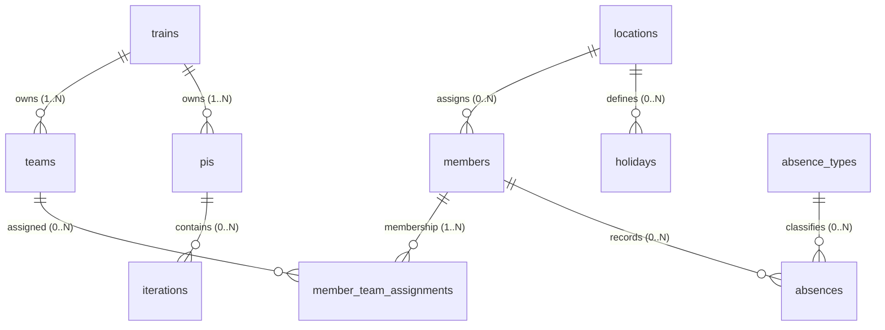

# Data Model: Organization & PI Cadence (F002)

**Branch**: `002-organization-cadence` | **Date**: 2026-11-23 (Updated for Review Pass 2 — OD-1..OD-10 & R2-1..R2-4) | **Spec**: [spec.md](./spec.md)  
**Conceptual Baseline**: `docs/architecture/domain-model.md` (Data Model v0.6) & Constitution Principle III

---

## 1. Entity Relationship Overview

All tables inherit F001's `auditColumns()` helper (`src/persistence/schema/common.ts`):
- `id`: `text` primary key, UUIDv4 (`crypto.randomUUID()`)
- `created_at`: `timestamptz` NOT NULL default `now()`
- `updated_at`: `timestamptz` NOT NULL default `now()`, `$onUpdate(() => new Date())`
- `created_by`: `text` NOT NULL default `'local:sm'`
- `updated_by`: `text` NOT NULL default `'local:sm'`

All foreign keys use **`ON DELETE RESTRICT`** (never `ON DELETE CASCADE`) to enforce Constitution Principle III and Clarification Q5. All soft-archivable entities use a uniform **`record_status`** (`'active' | 'archived'`) column, keeping `pis.lifecycle_status` separate (`F6`). All name/code uniqueness constraints are **case-insensitive** via `lower(trim(...))` unique indexes.

---

## 2. Physical Tables (Migration `0001_organization_cadence.sql`)

### 2.1 `trains` (Agile Release Trains / ARTs)

| Column | Type | Constraints | Notes |
|---|---|---|---|
| `...auditColumns()` | — | PK `id`, timestamps, actors | Standard F001 audit columns |
| `name` | `text` | NOT NULL, `length(trim(name)) > 0` | Explicit ART name |
| `record_status` | `text` | NOT NULL, DEFAULT `'active'`, CHECK (`record_status IN ('active', 'archived')`) | Soft-archive lifecycle |

Unique index: `trains_name_ci_unique` on `(lower(trim(name)))`.

### 2.2 `teams`

| Column | Type | Constraints | Notes |
|---|---|---|---|
| `...auditColumns()` | — | PK `id`, timestamps, actors | Standard F001 audit columns |
| `train_id` | `text` | NOT NULL, FK → `trains(id)` ON DELETE RESTRICT | Immutable single-ART ownership |
| `name` | `text` | NOT NULL, `length(trim(name)) > 0` | Unique (case-insensitive) within ART |
| `hours_per_day` | `double precision` | NOT NULL, DEFAULT `8.0`, CHECK (`hours_per_day > 0 AND hours_per_day <= 24`) | Preserved for F004/F013; not edited in F002 UI |
| `sprint_offset_workdays` | `integer` | NOT NULL, DEFAULT `0`, CHECK (`sprint_offset_workdays IN (-1, 0, 1)`) | Mon–Fri working-day offset |
| `record_status` | `text` | NOT NULL, DEFAULT `'active'`, CHECK (`record_status IN ('active', 'archived')`) | Soft-archive lifecycle |

Unique index: `teams_train_name_ci_unique` on `(train_id, lower(trim(name)))`.  
Index: `teams_train_id_idx` on `(train_id)`.

### 2.3 `locations` (`OD-3`, `R2-1`, `R2-2`)

| Column | Type | Constraints | Notes |
|---|---|---|---|
| `...auditColumns()` | — | PK `id`, timestamps, actors | Standard F001 audit columns |
| `code` | `text` | NOT NULL, `length(trim(code)) > 0` | Immutable after creation (`R2-2`); e.g., `PH`, `SG`, `AU-WA`, `IN`, `UK`, `US-TX` |
| `name` | `text` | NOT NULL, `length(trim(name)) > 0` | Display name |
| `country_code` | `text` | NOT NULL, CHECK (`country_code ~ '^[A-Z]{2}$'`) | ISO 3166-1 alpha-2 |
| `subdivision_code` | `text` | NULLABLE, CHECK (`subdivision_code IS NULL OR subdivision_code ~ '^[A-Z0-9]{1,3}$'`) | ISO 3166-2 subdivision part |
| `time_zone` | `text` | NOT NULL | Canonical IANA timezone validated via `Intl.DateTimeFormat` |
| `calendar_source` | `text` | NOT NULL | Descriptive label |
| `last_refreshed_at` | `timestamptz` | NULLABLE | Updated only when library seeding executes for this Location |
| `seeded_years` | `jsonb` | NOT NULL, DEFAULT `'[]'::jsonb` | Sorted `number[]` of years already seeded (`R2-1`) |
| `library_seed_cutoff_date` | `text` | NULLABLE, CHECK (`library_seed_cutoff_date IS NULL OR library_seed_cutoff_date ~ '^\d{4}-\d{2}-\d{2}$'`) | Set to `today` on jurisdiction change; startup/rollover seeding never inserts library rows before this date (`R2-1`) |
| `record_status` | `text` | NOT NULL, DEFAULT `'active'`, CHECK (`record_status IN ('active', 'archived')`) | Soft-archive lifecycle (`OD-3`) |

Unique index: `locations_code_ci_unique` on `(lower(trim(code)))`.

### 2.4 `members` (`OD-8`)

| Column | Type | Constraints | Notes |
|---|---|---|---|
| `...auditColumns()` | — | PK `id`, timestamps, actors | Standard F001 audit columns |
| `location_id` | `text` | NOT NULL, FK → `locations(id)` ON DELETE RESTRICT | Member-based holiday calendar link (must be active on create/change; archived Location preserved on reactivation) |
| `full_name` | `text` | NOT NULL, `length(trim(full_name)) > 0` | Full display name |
| `nickname` | `text` | NOT NULL, DEFAULT `''` | Short/preferred name |
| `initials` | `text` | NOT NULL, CHECK (`length(trim(initials)) BETWEEN 1 AND 4`) | Avatar initials |
| `role` | `text` | NOT NULL, CHECK (`role IN ('Admin', 'RTE', 'SM', 'PO', 'Team member')`) | Domain enum + SQL `CHECK`; `PO`/`SM` excluded from dev capacity |
| `fte_factor` | `double precision` | NOT NULL, DEFAULT `1.0`, CHECK (`fte_factor > 0 AND fte_factor <= 1.0`) | Stored for F004 |
| `avatar_color` | `text` | NOT NULL, DEFAULT `'#2F62C8'`, CHECK (`avatar_color ~ '^#[0-9A-Fa-f]{6}$'`) | Hex colour token |
| `record_status` | `text` | NOT NULL, DEFAULT `'active'`, CHECK (`record_status IN ('active', 'archived')`) | Soft-archive lifecycle |

*(No `team_id` column on `members`; `member_team_assignments` is the sole source of truth for Team membership per `OD-8`.)*  
Index: `members_location_id_idx` on `(location_id)`.

### 2.5 `member_team_assignments` (`OD-4`, `OD-8`, `OD-9`)

| Column | Type | Constraints | Notes |
|---|---|---|---|
| `...auditColumns()` | — | PK `id`, timestamps, actors | Standard F001 audit columns |
| `member_id` | `text` | NOT NULL, FK → `members(id)` ON DELETE RESTRICT | Member whose assignment is recorded |
| `team_id` | `text` | NOT NULL, FK → `teams(id)` ON DELETE RESTRICT | Team assigned; blocks hard delete of Team while any row exists |
| `start_date` | `text` | NOT NULL, CHECK (`start_date ~ '^\d{4}-\d{2}-\d{2}$'`) | ISO start date of assignment (`start_date > today` = pending future move) |
| `end_date` | `text` | NULLABLE, CHECK (`end_date IS NULL OR (end_date ~ '^\d{4}-\d{2}-\d{2}$' AND start_date <= end_date)`) | `NULL` = latest open row (current if `start_date <= today`, pending if `start_date > today`) |

Partial unique index: `member_team_assignments_member_open_unique` on `(member_id) WHERE end_date IS NULL` (at most one open row per Member).  
Indexes: `member_team_assignments_member_idx` on `(member_id, start_date)`, `member_team_assignments_team_idx` on `(team_id, start_date)`.  
Date lookup rule (`OD-8`, `OD-9`, `OD-11`): On date `D` (defaulting to server local `today`), a Member's Team is the row with `start_date <= D AND (end_date IS NULL OR end_date >= D)`. At most one pending row (`start_date > today`) per Member is allowed. Backdating (`effectiveDate < today`) is rejected (`400`); same-day correction (`OD-9`) applies only to rows starting `today` or pending rows, and correcting back to the preceding Team removes the pending or same-day move and reopens the preceding row. A same-day correction requires the preceding Team to be active.

### 2.6 `pis` (Program Increments) (`F6`)

| Column | Type | Constraints | Notes |
|---|---|---|---|
| `...auditColumns()` | — | PK `id`, timestamps, actors | Standard F001 audit columns |
| `train_id` | `text` | NOT NULL, FK → `trains(id)` ON DELETE RESTRICT | Single-ART ownership |
| `name` | `text` | NOT NULL, `length(trim(name)) > 0` | Explicit name (never parsed for dates) |
| `start_date` | `text` | NOT NULL, CHECK (`start_date ~ '^\d{4}-\d{2}-\d{2}$'`) | Explicit ISO calendar date |
| `end_date` | `text` | NOT NULL, CHECK (`end_date ~ '^\d{4}-\d{2}-\d{2}$' AND start_date <= end_date`) | Explicit ISO calendar date |
| `lifecycle_status` | `text` | NOT NULL, DEFAULT `'planning'`, CHECK (`lifecycle_status IN ('planning', 'in_progress', 'closed')`) | PI planning lifecycle (transitioned by F012) |
| `record_status` | `text` | NOT NULL, DEFAULT `'active'`, CHECK (`record_status IN ('active', 'archived')`) | Soft-archive flag, distinct from `lifecycle_status` |

Unique index: `pis_train_name_ci_unique` on `(train_id, lower(trim(name)))`.  
Index: `pis_train_id_dates_idx` on `(train_id, start_date, end_date)`.  
Domain/transaction invariant: Active (`record_status = 'active'`) PIs sharing `train_id` MUST NOT overlap. Archived PIs may overlap active PIs; F004+ must filter by `record_status = 'active'` unless inspecting archived history.

### 2.7 `iterations` (Sprints) (`OD-1`)

| Column | Type | Constraints | Notes |
|---|---|---|---|
| `...auditColumns()` | — | PK `id`, timestamps, actors | Standard F001 audit columns |
| `pi_id` | `text` | NOT NULL, FK → `pis(id)` ON DELETE RESTRICT | Single-PI ownership |
| `name` | `text` | NOT NULL, `length(trim(name)) > 0` | Explicit name; optional `YYWW` helper |
| `kind` | `text` | NOT NULL, DEFAULT `'development'`, CHECK (`kind IN ('development', 'ip')`) | Development Sprint or IP iteration |
| `start_date` | `text` | NOT NULL, CHECK (`start_date ~ '^\d{4}-\d{2}-\d{2}$'`) | Canonical ART start date (**Monday–Friday weekday** enforced in domain/API) |
| `end_date` | `text` | NOT NULL, CHECK (`end_date ~ '^\d{4}-\d{2}-\d{2}$' AND start_date <= end_date`) | Canonical ART end date (**Monday–Friday weekday** enforced in domain/API) |

Unique index: `iterations_pi_name_ci_unique` on `(pi_id, lower(trim(name)))`.  
Index: `iterations_pi_id_dates_idx` on `(pi_id, start_date, end_date)`.  
Domain/transaction invariants: Mon–Fri weekday boundaries (`OD-1`), non-overlapping within `pi_id`, contained within `[pi.start_date, pi.end_date]`, gaps permitted.

### 2.8 `holidays` (`F3`, `F5`)

| Column | Type | Constraints | Notes |
|---|---|---|---|
| `...auditColumns()` | — | PK `id`, timestamps, actors | Standard F001 audit columns |
| `location_id` | `text` | NOT NULL, FK → `locations(id)` ON DELETE RESTRICT | Owned by Location, never Team |
| `date` | `text` | NOT NULL, CHECK (`date ~ '^\d{4}-\d{2}-\d{2}$'`) | Explicit ISO calendar date |
| `name` | `text` | NOT NULL, `length(trim(name)) > 0` | Holiday title |
| `portion` | `text` | NOT NULL, DEFAULT `'full'`, CHECK (`portion IN ('full', 'half')`) | Full or half day |
| `source` | `text` | NOT NULL, DEFAULT `'library'`, CHECK (`source IN ('library', 'company', 'manual')`) | Provenance preserved across refreshes |
| `confirmed` | `boolean` | NOT NULL, DEFAULT `true` | `false` for Islamic/Hijri moon-sighting rules (`F5`) |

Partial unique index: `holidays_library_identity_unique` on `(location_id, date, name) WHERE source = 'library'` (`F3`).  
Index: `holidays_location_date_idx` on `(location_id, date)`.  
Override rule (`F3`): Any `company` or `manual` row on `(location_id, date)` supersedes `library` row(s) on that same date in effective holiday queries without deleting the `library` row.

### 2.9 `absence_types`

| Column | Type | Constraints | Notes |
|---|---|---|---|
| `...auditColumns()` | — | PK `id`, timestamps, actors | Standard F001 audit columns |
| `code` | `text` | NOT NULL, `length(trim(code)) > 0` | `AL`, `SL`, `HD`, `BT`, `WFH`, `ON_SITE` |
| `name` | `text` | NOT NULL, `length(trim(name)) > 0` | Display label |
| `color` | `text` | NOT NULL, CHECK (`color ~ '^#[0-9A-Fa-f]{6}$'`) | Hex colour token |
| `affects_capacity` | `boolean` | NOT NULL | `true` for `AL`, `SL`, `HD`; `false` for `BT`, `WFH`, `ON_SITE` |

Unique index: `absence_types_code_ci_unique` on `(lower(trim(code)))`.

### 2.10 `absences`

| Column | Type | Constraints | Notes |
|---|---|---|---|
| `...auditColumns()` | — | PK `id`, timestamps, actors | Standard F001 audit columns |
| `member_id` | `text` | NOT NULL, FK → `members(id)` ON DELETE RESTRICT | Member association |
| `absence_type_id` | `text` | NOT NULL, FK → `absence_types(id)` ON DELETE RESTRICT | AbsenceType classification |
| `date` | `text` | NOT NULL, CHECK (`date ~ '^\d{4}-\d{2}-\d{2}$'`) | Always dated; floating leave forbidden |
| `portion` | `text` | NOT NULL, DEFAULT `'full'`, CHECK (`portion IN ('full', 'am', 'pm')`) | Full day or half-day AM/PM |
| `planned` | `boolean` | NOT NULL, DEFAULT `true` | Planned vs unplanned (`SL`) |
| `status` | `text` | NOT NULL, DEFAULT `'active'`, CHECK (`status IN ('active', 'cancelled')`) | Cancelled absences excluded by F004 |
| `extra_hours` | `double precision` | NULLABLE, CHECK (`extra_hours IS NULL OR extra_hours >= 0`) | Planned overtime support for F005 |
| `note` | `text` | NULLABLE | Optional SM note |

Index: `absences_member_date_idx` on `(member_id, date)`.  
Domain/transaction invariant (`OD-10`): Active Absence conflicts apply **only** among `status = 'active'` Absences whose `AbsenceType.affects_capacity = true` (`AL`, `SL`, `HD`) on the same `(member_id, date)` — an active capacity-reducing `full` Absence cannot coexist with any other active capacity-reducing Absence on the same date, and duplicate active capacity-reducing `am` or `pm` Absences on the same date are rejected (`409`). Attendance-only types (`WFH`, `ON_SITE`, `BT`, where `affects_capacity = false`) never conflict with any Absence; `cancelled` records never conflict.

---

## 3. Derived Domain Projections (Never Persisted)

1. **`TeamIterationSchedule`** (`src/domain/organization/cadence.ts`):
   - Derived from `(Iteration, Team.sprint_offset_workdays)` via `shiftWorkdays()`. Because canonical Sprint boundaries are Mon–Fri weekdays and never overlap/touch, shifted Sprints strictly preserve order and never share a day (`OD-1`).
2. **Development Capacity Eligibility** (`src/domain/organization/roles.ts`):
   - `contributesToDevCapacity(role)`: `false` for `'PO'` and `'SM'`; `true` for `'Admin'`, `'RTE'`, and `'Team member'`.
3. **Today Widget Cadence Status (`OD-2`, `OD-5`)** (`src/domain/organization/cadence.ts`):
   - `resolveTodayCadenceStatus(todayIsoDate, selectedPi, teamSchedules)`:
     - Matches `todayIsoDate` against each schedule's **Team-shifted** `[scheduledStartDate, scheduledEndDate]` (including days just outside the PI's canonical bounds).
     - Safety-net tie-break (only if crafted invalid data yields >1 match): prefer the Sprint whose canonical `[canonicalStartDate, canonicalEndDate]` contains `todayIsoDate` (then earliest `canonicalStartDate`).
     - Formats matched Sprint as `Sprint <name>`, omitting `Sprint ` when `/^sprint\b/i.test(name)` (no IP marker).
4. **Effective Location Holidays (`F3`)** (`src/domain/organization/holidays.ts`):
   - `resolveEffectiveLocationHolidays(rows)`: for each `date`, if one or more `company`/`manual` rows exist, return those; otherwise return the `library` row(s).

---

## 4. Reference-Data Seeding (`src/persistence/seed.ts`)

Invoked idempotently inside `runMigrations()` before writing `.azusa-last-healthy.json` (which records `APP_VERSION = '0.2.0'` shared with `src/persistence/backup.ts`; `foundation.init.schemaVersion` intentionally stays `'0000_foundation_init'`):
1. **6 Initial Locations**: `PH` (`Asia/Manila`), `SG` (`Asia/Singapore`), `AU-WA` (`Australia/Perth`), `IN` (`Asia/Kolkata` — if `IN`/`KA` is unsupported in pinned `date-holidays` and falls back to all-India, set `calendar_source = 'Public holidays, IN'`), `UK` (`Europe/London`), `US-TX` (`America/Chicago`, calendar source `"Federal holidays, US · TX"`, company days added in F005). Insert-if-absent by case-insensitive `code` (since `code` is immutable after creation per `R2-2`, edited seeded Locations never duplicate).
2. **Public Holidays (`date-holidays`) (`R2-1`)**: Compute `targetYears = getHolidaySeedYears(referenceYear)` (`[referenceYear - 1, referenceYear + 2] ∪ {2026, 2027, 2028}`) and `missingYears = targetYears.filter(y => !location.seededYears.includes(y))`. If `missingYears.length === 0`, skip seeding and do not update `last_refreshed_at`. Otherwise insert `public`/`bank` holidays for `missingYears` filtering `date >= location.library_seed_cutoff_date` (when cutoff is set), with `source = 'library'`, `portion = 'full'`, and `confirmed = !isEstimatedHolidayRule(rule)` using `onConflictDoNothing()` on `holidays_library_identity_unique`, merge `missingYears` into `locations.seeded_years` (including years where `date-holidays` returns zero rows; later library upgrades do not retroactively fill or refresh estimated dates, as refresh belongs to `F005`), and update `locations.last_refreshed_at`.
3. **6 Initial AbsenceTypes**: `AL`, `SL`, `HD` (`affects_capacity: true`), `BT`, `WFH`, `ON_SITE` (`affects_capacity: false`). Insert-if-absent by case-insensitive `code`.

---

## 5. Out-of-Scope Entities (Principle III Boundary)

F002 creates **zero** tables or columns for: `Team.deduction_mode` (`F004`), `Category`, `TeamCategoryAllocation`, `OverheadReserve`, `OverheadTicket`, `Buffer`, `BufferDraw`, `SprintCeremony`, `Meeting`, `Milestone`, `Project`, `Feature`, `Story`, `Bug`, `StorySlice`, `Task`, `PlanVersion`, `PICommitment`, `SprintCommitment`, `SprintClosure`, or `StateChange`.
