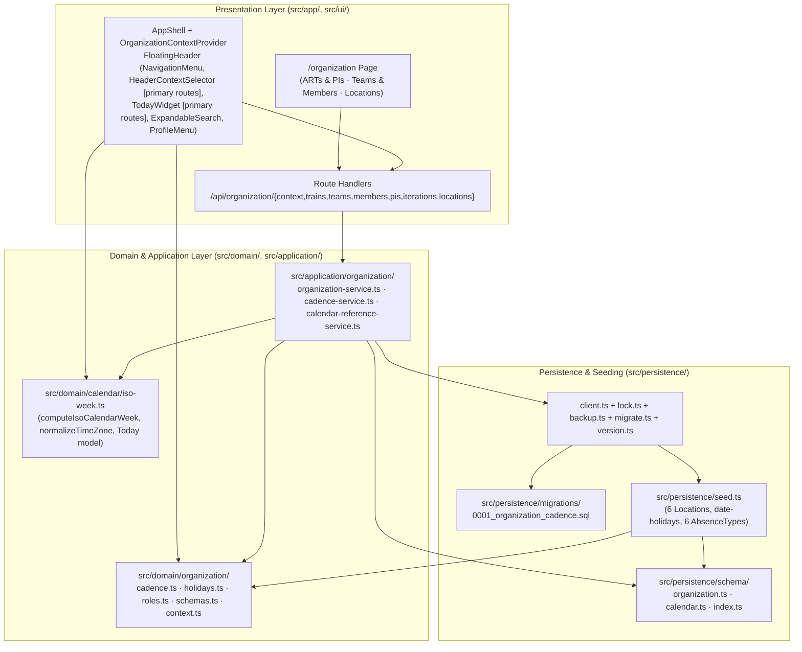

# Implementation Plan: Organization & PI Cadence (F002)

**Branch**: `002-organization-cadence` | **Date**: 2026-11-23 (Updated for Review Pass 2 — OD-1..OD-10 & R2-1..R2-4) | **Spec**: [spec.md](./spec.md)  
**Input**: Feature specification `/specs/002-organization-cadence/spec.md` and Feature Brief `/docs/features/002-organization-cadence.md` (v0.1)

---

## Summary

Establish Azusa's authoritative organizational hierarchy and PI/Sprint cadence foundations (`F002`) on top of the F001 local-first Next.js 15 / PGlite / Drizzle architecture. Introduce ten normalized Drizzle tables (`trains`, `teams`, `members`, `member_team_assignments`, `pis`, `iterations`, `locations`, `holidays`, `absence_types`, `absences`) via explicit SQL migration `0001_organization_cadence.sql` using F001's `auditColumns()`, `ON DELETE RESTRICT` foreign keys, uniform `record_status` (`active` | `archived`) separate from `pis.lifecycle_status` (`planning` | `in_progress` | `closed`), and case-insensitive `lower(trim(...))` uniqueness indexes, plus an idempotent reference-data seeder (`src/persistence/seed.ts`) populating the 6 initial Locations (`PH`, `SG`, `AU-WA`, `IN`, `UK`, `US-TX`), their `date-holidays` (ISC) public holidays (with a concrete Islamic/Hijri `confirmed = false` rule), and the 6 initial `AbsenceType` records (`AL`, `SL`, `HD`, `BT`, `WFH`, `ON_SITE`).

Enforce all organizational, Mon–Fri weekday Sprint boundary, date-overlap/containment, Mon–Fri weekday ±1 working-day Team Sprint offset, `PO`/`SM` dev-capacity exclusion, Member Team-transfer history (`member_team_assignments`), dated-only non-conflicting Absence, soft-archive/reactivation, and unreferenced-only hard-delete invariants in pure domain modules (`src/domain/organization/`) and transactional application services (`src/application/organization/`). Deliver a dedicated `/organization` management surface reachable via a new **`Organization`** link in the profile dropdown (keeping **`Settings`** disabled as a non-navigating placeholder), match `Settings.dc.html`'s uncluttered header on `/organization` (logo + search `"Search organization…"` + profile only), activate the faithful `Main.dc.html` **`ART › Team › PI`** header breadcrumb on primary routes (plain-text ART link to `/program-board`, Team dropdown grouped by ART, PI dropdown), update the profile dropdown subtitle, and wire the Today widget to display `<PI> · Sprint <name>` matched against the selected Team's shifted Sprint dates without implying formal commitment.

---

## Technical Context

- **Language / Runtime**: TypeScript 5.x (`strict: true`, `noUncheckedIndexedAccess: true`), Node.js 22.12+ / 24.x / 26+
- **Framework**: Next.js 15 (App Router), React 19, bound to `127.0.0.1`, `NEXT_TELEMETRY_DISABLED=1`, `serverExternalPackages: ['@electric-sql/pglite', 'date-holidays']`
- **New Dependency**: `date-holidays` (npm, ISC licence, actively maintained, runs 100% locally offline with zero API calls; provides ISO 3166-1/3166-2 public/bank holiday catalogs required by Feature Brief §2.6 and `AZUSA_HANDOFF.md` §10)
- **Storage & Locking**: Embedded PGlite + Drizzle ORM (`0001_organization_cadence.sql`), reusing F001's `proper-lockfile` locking, `globalThis.__azusaDbState` singleton, automatic pre-migration startup backup, and `db:backup` / `db:restore` CLI workflows (sharing `APP_VERSION = '0.2.0'` across `migrate.ts` and `backup.ts`)
- **Validation & Testing**: Strict Zod v4 schemas, ESLint, Prettier, Vitest (unit + integration), Playwright (`port 3100`, `reuseExistingServer: false`, `.next-playwright`, `.azusa/test-playwright/`), `@axe-core/playwright`
- **Visual-Fidelity Mode**: **`Mixed`**
  - **Prototype / Design Reference**: `docs/handoffs/azusa-handoff-v2.zip` (`AZUSA_HANDOFF.md` §§7.1, 7.2, 10; `AZUSA_HANDOFF_UPDATE_2026-11-20.md`; `docs/azusa-data-model.md` v0.6; `prototype/Main.dc.html`; `prototype/Settings.dc.html`; `screenshots/01-team-pi-board.png`; `screenshots/07-settings-locations-holidays.png`).
  - **Planned Deviations (`D1`–`D4`)**:
    - **D1 (`/organization` route & disabled `Settings`)**: Add an enabled **`Organization`** link in the profile dropdown leading to `/organization` while keeping **`Settings`** disabled as a non-navigating placeholder, instead of `Settings.dc.html`'s multi-section Settings app (Brief §3, §6; Clarification Q1).
    - **D2 (Location registry scope vs `Settings.dc.html`)**: Provide Location create/edit/archive and read-only holiday inspection on `/organization`, with an organization-wide Location count, seed order matching the handoff, management actions, current UTC offsets derived from stored IANA zones, and effective holiday totals for the selected year, omitting per-location `Hours / day` inputs and full-year holiday editing (per-location hours is deferred; operational holiday/absence editing belongs to F005).
    - **D3 (Today widget single viewer-local clock & uncommitted cadence label)**: Keep F001's single viewer-local clock (not 3 sample team clocks) and display `<PI> · Sprint <name>` (skipping `Sprint ` when `<name>` already begins with `"Sprint"`, case-insensitive) matched against the selected Team's shifted Sprint dates without implying formal PI/Sprint commitment (Clarifications Q1, OD-2, OD-5; Principle III).
    - **D4 (No hardcoded sample organization records)**: Seed only shared reference data (6 Locations, `date-holidays` public holidays, 6 AbsenceTypes); ARTs, Teams, Members, PIs, and Iterations start empty until created by the operator.

---

## Constitution Compliance Note

- **Principle I (Purpose & Scope)**: Remains 100% local, single-user, and free of authentication, RBAC enforcement, portfolio layers, or external APIs.
- **Principle II (Spec-Driven & Prototype Fidelity)**: Declares `Mixed` fidelity referencing Handoff v2 (`Main.dc.html` for primary-route header context & Today widget; `Settings.dc.html` for `/organization` header & Location registry); all 4 planned deviations (`D1`–`D4`) are explicitly justified and operator-accepted. Per `OD-7`, header ART stays plain text linking to `/program-board` with Teams grouped under ART headings in the Team dropdown (no ART-picker deviation).
- **Principle III (Domain & Historical Integrity)**:
  - Business rules (`isWeekday`, `shiftWorkdays`, `computeTeamIterationSchedule`, `suggestYywwName`, `validatePiDates`, `validateIterationDates`, `contributesToDevCapacity`, `resolveTodayCadenceStatus`, `isEstimatedHolidayRule`, `resolveEffectiveLocationHolidays`) live in single, authoritative pure functions in `src/domain/organization/` — never duplicated in UI components.
  - F002 introduces **zero** `PlanVersion`, `PICommitment`, `SprintCommitment`, `SprintClosure`/`Actuals`, or `StateChange` records; Today-widget cadence display never implies formal commitment.
  - Canonical ART `Iteration` dates remain separate from derived `TeamIterationSchedule` boundaries; `ON DELETE RESTRICT`, uniform `record_status` (`active` | `archived`) distinct from `pis.lifecycle_status`, and `member_team_assignments` protect historical integrity.
- **Principle IV (Architecture, Migrations, Backup/Recovery & Dependencies)**:
  - Strict separation: `src/domain/organization/` (pure TS + Zod, zero framework/DB/FS/`date-holidays` imports) → `src/application/organization/` (transactional services) → `src/persistence/` (Drizzle schemas, SQL migration `0001_organization_cadence.sql`, idempotent seeder, shared `APP_VERSION`) → `src/app/` & `src/ui/`.
  - **Migrations & Backup/Recovery**: `0001_organization_cadence.sql` is an additive Drizzle SQL migration applied through F001's locked `runMigrations()` path, creating an atomic pre-migration startup backup before applying the migration and deferring pruning until both migration and idempotent seeding succeed. `app_metadata` stays strictly infrastructure-owned (`foundation.init.schemaVersion` remains `'0000_foundation_init'`); `APP_VERSION = '0.2.0'` is shared by `migrate.ts` and `backup.ts` so both migration and restore write the synchronized marker version.
  - **Recoverable Error Handling**: Invalid inputs/params return structured `400`/`404`/`409` JSON errors rendered inline in forms; DB/lock failures propagate F001's `503` + `<ErrorAlertBanner role="alert" />`.
  - **New Dependency**: `date-holidays` (ISC, open-source, offline, explicitly specified in Brief §2.6).
- **Principle V (Deterministic Testing)**: Pure unit tests for weekday/offset/no-overlap/tie-break/Sprint-label/holiday-rule/role/schema/context invariants, PGlite integration tests with frozen 2027 golden holiday fixtures, migration upgrade, seed idempotency, override/jurisdiction preservation, Team moves, archive/reactivate/delete guards, and backup/restore round-trip (`appVersion` verified), plus Playwright E2E (including post-edit reload persistence) and `@axe-core/playwright` tests.
- **Principle VI (Documentation)**: Updates `README.md`, `docs/architecture/overview.md`, `docs/architecture/domain-model.md`, `docs/architecture/data-dictionary.md`, `docs/operations/database-and-recovery.md`, `docs/REPO_MAP.md`, ADR `docs/architecture/decisions/0002-organization-cadence-and-holiday-seeding.md`, and `CHANGELOG.md`. `docs/feature-roadmap.md`'s `F002` checkbox remains unchecked until conformance review and operator UAT acceptance.
- **Principle VII (UX & Accessibility)**: Warm-light Kumiko design tokens, keyboard-operable pickers, underline section tabs, keyboard operability, `:focus-visible` `2px solid #E07F24` outlines, mutual exclusion across header overlays, responsive `1440px`/`1024px`/`768px` behavior, and zero `@axe-core/playwright` violations.

---

## Architecture



### Layer Rules
1. **`src/domain/organization/`**: Pure TypeScript and Zod schemas only (may import `src/domain/calendar/iso-week.ts`). Zero imports from `next/*`, `react`, `drizzle-orm`, `@electric-sql/pglite`, `date-holidays`, or `node:fs`.
2. **`src/application/organization/`**: Orchestrates Drizzle transactions, domain validators, actor resolution (`resolveActor()`), and typed error mapping (`ValidationError`, `ConflictError`, `NotFoundError`). Zero React/UI imports.
3. **`src/persistence/`**: Defines Drizzle tables, SQL migration `0001_organization_cadence.sql`, shared `APP_VERSION` (`version.ts`), and idempotent `date-holidays` seeding (`seed.ts`) invoked inside `runMigrations()`.
4. **`src/ui/` & `src/app/`**: Renders `/organization`, `OrganizationContextProvider`, `HeaderContextSelector`, updated `ProfileMenu`, `ExpandableSearch`, `TodayWidget`, and thin API Route Handlers.

---

## Data Flow

### 1. Migration & Idempotent Reference-Data Seeding
1. On server startup or `npm run db:migrate`, F001's `getDbContext()` acquires the `proper-lockfile` lock, waits `> 2000ms`, creates a pre-migration startup backup of any existing healthy cluster, and calls `runMigrations()`.
2. `runMigrations()` applies `0001_organization_cadence.sql`, ensures `'foundation.init'` (preserving `schemaVersion: '0000_foundation_init'`), then runs `seedReferenceData(db, actor)`:
   - Inserts any missing initial Locations (`PH`, `SG`, `AU-WA`, `IN`, `UK`, `US-TX`) without overwriting operator-edited rows.
   - Seeds `date-holidays` public/bank holidays (`source = 'library'`, `confirmed = !isEstimatedHolidayRule(rule)`) across `getHolidaySeedYears(currentYear)` (`[currentYear - 1, currentYear + 2] ∪ {2026, 2027, 2028}`) using `onConflictDoNothing()` on `holidays_library_identity_unique`, preserving any existing `company`/`manual` overrides and updating `locations.last_refreshed_at` **only when** library seeding executes for a Location.
   - Inserts any missing initial `AbsenceType` records (`AL`, `SL`, `HD`, `BT`, `WFH`, `ON_SITE`).
3. Only after migration and seeding succeed does `runMigrations()` write `.azusa-last-healthy.json` with `APP_VERSION`, allowing startup backup retention pruning to proceed.

### 2. Organization, Member Move & Cadence Mutations
1. `/organization` submits strict JSON payloads to `/api/organization/*`.
2. Route Handler validates path UUIDs, query params, and strict Zod request body (rejecting unknown keys and actor fields), then delegates to `src/application/organization/*`.
3. Service executes inside `db.transaction(...)`: checks parent existence & `record_status === 'active'`, enforces pure domain invariants (Mon–Fri weekday Sprint dates, PI non-overlap among active PIs within ART, Iteration non-overlap & PI containment, `sprint_offset_workdays ∈ {-1, 0, 1}`, valid IANA timezone, active Location/Team on Member assign/move, `effectiveDate > openAssignment.startDate` on Team move, non-conflicting active Absences, unreferenced check on delete), writes with `resolveActor()`, and returns DTOs.
4. On success, `/organization` refreshes its view and triggers `OrganizationContextProvider.refresh()` so the header context and profile subtitle reflect changes immediately.

### 3. Header Context Breadcrumb, `/organization` Header & Live Today Widget (`OD-2`, `OD-5`, `OD-6`, `OD-7`)
1. `OrganizationContextProvider` mounts inside `AppShell`, fetches `GET /api/organization/context` (active ARTs that have `>= 1` active Team), and reconciles against `localStorage` (`azusa:active-context:v1`):
   - If zero active Teams exist → `selected = { train: null, team: null, pi: null }`.
   - Otherwise restores valid stored IDs or falls back deterministically to the first active Team/ART/PI.
2. `FloatingHeader` checks the current pathname (`usePathname()`):
   - On `/organization` (`OD-6`): renders **only** `NavigationMenu`, `ExpandableSearch` (placeholder `"Search organization…"`), and `ProfileMenu` (subtitle still shows selected `Team · ART`). Omits `HeaderContextSelector` and `TodayWidget`.
   - On the 9 primary routes (`OD-7`): renders `NavigationMenu`, `HeaderContextSelector` (plain-text `<ART>` linking to `/program-board`, Team dropdown grouped under ART headings, PI dropdown for that ART; omitted when zero active Teams exist), `TodayWidget`, `ExpandableSearch` (`"Search stories, features…"`), and `ProfileMenu`.
3. `TodayWidget` passes `(now, browserTimeZone, selectedPi, selectedTeamSchedules)` to `resolveTodayCadenceStatus()`, matching viewer-local `YYYY-MM-DD` against **Team-shifted** Sprint dates (including days just outside canonical PI bounds, with canonical-range tie-break) and formatting `<PI> · Sprint <name>` (omitting `Sprint ` if `<name>` already begins with `"Sprint"`, case-insensitive; no IP marker) without implying commitment.

---

## Project Structure

```text
src/
├── app/
│   ├── organization/page.tsx                           # Dedicated /organization management route
│   └── api/organization/
│       ├── context/route.ts                            # GET active header context tree (ARTs with >=1 active Team)
│       ├── trains/route.ts                             # GET, POST ARTs
│       ├── trains/[id]/route.ts                        # PATCH, DELETE ART
│       ├── teams/route.ts                              # GET, POST Teams
│       ├── teams/[id]/route.ts                         # PATCH, DELETE Team
│       ├── members/route.ts                            # GET (date-resolved ?asOf), POST Members
│       ├── members/[id]/route.ts                       # PATCH (incl. future/same-day teamId moves), DELETE Member
│       ├── members/[id]/pending-move/route.ts          # DELETE cancel pending future move (OD-8)
│       ├── pis/route.ts                                # GET, POST PIs
│       ├── pis/[id]/route.ts                           # PATCH, DELETE PI
│       ├── pis/[id]/iterations/route.ts                # GET (with optional teamId schedule), POST Iteration (consistent [id] slug)
│       ├── iterations/[id]/route.ts                    # PATCH, DELETE Iteration
│       ├── locations/route.ts                          # GET, POST Locations
│       ├── locations/[id]/route.ts                     # PATCH (incl. recordStatus & jurisdiction re-seed), DELETE Location
│       └── locations/[id]/holidays/route.ts            # GET Holidays for Location (with effective override indicator)
├── domain/
│   ├── calendar/iso-week.ts                            # Extended TodayWidget model accepting optional cadence status
│   └── organization/
│       ├── roles.ts                                    # 5 Member roles + contributesToDevCapacity()
│       ├── cadence.ts                                  # ISO date math, isWeekday, shiftWorkdays, TeamIterationSchedule, YYWW helper, overlap/containment validators, Today cadence resolver (OD-1, OD-2, OD-5)
│       ├── holidays.ts                                 # getHolidaySeedYears, isEstimatedHolidayRule (Hijri/Islamic), resolveEffectiveLocationHolidays (F3, F5)
│       ├── context.ts                                  # Pure active-context reconciliation & subtitle formatting
│       └── schemas.ts                                  # Strict Zod v4 schemas for all F002 entities, requests, path & query params
├── application/
│   └── organization/
│       ├── errors.ts                                   # Typed domain/application HTTP error classes
│       ├── organization-service.ts                     # ART, Team, Member CRUD + Team moves (member_team_assignments) + archive/reactivate/delete guards
│       ├── cadence-service.ts                          # PI, Iteration CRUD + weekday/overlap/containment + context tree
│       └── calendar-reference-service.ts               # Location CRUD/archive/jurisdiction re-seed, Holiday queries, AbsenceType/Absence services
├── persistence/
│   ├── version.ts                                      # Shared APP_VERSION = '0.2.0' used by migrate.ts & backup.ts
│   ├── schema/
│   │   ├── organization.ts                             # trains, teams, members, member_team_assignments, pis, iterations
│   │   ├── calendar.ts                                 # locations, holidays, absence_types, absences
│   │   └── index.ts                                    # Re-exports all schemas
│   ├── migrations/0001_organization_cadence.sql        # Additive Drizzle SQL migration (+ meta/_journal.json & snapshot)
│   ├── seed.ts                                         # Idempotent 6 Locations, date-holidays (with IN/KA check), 6 AbsenceTypes seeder
│   ├── migrate.ts                                      # Calls seedReferenceData() after Drizzle migrate(), uses APP_VERSION
│   └── backup.ts                                       # Uses shared APP_VERSION on restore marker write
└── ui/
    ├── shell/
    │   ├── OrganizationContext.tsx                     # Client context provider + localStorage persistence
    │   ├── HeaderContextSelector.tsx                   # Plain-text ART link + grouped Team picker + PI picker (Main.dc.html#L35-L39)
    │   ├── ExpandableSearch.tsx                        # Accepts page-specific placeholder ("Search organization…" on /organization)
    │   ├── FloatingHeader.tsx                          # Route-aware header (Settings.dc.html layout on /organization) & mutual exclusion
    │   ├── ProfileMenu.tsx                             # Dynamic subtitle + Organization link + disabled Settings
    │   ├── TodayWidget.tsx                             # Consumes selected PI & Team-shifted current Sprint (OD-2, OD-5)
    │   └── AppShell.tsx                                # Wraps shell in OrganizationContextProvider
    └── organization/
        ├── OrganizationWorkspace.tsx                   # Tabbed /organization workspace (ARTs & PIs, Teams & Members, Locations)
        ├── TrainsAndCadencePanel.tsx                   # ART CRUD + PI & weekday Iteration editor with YYWW helper & Team offset preview
        ├── TeamsAndMembersPanel.tsx                    # Team CRUD (offset selector) + unlimited Member roster CRUD & Team move
        ├── LocationsPanel.tsx                          # Location registry CRUD/archive + read-only Holiday inspection drawer/table
        └── organization.module.css                     # Kumiko-aligned styling
```

---

## Risks and Tradeoffs

| Risk | Impact | Mitigation |
|---|---|---|
| **`date-holidays` bundling & `IN`/`KA` subdivision coverage** | Next.js webpack bundling can fail to resolve `date-holidays` data; `IN`/`KA` subdivision may not be populated in pinned library version. | Add `'date-holidays'` to `serverExternalPackages` in `next.config.ts`; test `IN`/`KA` in `T006` with explicit country-level `IN` fallback documented in ADR `0002` and `data-dictionary.md`. |
| **F001 visual-fidelity regression on empty DB** | Adding the `ART › Team › PI` breadcrumb could break F001's empty-state visual/E2E tests. | Render `HeaderContextSelector` only on primary routes when `>= 1` active Team exists, preserving F001's exact empty-state header, `"No ART or team configured"` subtitle, and `"No active PI · No active Sprint"` Today widget until configured. |
| **Narrow-viewport header crowding (`1024px`, `768px`)** | Adding `ART › Team › PI` alongside logo, Today widget, search, and profile button risks overlap. | Use `min-width: 0` + `text-overflow: ellipsis` on breadcrumb pills, keep `TodayWidget` `visibility: hidden` when search expands `< 1100px`, and verify bounding boxes across `1440px`, `1024px`, and `768px` in Playwright. |
| **No-op startup seeding mutating `last_refreshed_at`** | Updating `last_refreshed_at` on every boot would cause unnecessary DB writes and misleading refresh timestamps. | Check whether a Location's seed window is already populated before writing; update `last_refreshed_at` only when library seeding actually runs. |
| **Concurrent PI/Iteration overlap or Member move races** | Unsynchronized check-then-write could create overlapping PIs or two open `member_team_assignments` rows. | Execute all multi-row validations and mutations inside `db.transaction(...)` backed by the partial unique index `member_team_assignments_member_open_unique`. |

---

## Validation Approach

1. **Deterministic Unit Tests (`tests/unit/` via `npm run test:run`)**:
   - `organization-cadence.test.ts`: `isWeekday` rejecting Sat/Sun (`OD-1`); `shiftWorkdays` (`-1`/`0`/`+1`) guaranteeing zero shared days across shifted Sprints within a PI and across consecutive PIs; `suggestYywwName` including ISO year boundaries (`2026-12-31`, `2027-01-01`); PI non-overlap (active PIs within ART vs cross-ART); Iteration non-overlap & PI containment; `resolveTodayCadenceStatus` matching `-1` Team on the Friday before canonical PI start and `+1` Team on the Monday after canonical PI end (`OD-2`), safety-net tie-break on crafted data (`OD-2`), and Sprint label formatting (`2706` → `Sprint 2706`, `Sprint 5` → `Sprint 5`, `OD-5`).
   - `organization-roles-schemas.test.ts`: `contributesToDevCapacity` (`PO`/`SM` → `false`, `Admin`/`RTE`/`Team member` → `true`); `isEstimatedHolidayRule` (Islamic/Hijri → `true`, SG Chinese New Year → `false`); `resolveEffectiveLocationHolidays` (`company`/`manual` supersedes `library` on same date); strict Zod schemas rejecting unknown keys, actor injection, invalid offsets, invalid FTE, malformed path/query UUIDs, invalid `year`/`includeArchived`, invalid timezones, and undated Absences.
   - `organization-context.test.ts`: Active context reconciliation (omitting ARTs with zero active Teams, archived/deleted fallback); profile subtitle formatting.
2. **Persistence, Migration, Golden Seed & Backup Integration Tests (`tests/integration/` via `npm run test:run`)**:
   - `organization-persistence.test.ts`: Full CRUD + archive/reactivate/unreferenced-delete guards for ARTs, Teams (immutable `trainId`, blocked archive with pending incoming moves, blocked delete when any `member_team_assignments` exist), Members (>13 roster, multi-location, date-resolved Team moves across ARTs with no backdating, same-day/pending correction, unified cancel-pending-move succeeding even when original Team is archived, archived Member move, deleting unreferenced Member cleans its assignments), PIs (`lifecycle_status` vs `record_status`, reactivation overlap & archived-parent rejection), Iterations (weekday rejection `400`, cross-ART `teamId` rejection `409`), Locations (immutable `code`, archive hides from assign/move `409`, existing Members keep it, reactivation works, jurisdiction edit sets `library_seed_cutoff_date = today` re-seeding future library rows only), Holidays (`company`/`manual` overrides + `confirmed: false`), `AbsenceType`, and dated `Absence` (undated rejected `400`; active conflicts enforced **only** among `affects_capacity = true` types such as `AL full + SL full` / `AL full + HD am` → `409`, while attendance-only types like `WFH full + HD pm` and `ON_SITE full + SL pm` are allowed per `OD-10`).
   - `organization-migration-seed.test.ts`: Upgrades an F001 database containing `app_metadata` rows through `0001_organization_cadence.sql` (verifying 100% F001 preservation), freezes "today" to assert the golden 2027 holiday fixtures in [T007](./tasks.md), adjusted from Handoff §10 for the pinned library and public/bank seed filter, verifies seed idempotency & `last_refreshed_at` stability & override preservation, and verifies `db:backup` → `db:restore` round-trip preserves 100% of F002 records and writes `appVersion: '0.2.0'` to `.azusa-last-healthy.json`.
3. **Visual-Fidelity & E2E Accessibility Tests (`tests/visual/`, `tests/e2e/` via `npm run test:visual`, `npm run test:e2e`)**:
   - Existing F001 `shell-fidelity.spec.ts` and `foundation-smoke.spec.ts` updated for the enabled `Organization` link above disabled `Settings`, plus populated primary-route header (`Main.dc.html#L35-L39`) and `/organization` header (`Settings.dc.html#L24-L38`, no Today widget / no context breadcrumb) geometry checks at `1440px`, `1024px`, and `768px`.
   - New `tests/e2e/organization-cadence.spec.ts`: Walks US1–US4 end-to-end including post-edit reload persistence for ARTs, PIs, Teams, Members, and Locations (`SC-004`, `F8`), Member Team moves, Location archiving/reactivation, ART-with-no-Teams omission from header (`OD-7`), absence of Today widget & context selector on `/organization` (`OD-6`), live Today widget `<PI> · Sprint <name>` on `/` (`OD-2`, `OD-5`), zero external network requests, and zero `@axe-core/playwright` violations on `/` and `/organization` across `1440px`, `1024px`, and `768px`.

---

## Affected Areas

### Files / Components to Be Inspected (Read-Only Reference)
- `.specify/memory/constitution.md`
- `docs/features/002-organization-cadence.md`
- `docs/feature-roadmap.md`
- `docs/handoffs/azusa-handoff-v2.zip` (`AZUSA_HANDOFF.md`, `AZUSA_HANDOFF_UPDATE_2026-11-20.md`, `docs/azusa-data-model.md`, `prototype/Main.dc.html`, `prototype/Settings.dc.html`, `screenshots/01-team-pi-board.png`, `screenshots/07-settings-locations-holidays.png`)
- `specs/002-organization-cadence/spec.md`
- `src/persistence/{schema/common.ts,schema/app-metadata.ts,lock.ts,client.ts}` (inspect to preserve F001 contracts)
- `src/domain/{audit/actor.ts,health/schemas.ts}` (inspect to preserve actor & `app_metadata` contracts)

### Files / Components to Be Created or Modified
- **Config**: `package.json`, `package-lock.json` (`date-holidays`, version bump `0.2.0`), `next.config.ts` (`serverExternalPackages`)
- **Domain**: `src/domain/calendar/iso-week.ts` (modify), `src/domain/organization/{roles.ts,cadence.ts,holidays.ts,context.ts,schemas.ts}` (create)
- **Application**: `src/application/organization/{errors.ts,organization-service.ts,cadence-service.ts,calendar-reference-service.ts}` (create)
- **Persistence**: `src/persistence/version.ts` (create), `src/persistence/schema/{organization.ts,calendar.ts}` (create), `src/persistence/schema/index.ts` (modify), `src/persistence/migrations/0001_organization_cadence.sql` (+ `meta/_journal.json`, `meta/0001_snapshot.json`) (create), `src/persistence/seed.ts` (create), `src/persistence/migrate.ts` (modify), `src/persistence/backup.ts` (modify — use shared `APP_VERSION`)
- **API Routes**: `src/app/api/organization/{context/route.ts,trains/route.ts,trains/[id]/route.ts,teams/route.ts,teams/[id]/route.ts,members/route.ts,members/[id]/route.ts,members/[id]/pending-move/route.ts,pis/route.ts,pis/[id]/route.ts,pis/[id]/iterations/route.ts,iterations/[id]/route.ts,locations/route.ts,locations/[id]/route.ts,locations/[id]/holidays/route.ts}` (create)
- **UI & Shell**: `src/app/organization/page.tsx` (create), `src/ui/organization/{OrganizationWorkspace.tsx,TrainsAndCadencePanel.tsx,TeamsAndMembersPanel.tsx,LocationsPanel.tsx,organization.module.css}` (create), `src/ui/shell/{OrganizationContext.tsx,HeaderContextSelector.tsx}` (create), `src/ui/shell/{AppShell.tsx,FloatingHeader.tsx,ExpandableSearch.tsx,ProfileMenu.tsx,TodayWidget.tsx,shell.module.css}` (modify)
- **Documentation**: `README.md`, `CHANGELOG.md`, `docs/REPO_MAP.md`, `docs/architecture/{overview.md,domain-model.md,data-dictionary.md}`, `docs/architecture/decisions/0002-organization-cadence-and-holiday-seeding.md`, `docs/operations/database-and-recovery.md` *(note: `docs/feature-roadmap.md` `F002` checkbox is updated only after UAT)*

### Tests to Be Added or Updated
- **Add**: `tests/unit/{organization-cadence.test.ts,organization-roles-schemas.test.ts,organization-context.test.ts}`
- **Add**: `tests/integration/{organization-persistence.test.ts,organization-migration-seed.test.ts}`
- **Add**: `tests/e2e/organization-cadence.spec.ts`
- **Update (as needed)**: `tests/visual/shell-fidelity.spec.ts`, `tests/e2e/foundation-smoke.spec.ts`, `tests/unit/docs-completeness.test.ts`

### Explicitly Out of Scope
- Any `/settings` route or enabling the profile-menu `Settings` placeholder
- Work categories and allocations (`F003`)
- Capacity engine, `NETWORKDAYS`, `Team.deduction_mode`, velocity, forecast SP, or Capacity Planner UI (`F004`)
- Team Calendar grid, operational absence/holiday editing or library-holiday cancellation, ceremonies, meetings, milestones, or overtime UI (`F005`)
- Projects, Features, Stories, Bugs, Tasks, Dependencies, or operational boards (`F006`–`F019`)
- `Start PI`, `Start Sprint`, `Close Sprint`, `PI.lifecycle_status` transitions, `PlanVersion`, `PICommitment`, `SprintCommitment`, or `Actuals` (`F012`–`F015`)
- Assignment history editing/backdating UI (`member_team_assignments` future enhancement)
- Authentication, user accounts, RBAC enforcement, `Business Owner` role, or per-location workday hours
