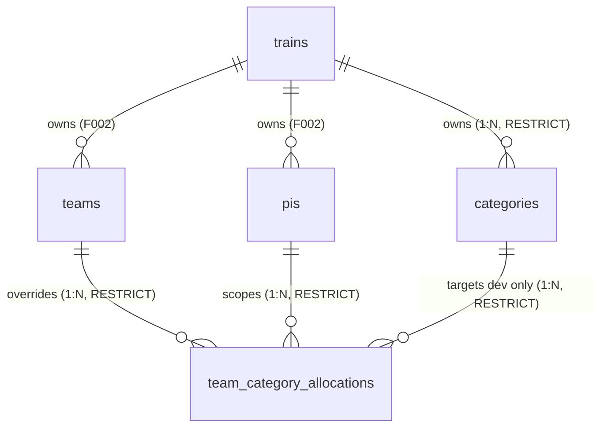

# Physical Data Model: Work Categories & Allocation (F003)

**Branch**: `003-work-categories-allocation` | **Date**: 2026-11-24 (Updated for Review Pass 1 — `IS NOT NULL` CHECK, D-1..D-4) | **Spec**: [spec.md](./spec.md)  
**Migration**: `src/persistence/migrations/0002_work_categories_allocation.sql` (additive upgrade from `0001_organization_cadence.sql`)  
**Shared App Version**: `APP_VERSION = '0.3.0'` (`src/persistence/version.ts`, `package.json`, & `package-lock.json`)

---

## 1. Common Conventions

- All F003 tables inherit F001's `auditColumns()` (`id` UUIDv4 `text` PK, `created_at` UTC timestamp, `updated_at` UTC timestamp, `created_by` default `'local:sm'`, `updated_by` default `'local:sm'`).
- All foreign keys use **`ON DELETE RESTRICT`** — never `ON DELETE CASCADE`.
- Archive status uses `record_status` (`'active' | 'archived'`), matching F002.
- Percentages are stored as `integer` (`0..100`) — zero floating-point columns.
- F003 creates **zero** `PlanVersion`, `PICommitment`, `SprintCommitment`, `SprintClosure`/`Actuals`, or `StateChange` tables (Constitution Principle III).

---

## 2. Table Definitions (`src/persistence/schema/categories.ts`)

### 2.1 `categories`

ART-owned work categories (`development` and `overhead`).

| Column | Type | Nullable | Default | Constraints / Notes |
|---|---|---|---|---|
| `id` | `text` | No | UUIDv4 | Primary key (`auditColumns()`) |
| `train_id` | `text` | No | — | FK → `trains.id` (`ON DELETE RESTRICT`); immutable after creation |
| `name` | `text` | No | — | `CHECK (length(trim(name)) > 0)`; case-insensitively unique per `train_id` |
| `short_label` | `text` | No | — | `CHECK (length(trim(short_label)) > 0)` |
| `color` | `text` | No | — | `CHECK (color ~ '^#[0-9A-Fa-f]{6}$')` |
| `kind` | `text` | No | — | `CHECK (kind IN ('development', 'overhead'))`; immutable once referenced |
| `semantic_role` | `text` | Yes | `null` | `IS NOT NULL` and `'feature' \| 'maintenance_bugs' \| 'standard'` when `kind = 'development'`; `NULL` when `kind = 'overhead'` |
| `default_pct` | `integer` | Yes | `null` | `IS NOT NULL` and `0..100` when `kind = 'development'` (initialized to `0` on individual create); `NULL` when `kind = 'overhead'` |
| `sort_order` | `integer` | No | `0` | `CHECK (sort_order >= 0)`; presentation order within `(train_id, kind)` |
| `record_status` | `text` | No | `'active'` | `CHECK (record_status IN ('active', 'archived'))` |
| `created_at` / `updated_at` | `timestamp` | No | `now()` | UTC timestamps (`auditColumns()`) |
| `created_by` / `updated_by` | `text` | No | `'local:sm'` | Internal actor provenance (`auditColumns()`) |

**Table-level `CHECK` constraint** (explicit `IS NOT NULL` guards prevent PostgreSQL `NULL` check pass-through):
- `categories_kind_fields_valid`:
  ```sql
  (
    kind = 'development'
    AND semantic_role IS NOT NULL
    AND semantic_role IN ('feature', 'maintenance_bugs', 'standard')
    AND default_pct IS NOT NULL
    AND default_pct BETWEEN 0 AND 100
  )
  OR
  (
    kind = 'overhead'
    AND semantic_role IS NULL
    AND default_pct IS NULL
  )
  ```

**Indexes**:
- `categories_train_name_ci_unique`: `UNIQUE (train_id, lower(trim(name)))`
- `categories_train_active_bugs_unique`: `UNIQUE (train_id) WHERE record_status = 'active' AND semantic_role = 'maintenance_bugs'`
- `categories_train_kind_sort_idx`: `INDEX (train_id, kind, sort_order)`

---

### 2.2 `team_category_allocations`

PI-scoped Team percentage overrides for ART `development` categories. Row absence = **Inherit** (`null`); stored row with `override_pct = 0` = **explicit `0%`**.

| Column | Type | Nullable | Default | Constraints / Notes |
|---|---|---|---|---|
| `id` | `text` | No | UUIDv4 | Primary key (`auditColumns()`) |
| `team_id` | `text` | No | — | FK → `teams.id` (`ON DELETE RESTRICT`) |
| `pi_id` | `text` | No | — | FK → `pis.id` (`ON DELETE RESTRICT`) |
| `category_id` | `text` | No | — | FK → `categories.id` (`ON DELETE RESTRICT`) |
| `override_pct` | `integer` | No | — | `CHECK (override_pct BETWEEN 0 AND 100)` |
| `created_at` / `updated_at` | `timestamp` | No | `now()` | UTC timestamps (`auditColumns()`) |
| `created_by` / `updated_by` | `text` | No | `'local:sm'` | Internal actor provenance (`auditColumns()`) |

**Indexes**:
- `team_cat_alloc_unique`: `UNIQUE (team_id, pi_id, category_id)` (its leading columns also serve `(team_id, pi_id)` lookups, so no separate index is needed)
- `team_cat_alloc_category_idx`: `INDEX (category_id)`

**Application/Domain Cross-Table Invariants (enforced transactionally in `category-service.ts`)**:
1. `team.train_id === pi.train_id === category.train_id` (strict cross-ART isolation; because F002 makes `teams.train_id` and `pis.train_id` immutable after creation, a validated row can never drift across ARTs later).
2. `category.kind === 'development'` and `category.record_status === 'active'` on write.
3. `train.record_status === 'active'`, `team.record_status === 'active'`, and `pi.record_status === 'active'` on write (`PUT` and `DELETE`).
4. `PUT /api/categories/allocations` requires every active `development` category of the ART in `overrides[]` and enforces exact `Σ (override_pct ?? default_pct) === 100` on the saved state.
5. `DELETE /api/categories/allocations` deletes override rows for **active** development categories only, preserving historical override rows belonging to archived categories.

---

## 3. Entity Relationship Summary



---

## 4. Downstream Snapshot Contract (Read Model for F004 & F012)

`resolveTeamPiAllocation()` returns a deterministic, immutable-friendly read model without introducing snapshot tables in F003:

```ts
export type ArtConfigStatus = 'not_configured' | 'valid' | 'invalid';

export type ResolvedCategoryAllocation = {
  categoryId: string;
  name: string;
  shortLabel: string;
  color: string;
  semanticRole: 'feature' | 'maintenance_bugs' | 'standard';
  sortOrder: number;
  artDefaultPct: number;
  overridePct: number | null;
  effectivePct: number;
  source: 'inherit' | 'override';
};

export type TeamPiAllocationView = {
  trainId: string;
  teamId: string;
  piId: string;
  piEndDate: string;
  isCurrentOrFuturePi: boolean;
  items: ResolvedCategoryAllocation[];
  artConfigStatus: ArtConfigStatus;
  artDefaultTotalPct: number;
  artDefaultsValid: boolean;
  effectiveTotalPct: number;
  isValid: boolean;
  hasDriftWarning: boolean;
};
```
