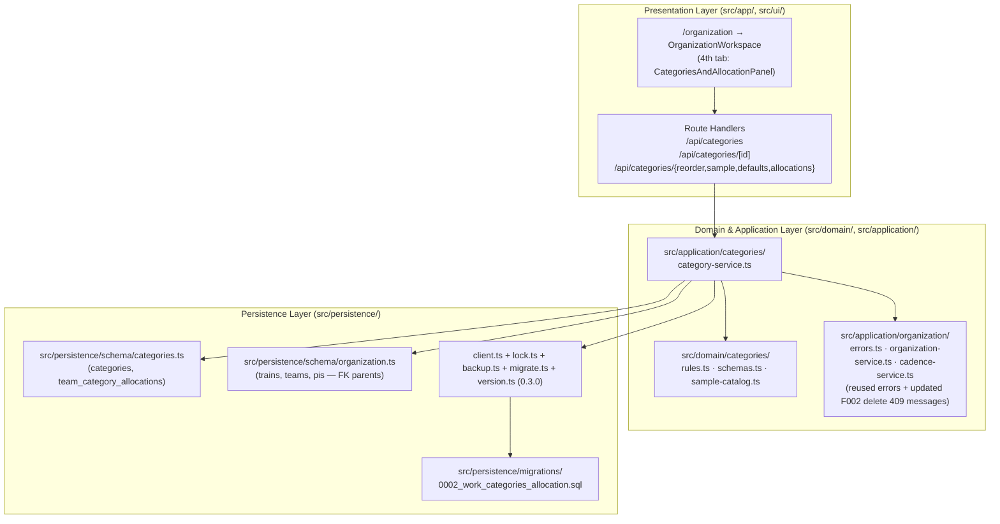

# Implementation Plan: Work Categories & Allocation (F003)

**Branch**: `003-work-categories-allocation` | **Date**: 2026-11-24 (Updated for Review Pass 2 — active-Team/PI drift guard, reorder/error-order/semanticRole-null refinements) | **Spec**: [spec.md](./spec.md)  
**Input**: Feature specification `/specs/003-work-categories-allocation/spec.md` and Feature Brief `/docs/features/003-work-categories-allocation.md` (v0.1)

---

## Summary

Deliver ART-owned work category management and PI-scoped Team percentage allocation (`F003`) on top of Azusa's local-first Next.js 15 / PGlite / Drizzle architecture (`F001`–`F002`), with **zero new npm dependencies**. Introduce two normalized Drizzle tables (`categories`, `team_category_allocations`) via explicit additive SQL migration `0002_work_categories_allocation.sql` using F001's `auditColumns()`, `ON DELETE RESTRICT` foreign keys, uniform `record_status` (`active` | `archived`), explicit `IS NOT NULL` + integer `0..100` SQL `CHECK` constraints, case-insensitive ART-scoped name uniqueness, and a partial unique index enforcing **at most one active `maintenance_bugs` category per ART**.

Enforce all domain invariants in pure TypeScript modules (`src/domain/categories/`) and transactional application services (`src/application/categories/category-service.ts`), plus updated `409 CONFLICT` reference messages in F002's `deleteTrain`/`deleteTeam`/`deletePi`: `development` vs. `overhead` separation, stable `semantic_role` (`feature` | `maintenance_bugs` | `standard`, editable in F003 per `D-4`), `kind` immutability once referenced, archive/delete/reactivation without a `default_pct === 0` lock (flagging any non-100% total without silent redistribution per `D-2`), new categories starting at `0%` (percentages edited only via atomic `PUT /api/categories/defaults`), exact integer `0–100` arithmetic, full-set Team/PI saves, unambiguous `Inherit` (`null` / absent row) vs. explicit `0%` (`override_pct = 0`), active-only reset-all preserving archived-category overrides, PI-scoped cross-ART isolation, live-resolved ART defaults with drift warnings for all invalid **current and future PIs** (`pi.end_date >= today` per `D-1`), and an optional operator-initiated **"Apply sample catalog"** starter action for empty ARTs. Expose the management workflow as a new **`Categories & Allocation`** tab inside `/organization` (preserving F002's uncluttered header and keeping profile-menu `Settings` disabled).

---

## Technical Context

- **Language / Runtime**: TypeScript 5.x (`strict: true`, `noUncheckedIndexedAccess: true`), Node.js 22.12+ / 24.x / 26+
- **Framework**: Next.js 15 (App Router), React 19, bound to `127.0.0.1`, `NEXT_TELEMETRY_DISABLED=1`
- **New Dependencies**: **None** (reuses existing Drizzle ORM, PGlite, Zod v4, Vitest, Playwright, `@axe-core/playwright`)
- **Storage & Locking**: Embedded PGlite + Drizzle ORM (`0002_work_categories_allocation.sql`), reusing F001's `proper-lockfile` locking, `globalThis.__azusaDbState` singleton, automatic pre-migration startup backup, and `db:backup` / `db:restore` CLI workflows (bumping shared `APP_VERSION` in `src/persistence/version.ts`, `package.json`, and `package-lock.json` from `0.2.0` to `0.3.0`)
- **Validation & Testing**: Strict Zod v4 schemas, ESLint, Prettier, Vitest (unit + integration), Playwright (`port 3100`, `reuseExistingServer: false`, `.next-playwright`, `.azusa/test-playwright/`), `@axe-core/playwright`
- **Visual-Fidelity Mode**: **`Mixed`**
  - **Prototype / Design Reference**: `docs/handoffs/azusa-handoff-v2.zip` (`AZUSA_HANDOFF.md` §9; `AZUSA_HANDOFF_UPDATE_2026-11-20.md` §1, §20–§21; `docs/azusa-data-model.md` v0.6 §§1–2, §4; `docs/azusa-sprint-planning-decisions.md`; `prototype/Settings.dc.html`; `screenshots/03-capacity-planner.png`). No dedicated final prototype screen exists for F003; UI follows the established Kumiko design system and F002's `/organization` workspace.
  - **Planned Deviations (`D1`–`D4`)**:
    - **D1 (`Categories & Allocation` tab inside `/organization`)**: Hosted inside `/organization` rather than activating a standalone `/settings` application (`Settings.dc.html`); profile-menu `Settings` remains disabled (Brief §3, §6; Roadmap v0.2; Clarification Q5).
    - **D2 (No automatic sample catalog seeding)**: New ARTs start with an empty category catalog (`not_configured`) and provide an explicit operator-initiated **"Apply sample catalog"** action rather than auto-seeding Dyson's sample catalog (Brief §2.4, §7.5; Clarification Q5).
    - **D3 (Percentages only — no SP budgets or overhead days/Sprint)**: Displays percentages and totals only (no forecast SP budgets, which belong to F004) and stores no legacy fixed days-per-Sprint defaults on overhead categories (replaced in Data Model v0.6 by per-member/per-Sprint `OverheadReserve` hours in F005/F009/F013).
    - **D4 (Sample Feature category short label — operator-accepted, `D-3`)**: Sample catalog uses `Feature development` with short label `"Feature dev."` and semantic role `feature` (fully editable). Accepted by operator on `2026-11-24`, resolving and overriding `AZUSA_HANDOFF_UPDATE_2026-11-20.md` §21 item 7 to avoid confusion with the `Feature` work-item entity.

---

## Constitution Check

- [x] **I. Purpose & Scope** — 100% local, single-user, no auth/RBAC enforcement, no portfolio layer, no external APIs or monetization.
- [x] **II. Spec-Driven / Prototype Fidelity** — Strictly scoped to F003; `Visual-Fidelity Mode: Mixed`; all 4 planned deviations (`D1`–`D4`, including operator-accepted `D4` per `D-3`) explicitly justified; `1440px` baseline with usable, collision-free `1024px`/`768px` adaptation verified by `tests/visual/categories-allocation.spec.ts`.
- [x] **III. Domain & Historical Integrity** — All business rules (`validateArtDefaultTotals`, `resolveTeamPiAllocation`, `validateTeamPiAllocationSave`, semantic role & `kind` guards) live in single, authoritative pure functions in `src/domain/categories/`; zero `PlanVersion`, `PICommitment`, `SprintCommitment`, `SprintClosure`/`Actuals`, or `StateChange` tables created in F003; `ON DELETE RESTRICT` + soft-archive + preserved archived-category overrides + current/future-PI drift warnings protect historical integrity and expose a snapshot-ready read contract for F012.
- [x] **IV. Architecture & Data Safety** — Clean domain → application → persistence → UI/HTTP boundaries; zero new dependencies; explicit additive SQL migration `0002_work_categories_allocation.sql` with `IS NOT NULL` CHECK guards verified for F002→F003 upgrade and CLI `db:backup`/`db:restore` round-trip with synchronized `APP_VERSION = '0.3.0'`; exact `400`/`404`/`409`/`503` recoverable errors.
- [x] **V. Deterministic Testing** — Pure Vitest unit tests, real PGlite service & migration/CLI-backup integration tests, dedicated HTTP route tests (`tests/integration/categories-routes.test.ts`), Playwright visual geometry tests (`tests/visual/categories-allocation.spec.ts`), and Playwright E2E + `@axe-core/playwright` tests (`tests/e2e/categories-allocation.spec.ts`) across `1440px`, `1024px`, and `768px`.
- [x] **VI. Documentation** — Updates `docs/architecture/overview.md`, `docs/architecture/domain-model.md`, `docs/architecture/data-dictionary.md`, `docs/operations/database-and-recovery.md`, `docs/REPO_MAP.md`, `CHANGELOG.md`, `README.md`, and adds ADR `docs/architecture/decisions/0003-work-categories-and-allocation.md`. (`docs/feature-roadmap.md` keeps `F003` unchecked until conformance review and operator UAT acceptance.)
- [x] **VII. UX & Accessibility** — Warm-light Kumiko tokens, tabular numerals (`IBM Plex Mono`) for percentages/totals, explicit text badges (`Inherit` / `Override` / `100% ✓` / `Not configured` / drift warning — never color alone), keyboard-operable controls, `:focus-visible` `2px solid #E07F24` outlines, empty/invalid/read-only/error states, zero `@axe-core/playwright` violations.

---

## Architecture



### Layer Rules
1. **`src/domain/categories/`**: Pure TypeScript and Zod v4 only. Zero imports from `next/*`, `react`, `drizzle-orm`, `@electric-sql/pglite`, or `node:*`. Owns integer allocation arithmetic, `Inherit` vs `0%` resolution, current/future-PI drift evaluation, semantic role constants, sample catalog template, and strict Zod schemas.
2. **`src/application/categories/`**: Transactional service (`category-service.ts`) reusing `src/application/organization/errors.ts`, `OrganizationOptions.today`, and `resolveActor()`. Enforces cross-table invariants (ART/Team/PI ownership, active parent checks, `kind` immutability once referenced, atomic full-set ART defaults & Team/PI allocation saves, active-only reset-all, current/future-PI drift listing). Also updates F002 `deleteTrain`, `deleteTeam`, and `deletePi` conflict messages in `src/application/organization/{organization-service.ts,cadence-service.ts}` so referencing F003 records produce accurate `409 CONFLICT` explanations. Zero React/UI imports.
3. **`src/persistence/`**: Additive Drizzle schema (`src/persistence/schema/categories.ts`, re-exported from `index.ts`), explicit SQL migration `0002_work_categories_allocation.sql` (+ Drizzle journal & `0002_snapshot.json`), and synchronized `APP_VERSION = '0.3.0'`. No startup seeding of sample categories (new ARTs start empty per Q5).
4. **`src/app/api/categories/` & `src/ui/organization/`**: Thin Route Handlers reusing `src/app/api/organization/http.ts` and a focused `CategoriesAndAllocationPanel` mounted as the 4th tab in `OrganizationWorkspace.tsx`.

---

## Data Flow

### 1. ART Category Management, Reordering & Optional Sample Catalog
1. User selects an ART in `/organization` → **`Categories & Allocation`**. Panel fetches `GET /api/categories?trainId=<uuid>&includeArchived=<bool>` (returning categories ordered by `kind, sort_order, name`, ART config status `{ artConfigStatus: 'not_configured' | 'valid' | 'invalid', activeDevelopmentTotalPct, artDefaultsValid }`, and `driftedAllocations[]` for active Teams × active current/future PIs where `pi.end_date >= today`).
2. If the ART has zero categories (active or archived), user may click **"Apply sample catalog"** → `POST /api/categories/sample` (`{ trainId }`), which inserts all 7 handoff sample categories atomically (`49/20/14/10/7` + `General work`/`Training`) and rejects with `409 CONFLICT` if any category already exists.
3. Creating a `development` category via `POST /api/categories` always initializes `default_pct = 0` (percentages are edited only via `PUT /api/categories/defaults`). Reordering via `POST /api/categories/reorder` accepts `{ trainId, kind, orderedIds }` covering all **active** categories of that `kind` (`development` or `overhead`), assigns `sort_order = 0..k-1` to `orderedIds`, places archived categories of that `kind` after them at `>= k` preserving their relative order, and leaves the other `kind` group untouched.
4. Archive (`PATCH` `recordStatus: 'archived'`), reactivate (`PATCH` `recordStatus: 'active'`), `kind` switch (unreferenced only), and unreferenced hard delete (`DELETE`) all succeed regardless of `default_pct` (`D-2`), flagging any resulting non-100% ART or current/future Team/PI total without redistributing percentages.

### 2. ART Default Allocation Save & Current/Future-PI Drift Detection
1. User edits integer default percentages across active `development` categories. The UI computes the live sum via `validateArtDefaultTotals()` and displays `100% ✓` or an explicit unmet-rule message with current total.
2. Submitting calls `PUT /api/categories/defaults` (`{ trainId, allocations: [{ categoryId, defaultPct }] }`).
3. Service verifies every active `development` category in the ART is included exactly once, every value is an integer `0..100`, and `sum === 100` (`400 VALIDATION_ERROR` otherwise, zero silent normalization).
4. In the same transaction, service updates `default_pct` on each category and computes `driftedAllocations` across **all** active Team × active current/future PI (`pi.end_date >= today`) pairs in that ART whose resolved effective total `!== 100` (`D-1`). Response returns updated defaults plus `driftedAllocations`.

### 3. Team PI Allocation Resolution, Full-Set Override Save & Active-Only Reset
1. User selects a Team and PI belonging to the selected ART (optionally toggling `"Show archived Teams/PIs"` for read-only inspection). Panel fetches `GET /api/categories/allocations?teamId=<uuid>&piId=<uuid>`.
2. Service validates that Team and PI exist (`404`) and share the same `train_id` (`409`), loads the ART's active `development` categories in `sort_order` plus any `team_category_allocations` rows for `(teamId, piId)`, and runs pure `resolveTeamPiAllocation()` with `teamRecordStatus`, `piRecordStatus`, and `isCurrentOrFuturePi = pi.endDate >= today`.
3. Each row resolves `overridePct` (`number | null`), `effectivePct = overridePct ?? artDefaultPct`, and `source: overridePct !== null ? 'override' : 'inherit'`, alongside `artConfigStatus`, `effectiveTotalPct`, `isValid: effectiveTotalPct === 100`, and `hasDriftWarning: teamRecordStatus === 'active' && piRecordStatus === 'active' && isCurrentOrFuturePi && items.length > 0 && !isValid` (matching `driftedAllocations[]` exactly so archived Teams/PIs never show drift warnings).
4. Saving calls `PUT /api/categories/allocations` (`{ teamId, piId, overrides: [{ categoryId, overridePct }] }`). Service verifies active ART, active Team, active PI, same ART, **full coverage of every active `development` category** (`400` on missing/duplicate IDs; `404` on unknown `categoryId`; `409` on foreign/overhead/archived category), and exact resolved `effectiveTotalPct === 100` (`400` otherwise), then atomically upserts rows where `overridePct !== null` (preserving explicit `0`) and deletes rows where `overridePct === null` (restoring `Inherit`).
5. **"Reset all to ART defaults"** calls `DELETE /api/categories/allocations?teamId=<uuid>&piId=<uuid>`, verifying active ART, active Team, active PI, and same ART, deleting override rows for **active** development categories only (preserving archived-category override rows), and succeeding even when ART defaults are invalid (returning the flagged `TeamPiAllocationView` per `D-2`).

---

## Project Structure

```text
src/
├── domain/
│   └── categories/
│       ├── rules.ts                  # Pure types, semantic roles, validateArtDefaultTotals, resolveTeamPiAllocation, validateTeamPiAllocationSave
│       ├── sample-catalog.ts         # Payments ART 7-category starter template (5 dev + 2 overhead; Feature dev. per D-3)
│       └── schemas.ts                # Strict Zod v4 schemas for all F003 requests, queries, and responses
├── application/
│   ├── categories/
│   │   └── category-service.ts       # Transactional ART category CRUD, sample catalog, within-group reorder, ART defaults, Team/PI allocation & drift
│   └── organization/
│       ├── organization-service.ts   # Update deleteTrain & deleteTeam 409 conflict messages to include Categories / category allocations
│       └── cadence-service.ts        # Update deletePi 409 conflict message to include category allocations
├── persistence/
│   ├── version.ts                    # Bump APP_VERSION to '0.3.0'
│   ├── schema/
│   │   ├── categories.ts             # Drizzle tables: categories, team_category_allocations
│   │   └── index.ts                  # Re-export categories schema
│   └── migrations/
│       ├── 0002_work_categories_allocation.sql
│       └── meta/
│           ├── _journal.json         # Add 0002 entry
│           └── 0002_snapshot.json    # Drizzle snapshot for 0002
├── app/
│   └── api/
│       └── categories/
│           ├── route.ts              # GET list by trainId, POST create category (always 0% for dev)
│           ├── [id]/route.ts         # PATCH edit/archive/reactivate, DELETE unreferenced (any %)
│           ├── reorder/route.ts      # POST within-group active reorder
│           ├── sample/route.ts       # POST apply Payments ART sample catalog to empty ART
│           ├── defaults/route.ts     # PUT atomic ART default allocation save (sum === 100)
│           └── allocations/route.ts  # GET resolved Team/PI allocation, PUT full-set overrides, DELETE active-only reset
└── ui/
    └── organization/
        ├── OrganizationWorkspace.tsx          # Add 4th tab: Categories & Allocation
        ├── CategoriesAndAllocationPanel.tsx   # ART categories, defaults editor, Team/PI override editor, empty/invalid/read-only & drift states
        └── organization.module.css            # Kumiko styles for category swatches, badges, allocation table, total/drift banners
```

---

## Risks and Tradeoffs

| Risk | Impact | Mitigation |
|---|---|---|
| **Invalid ART totals after archive / delete / reactivate (`D-2`)** | Allowing archive/delete with `default_pct > 0` and non-blocking reactivation can temporarily leave ART defaults at `!== 100%`. | Treat `0` active dev categories as `not_configured` and `!== 100%` as `invalid`; flag the ART and every invalid current/future Team/PI split (`hasDriftWarning: true`) until `PUT /api/categories/defaults` saves a valid `100%` split. Never silently redistribute. |
| **PostgreSQL `CHECK` evaluating to `NULL`** | `semantic_role IN (...)` or `default_pct BETWEEN 0 AND 100` evaluates to `NULL` when the column is `NULL`, which PostgreSQL treats as passing. | Include explicit `semantic_role IS NOT NULL` and `default_pct IS NOT NULL` in `categories_kind_fields_valid` and test both `NULL` insertions directly against PGlite in `T005`. |
| **Kept overrides on archived categories re-entering on reactivation** | If a Team had an explicit override on a category that was archived and later reactivated, active totals can drift. | `DELETE /api/categories/allocations` preserves archived-category override rows; on reactivation, the kept override re-enters active resolution and flags any invalid current/future Team/PI split so the operator can adjust or clear it via `PUT` or `DELETE`. Tested explicitly in `T007`. |
| **Explicit `0%` accidentally treated as falsy/unset** | Using `override || artDefault` or `Number("") === 0` would silently corrupt `Inherit` vs `0%`. | Use nullish coalescing (`overridePct ?? artDefaultPct`) exclusively; in the UI, map `""` to `null` (`Inherit`) and `"0"` to integer `0` (`Override`), with an explicit text badge on every row. |
| **Stale F002 delete conflict messages** | `deleteTrain`, `deleteTeam`, and `deletePi` currently hardcode F002-only messages even when an F003 FK triggers `23503`. | Update the three conflict messages in `organization-service.ts` and `cadence-service.ts` to name Categories / category allocations, and verify in `T007` (and update any F002 test string assertion if needed). |

---

## Validation Approach

1. **Deterministic Unit Tests (`tests/unit/categories-rules-schemas.test.ts` via `npm run test:run`)**:
   - `validateArtDefaultTotals`: `49+20+14+10+7 = 100` (`valid`), `95` and `105` (`invalid`), empty (`not_configured`), excludes archived and overhead.
   - `resolveTeamPiAllocation` & `validateTeamPiAllocationSave`: pure inherit, partial override (`56/15/14/8/7`), explicit `0%` (`63/15/14/8/0`), clearing `null` restores `Inherit`, partial payload rejection, current/future PI (`endDate >= today`) flagged on **both** partial-override drift and fully-inheriting invalid ART totals, past PI (`endDate < today`) live-resolves with `hasDriftWarning: false`.
   - Strict Zod schemas: rejects `defaultPct` on `POST /api/categories`, decimals (`12.5`), negatives (`-1`), `> 100`, unknown keys, actor injection, non-null `defaultPct`/`semanticRole` on `overhead`, invalid hex colours, empty names/short labels, malformed UUIDs.
   - Sample catalog fixture: 5 dev (`sum === 100`, `Feature dev.` per `D-3`, 1 `feature`, 1 `maintenance_bugs`, 3 `standard`) + 2 overhead (`null`).
2. **Real PGlite Service, Migration & CLI Backup Tests (`tests/integration/` via `npm run test:run`)**:
   - `categories-migration-backup.test.ts`: F002→F003 upgrade preserving 100% of F001/F002 rows; direct SQL `CHECK` tests including `development` with `semantic_role = NULL` and `default_pct = NULL`, `overhead` with non-null fields, `maintenance_bugs` partial unique index, and `ON DELETE RESTRICT`; CLI `db:backup` + `db:restore` into a separate destination directory verifying 100% F003 record counts and synchronized `APP_VERSION = '0.3.0'`.
   - `categories-persistence.test.ts`: Full service invariants with fixed injectable `today`, including `D-1` (past vs current/future PI drift, fully inheriting invalid ART total), `D-2` (archive/delete with `default_pct > 0`, deleting last category to empty ART then deleting ART, reactivation flagging without rejecting), `D-4` (`semantic_role` editable with overrides present; `kind` immutable once referenced), full-set `saveTeamPiAllocation` rejecting partial payload against existing overrides, `resetTeamPiAllocation` (active ART guard, preserving archived-category override rows, allowed when ART defaults invalid), drift after archiving/reactivating including a fully-overridden Team/PI, within-group reordering assigning `0..k-1` to active categories, placing archived categories of that `kind` after them at `>= k` in their relative order, and leaving the other `kind` group untouched, cross-ART isolation, and F002 `deleteTrain`/`deleteTeam`/`deletePi` updated `409` messages.
   - `categories-routes.test.ts` *(separate file matching F002's `organization-routes.test.ts`)*: Direct Route Handler contract tests verifying `200`/`201`, `Cache-Control: no-store`, exact `400` vs `404` (including unknown `categoryId`) vs `409` vs `503` responses, and strict unknown-key / actor-injection rejection.
3. **Playwright Visual Geometry, E2E & Accessibility Tests (`npm run test:visual`, `npm run test:e2e`)**:
   - `tests/visual/categories-allocation.spec.ts`: Verifies `/organization` header fidelity (`Settings.dc.html#L24-L38`, no `TodayWidget` / no `ART › Team › PI`), 4-tab bar geometry, `Categories & Allocation` panel layout, and zero horizontal overflow across `1440px`, `1024px`, and `768px`.
   - `tests/e2e/categories-allocation.spec.ts`: Walks US1–US4 end-to-end including sample catalog, create, edit/rename, within-group reorder, **archive, reactivate, and hard delete** (all with reload persistence per `SC-003`), `95%` vs `100%` ART defaults, `Palawan`/`PI-2027.1` overrides (`56/15/14/8/7`), explicit `0%` vs `Inherit`, reset-all, `PI-2027.2`/`Cebu` isolation, ART default drift warning (current/future PI only), empty/invalid-ART/read-only-archived Team/PI UI states, disabled `Settings`, zero external network requests, and zero `@axe-core/playwright` violations across `1440px`, `1024px`, and `768px`.

---

## Affected Areas

### Files / Components to Be Inspected (Read-Only Reference)
- `.specify/memory/constitution.md`
- `docs/features/003-work-categories-allocation.md`
- `docs/feature-roadmap.md`
- `docs/handoffs/azusa-handoff-v2.zip` (`AZUSA_HANDOFF.md` §9, `AZUSA_HANDOFF_UPDATE_2026-11-20.md`, `docs/azusa-data-model.md` v0.6, `docs/azusa-sprint-planning-decisions.md`)
- `specs/003-work-categories-allocation/spec.md`
- `src/persistence/{schema/common.ts,schema/organization.ts,client.ts,migrate.ts,backup.ts}`
- `src/application/organization/errors.ts`
- `src/app/api/organization/http.ts`
- `src/ui/organization/{controls.tsx,TrainsAndCadencePanel.tsx}`

### Files / Components to Be Created or Modified
- **Version / Config**: `src/persistence/version.ts` (modify — `0.3.0`), `package.json` (modify — `0.3.0`), `package-lock.json` (modify — `0.3.0`)
- **Domain**: `src/domain/categories/{rules.ts,sample-catalog.ts,schemas.ts}` (create)
- **Application**: `src/application/categories/category-service.ts` (create), `src/application/organization/{organization-service.ts,cadence-service.ts}` (modify — update `deleteTrain`/`deleteTeam`/`deletePi` 409 conflict messages)
- **Persistence**: `src/persistence/schema/categories.ts` (create), `src/persistence/schema/index.ts` (modify), `src/persistence/migrations/0002_work_categories_allocation.sql` + `meta/_journal.json` + `meta/0002_snapshot.json` (create/modify)
- **API Routes**: `src/app/api/categories/{route.ts,[id]/route.ts,reorder/route.ts,sample/route.ts,defaults/route.ts,allocations/route.ts}` (create)
- **UI**: `src/ui/organization/CategoriesAndAllocationPanel.tsx` (create), `src/ui/organization/{OrganizationWorkspace.tsx,organization.module.css}` (modify)
- **Documentation**: `docs/architecture/{overview.md,domain-model.md,data-dictionary.md}`, `docs/architecture/decisions/0003-work-categories-and-allocation.md` (create), `docs/operations/database-and-recovery.md`, `docs/REPO_MAP.md`, `CHANGELOG.md`, `README.md` *(note: `docs/feature-roadmap.md` `F003` checkbox remains unchecked until conformance review and operator UAT)*

### Tests to Be Added or Updated
- **Add**: `tests/unit/categories-rules-schemas.test.ts`
- **Add**: `tests/integration/{categories-persistence.test.ts,categories-routes.test.ts,categories-migration-backup.test.ts}`
- **Add**: `tests/visual/categories-allocation.spec.ts`
- **Add**: `tests/e2e/categories-allocation.spec.ts`
- **Update (only if needed)**: `tests/unit/docs-completeness.test.ts`, `tests/integration/organization-migration-seed.test.ts` (if `APP_VERSION` is hardcoded), `tests/integration/organization-persistence.test.ts` (if exact F002 delete conflict message strings are asserted)

### Explicitly Out of Scope
- Any `/settings` route or enabling the profile-menu `Settings` placeholder
- Capacity engine, `NETWORKDAYS`, member dev days, forecast SP, category SP budgets, load indicators, or Capacity Planner UI (`F004`)
- Team Calendar grid, holidays/absences editing, ceremonies, meetings, milestones, or overtime (`F005`)
- `OverheadReserve`, `OverheadTicket`, `UnplannedDeduction`, or legacy fixed days-per-Sprint overhead defaults (`F005`/`F009`/`F013`)
- Stories, Bugs, Tasks, work-item creation, type conversion, or Story/Bug layout rendering (`F007`)
- `Buffer`, `BufferDraw`, or board category gauges (`F009`/`F013`/`F014`)
- `PlanVersion`, `Start PI`, `PICommitment`, `SprintCommitment`, or `Actuals` (`F012`–`F015`)
- Decimal percentages, automatic percentage normalization/redistribution, or per-Sprint percentage allocations
- Authentication, multi-user accounts, RBAC enforcement, or hosted services
