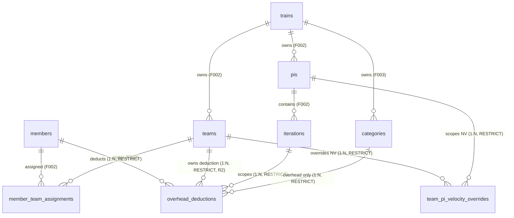

# Physical Data Model: Capacity Engine & Capacity Planner (F004)

**Branch**: `004-capacity-engine-planner` | **Date**: 2026-11-26 (Review Pass 2 — R5 `overhead_deductions`, R6 `deducted_hours` 0.25h steps, m12) | **Spec**: [spec.md](./spec.md)  
**Migration**: `src/persistence/migrations/0003_capacity_engine_planner.sql` (additive upgrade from `0002_work_categories_allocation.sql`)  
**Shared App Version**: `APP_VERSION = '0.4.0'` (`src/persistence/version.ts`, `package.json`, & `package-lock.json`)

---

## 1. Common Conventions

- All new F004 tables inherit F001's `auditColumns()` (`id` UUIDv4 `text` PK, `created_at` UTC timestamp, `updated_at` UTC timestamp, `created_by` default `'local:sm'`, `updated_by` default `'local:sm'`).
- All foreign keys use **`ON DELETE RESTRICT`** — never `ON DELETE CASCADE`.
- All persisted overhead deductions use **hours in `0.25h` steps** (`deducted_hours double precision`, `0..744`, exact IEEE-754 binary floats, `R6`). Day equivalents are derived on read (`deducted_hours / teams.hours_per_day`), and changing `teams.hours_per_day` does **not** rescale `deducted_hours`.
- `teams.hours_per_day` is constrained in SQL to `[1.0, 24.0]` in `0.5`-hour steps (`workdayMinutes` ∈ `[60, 1440]`, step `30`), guaranteeing exact integer half-day minutes (`30..720`) on the same `15`-minute / `0.25h` grid (`M2`, `R6`).
- No separate persistent team-level overhead-category default table is created (`A2`); `overhead_deductions` is the single persisted source of truth for per-member overhead deductions.
- Historical capacity reads use each Member's current `role`, `fte_factor`, and `location_id`; only `member_team_assignments` is dated.
- F004 creates **zero** `PlanVersion`, `PICommitment`, `SprintCommitment`, `SprintClosure`/`Actuals`, `OverheadTicket`, or `StateChange` tables (Constitution Principle III).

---

## 2. Schema Changes

### 2.1 `teams` (Extended — `src/persistence/schema/organization.ts`)

Two additive columns plus tightened `hours_per_day` SQL constraint on existing F002 `teams` table. Migration `0003` snaps any legacy F002 `hours_per_day` values outside `[1.0, 24.0]` step `0.5` as a safety net (`GREATEST(1.0, LEAST(24.0, ROUND((hours_per_day * 2)::numeric) / 2.0))`) before replacing `teams_hours_per_day_valid` (`/capacity` is the only UI/API place where `hours_per_day` is edited, per `m12`):

| Column | Type | Nullable | Default | Constraints / Notes |
|---|---|---|---|---|
| `hours_per_day` *(tightened)* | `double precision` | No | `8` | `CHECK (hours_per_day >= 1 AND hours_per_day <= 24 AND (hours_per_day * 2) = floor(hours_per_day * 2))` |
| `deduction_mode` *(new)* | `text` | No | `'fixed_days'` | `CHECK (deduction_mode IN ('fixed_days', 'percent'))`; governs bulk-apply input mode on `/capacity` |
| `seed_normalized_velocity` *(new)* | `double precision` | Yes | `null` | `CHECK (seed_normalized_velocity IS NULL OR (seed_normalized_velocity >= 0 AND seed_normalized_velocity <= 1000))`; manual NV fallback (`SP / dev day`) |

*(Existing `sprint_offset_workdays` [`integer`, default `0`, `IN (-1, 0, 1)`] remains unchanged and is consumed directly by F004.)*

---

### 2.2 `overhead_deductions` (New — `src/persistence/schema/capacity.ts`)

Authoritative Team-scoped per-Member × Team × Iteration × Overhead Category overhead deduction in fixed hours (`0.25h` steps) (`R2`, `R5`, `R6`; renamed from v0.6's teamless `OverheadReserve` entity, documented in ADR `0004`).

| Column | Type | Nullable | Default | Constraints / Notes |
|---|---|---|---|---|
| `id` | `text` | No | UUIDv4 | Primary key (`auditColumns()`) |
| `member_id` | `text` | No | — | FK → `members.id` (`ON DELETE RESTRICT`) |
| `team_id` | `text` | No | — | FK → `teams.id` (`ON DELETE RESTRICT`) (`R2`) |
| `iteration_id` | `text` | No | — | FK → `iterations.id` (`ON DELETE RESTRICT`) |
| `category_id` | `text` | No | — | FK → `categories.id` (`ON DELETE RESTRICT`) |
| `deducted_hours` | `double precision` | No | — | `CHECK (deducted_hours >= 0 AND deducted_hours <= 744 AND deducted_hours * 4 = floor(deducted_hours * 4))` (`R6`) |
| `source` | `text` | No | `'pi_plan'` | `CHECK (source IN ('pi_plan', 'sprint_adjusted'))` |
| `created_at` / `updated_at` | `timestamp` | No | `now()` | UTC timestamps (`auditColumns()`) |
| `created_by` / `updated_by` | `text` | No | `'local:sm'` | Internal actor provenance (`auditColumns()`) |

**Indexes**:
- `overhead_deductions_member_team_iter_cat_unique`: `UNIQUE (member_id, team_id, iteration_id, category_id)` (`R2`, `R5`)
- `overhead_deductions_team_iter_idx`: `INDEX (team_id, iteration_id)` (serves Team × PI batch reads and `deleteTeam` reference checks)
- `overhead_deductions_iteration_idx`: `INDEX (iteration_id)` (serves `deleteIteration` reference checks)
- `overhead_deductions_category_idx`: `INDEX (category_id)` (serves F003 `deleteCategory` and `kind`-change reference checks)

**Sparse Storage Semantics**:
- An absent row means `0` deducted hours for that `(member_id, team_id, iteration_id, category_id)`.
- In F004 (`source = 'pi_plan'`), saving `deducted_hours = 0` deletes any existing `pi_plan` row for that Team-scoped tuple to keep storage sparse; the SQL `CHECK (deducted_hours >= 0)` also permits F013 (`source = 'sprint_adjusted'`) to record an explicit `0` adjustment if needed.

**Application/Domain Cross-Table Invariants (enforced transactionally in `capacity-service.ts`)**:
1. `iteration.pi.train_id === team.train_id === category.train_id` (strict cross-ART isolation).
2. `category.kind === 'overhead'` and `category.record_status === 'active'` on write.
3. `train.record_status === 'active'`, `team.record_status === 'active'`, `pi.record_status === 'active'`, and `member.record_status === 'active'` on write.
4. `member.role === 'Team member'` and the Member has a dated `member_team_assignments` row for **`team_id`** overlapping that Iteration's Team-scheduled date window on write (`R2`, `m6`).
5. All reads, writes, bulk applies, and clears filter strictly by `team_id`; one Team's mutation never touches another Team's rows (`R2`).

---

### 2.3 `team_pi_velocity_overrides` (New — `src/persistence/schema/capacity.ts`)

Team-specific PI velocity override (never stored on the shared ART-level `pis` row).

| Column | Type | Nullable | Default | Constraints / Notes |
|---|---|---|---|---|
| `id` | `text` | No | UUIDv4 | Primary key (`auditColumns()`) |
| `team_id` | `text` | No | — | FK → `teams.id` (`ON DELETE RESTRICT`) |
| `pi_id` | `text` | No | — | FK → `pis.id` (`ON DELETE RESTRICT`) |
| `velocity` | `double precision` | No | — | `CHECK (velocity >= 0 AND velocity <= 1000)`; Team-specific override in `SP / dev day` |
| `created_at` / `updated_at` | `timestamp` | No | `now()` | UTC timestamps (`auditColumns()`) |
| `created_by` / `updated_by` | `text` | No | `'local:sm'` | Internal actor provenance (`auditColumns()`) |

**Indexes**:
- `team_pi_velocity_override_unique`: `UNIQUE (team_id, pi_id)`
- `team_pi_velocity_override_pi_idx`: `INDEX (pi_id)` (serves F002 `deletePi` reference checks)

**Application/Domain Cross-Table Invariants**:
1. `team.train_id === pi.train_id`.
2. `train.record_status === 'active'`, `team.record_status === 'active'`, and `pi.record_status === 'active'` on write (`PUT` / `DELETE`).

---

## 3. Entity Relationship Summary



---

## 4. Reference-Integrity Guard Updates (`FR-014`, `R2`, `R5`)

Because every F004 foreign key uses `ON DELETE RESTRICT`, existing F002/F003 services are updated to surface accurate `409 CONFLICT` messages when F004 rows exist:
- `deleteTeam` (`organization-service.ts`): detects `overhead_deductions` (`team_id`) and `team_pi_velocity_overrides` in addition to F002/F003 references (`R2`).
- `deleteMember` (`organization-service.ts`): detects `overhead_deductions` in addition to F002 absences/assignments.
- `deletePi` (`cadence-service.ts`): detects `team_pi_velocity_overrides` in addition to F002 iterations / F003 allocations.
- `deleteIteration` (`cadence-service.ts`): detects `overhead_deductions`.
- `listCategories`, `deleteCategory`, & `updateCategory` (`kind` switch) (`category-service.ts`): checks `overhead_deductions` in addition to `team_category_allocations` so an `overhead` category referenced by deductions reports `isReferenced: true` and cannot be hard-deleted or switched to `development` (`409 CONFLICT`).

---

## 5. Downstream Read-Model Contract (`TeamPiCapacityView`)

`calculateTeamPiCapacity()` returns an immutable-friendly, snapshot-ready read model consumed by `/capacity` (`F004`) and reusable by `F005`, `F009`, `F011`, `F012`, `F013`, `F016`, and `F019`:

```ts
export type VelocitySource =
  | 'sprint_override'
  | 'pi_override'
  | 'rolling_4_sprint'
  | 'rolling_partial'
  | 'manual_seed'
  | 'unset';

export type ResolvedVelocity = {
  value: number | null;
  source: VelocitySource;
  sprintCountUsed: number;
  totalCompletedSp: number | null;
  totalActualDevDays: number | null;
  piOverrideValue: number | null;
  seedValue: number | null;
};

export type LoadBand = 'amber' | 'green' | 'red' | 'none';

export type LoadResult = {
  plannedSp: number;
  forecastSp: number;
  loadPct: number | null;
  band: LoadBand;
};
```

Each Member × Iteration record exposes exact integer `workingMinutes`, `holidayMinutes`, `absenceMinutes`, `availableMinutes`, `overheadMinutes`, `preFteMinutes`, authoritative full-precision `devDaysRaw = (preFteMinutes * fteFactor) / workdayMinutes`, derived `devHours = devDaysRaw * hoursPerDay` and `devMinutes = Math.round(devDaysRaw * workdayMinutes)`, per-overhead-category stored deduction breakdowns (`deductedHours`, `daysRaw = deductedHours / hoursPerDay`, `source`), named holiday entries (including `confirmed: boolean` / `isEstimated: boolean`), named active absence entries, and `warnings: Array<'over_deducted'>`.
