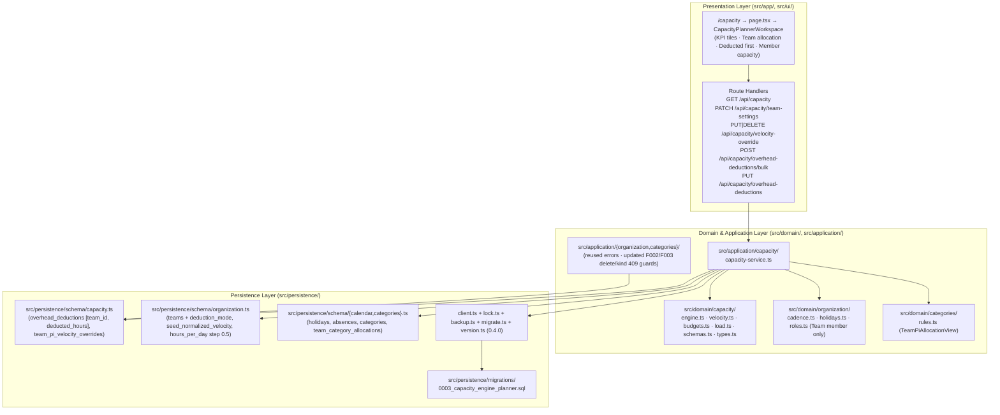

# Implementation Plan: Capacity Engine & Capacity Planner (F004)

**Branch**: `004-capacity-engine-planner` | **Date**: 2026-11-26 (Review Pass 3 — percent bulk >744h atomic 400, breakdown zero clamp, archived-Member scheduledEndDate < today, active-URL header sync) | **Spec**: [spec.md](./spec.md)  
**Input**: Feature specification `/specs/004-capacity-engine-planner/spec.md`, Feature Brief `/docs/features/004-capacity-engine-planner.md` (v0.1), and Design Handoff `/docs/handoffs/azusa-handoff-v2.zip`

---

## Summary

Deliver Azusa's authoritative, pure TypeScript **Capacity Calculation Engine** (`src/domain/capacity/`) and the interactive, transparent **Capacity Planner** (`/capacity`) on top of the local-first Next.js 15 / PGlite / Drizzle foundation (`F001`–`F003`), with **zero new npm dependencies**.

Extend `teams` with `deduction_mode` (`'fixed_days' | 'percent'`, default `'fixed_days'`) and `seed_normalized_velocity` (nullable `0..1000`), tighten `teams.hours_per_day` in SQL to `[1.0, 24.0]` step `0.5` (with a migration safety-net snap for any legacy rows; `/capacity` is the sole editor per `m12`), and add two normalized Drizzle tables — Team-scoped `overhead_deductions` (unique `(member_id, team_id, iteration_id, category_id)` storing fixed `deducted_hours` in `0..744` at `0.25h` steps with `source: 'pi_plan' | 'sprint_adjusted'`, per `R2`, `R5`, `R6`) and `team_pi_velocity_overrides` (Team-specific PI velocity override keyed by `(team_id, pi_id)`) — via explicit additive SQL migration `0003_capacity_engine_planner.sql`, with `ON DELETE RESTRICT` foreign keys and synchronized `APP_VERSION = '0.4.0'`.

Compute all Member × Iteration, Team × Iteration, and PI capacity values in pure TypeScript using exact integer minutes internally (`workdayMinutes = Math.round(hoursPerDay * 60)` in `[60, 1440]` step `30`; `deductedHours * 60` always an exact multiple of `15` minutes):
- Team-scheduled Sprint windows from F002 (`computeTeamIterationSchedule`, `±1` weekday offset) intersected with dated `member_team_assignments` for that Team.
- Per-Location effective holidays (`resolveEffectiveLocationHolidays`), with unconfirmed holidays (`confirmed = false`) deducted immediately and flagged `est.`, weekend holidays ignored, independent `am`/`pm` half-day absence tracking (duplicates counted once), and per-weekday overlap capping so holiday + absence never exceeds `1.0` working day.
- Role eligibility tightened in `src/domain/organization/roles.ts` so only `Team member` contributes to development capacity (`Admin`, `RTE`, `SM`, `PO` excluded).
- `fte_factor` applied after availability and overhead deductions (`preFteMinutes = max(0, availableMinutes − overheadMinutes)`, authoritative `devDaysRaw = (preFteMinutes × fteFactor) / workdayMinutes`, derived `devMinutes = Math.round(devDaysRaw × workdayMinutes)`), clamping negative capacity to `0` with an `'over_deducted'` warning.
- Stored `deducted_hours` stay fixed when `teams.hours_per_day` changes (no rescaling, `R6`); day equivalents (`deducted_hours / hours_per_day`), dev days, and Forecast SP recalculate predictably.
- Full v0.6 Normalized Velocity resolution chain (`Sprint override → PI override → Rolling 4-Sprint ratio of sums incl. IP → Team seed`), distinguishing zero-denominator fallback from genuine `0.0` NV.
- Presentation-only rounding: per-Sprint Forecast SP rounded to nearest integer and summed for PI Forecast SP; per-Sprint Category Budgets via exact integer largest-remainder rounding (`forecastSpDisplay × effectivePct` divmod `100`, tie-broken by `sort_order` ascending then `categoryId` ascending) summing to Sprint Forecast SP and summed for PI Category Budgets; reusable `calculateLoad` (`< 85%` amber, `85–115%` green, `> 115%` red).

Replace the `/capacity` placeholder with the v2 prototype layout (`Capacity.dc.html` / `03-capacity-planner.png`) at `1440px` baseline subject to operator-accepted deviations `D1`–`D8` (exact KPI labels per `R7`, stored pre-FTE cells/inputs/footers per `R8`, no adjusted marker per `R4`).

---

## Technical Context

- **Language / Runtime**: TypeScript 5.x (`strict: true`, `noUncheckedIndexedAccess: true`), Node.js 22.12+ / 24.x / 26+
- **Framework**: Next.js 15 (App Router), React 19, bound to `127.0.0.1`, `NEXT_TELEMETRY_DISABLED=1`
- **New Dependencies**: **None** (reuses Drizzle ORM, PGlite, Zod v4, Vitest, Playwright, `@axe-core/playwright`)
- **Storage & Locking**: Embedded PGlite + Drizzle ORM (`0003_capacity_engine_planner.sql`), reusing F001's `proper-lockfile` locking, `globalThis.__azusaDbState` singleton, automatic pre-migration startup backup, and `db:backup` / `db:restore` CLI workflows (bumping shared `APP_VERSION` in `src/persistence/version.ts`, `package.json`, and `package-lock.json` from `0.3.0` to `0.4.0`)
- **Validation & Testing**: Strict Zod v4 schemas, ESLint, Prettier, Vitest (unit + golden + real PGlite integration + HTTP route tests), Playwright (`port 3100`, `reuseExistingServer: false`, `.next-playwright`, `.azusa/test-playwright/`), `@axe-core/playwright`
- **Visual-Fidelity Mode**: **`Visual-fidelity`**
  - **Prototype / Design Reference**: `docs/handoffs/azusa-handoff-v2.zip` (`prototype/Capacity.dc.html`, `screenshots/03-capacity-planner.png`, `AZUSA_HANDOFF.md` §8, §8.1, §13.3, `AZUSA_HANDOFF_UPDATE_2026-11-20.md` §1, `docs/azusa-data-model.md` v0.6 §2 & §4). Fidelity guaranteed at `1440px` baseline width; `1024px` and `768px` adapt cleanly (collision-free, usable, accessible under Principle VII).
  - **Planned Deviations (`D1`–`D8`, all operator-accepted across Sessions `2026-11-26`, `review`, & `review pass 2`)**:
    - **D1 (`Planned SP` placeholder until F009)** *(accepted `2026-11-26`, `A1`)*: Dark `Planned SP` KPI tile and Team Allocation planned cells display `—` (`Not yet available`) instead of mock `242 / 268 SP` or `0`.
    - **D2 (Link to `/calendar` instead of `+ Day off`)** *(accepted `2026-11-26`, `A1`)*: Title row links to `/calendar` (`Team calendar`, F005) instead of rendering `+ Day off`.
    - **D3 (Link to `/organization` instead of inline category `%` editing)** *(accepted `2026-11-26`, `A1`)*: Team Allocation matrix renders read-only effective percentages, ART default vs. override badges, and links to `/organization` (`Categories & Allocation`, F003).
    - **D4 (Dynamic ART overhead categories + Deducted-first summary)** *(accepted `2026-11-26 (review)`, `R1`)*: Dynamically renders all active F003 `overhead` categories for the ART plus a dedicated **Deducted first** overhead summary.
    - **D5 (`Hours per day` & Velocity seed/PI override controls)** *(accepted `2026-11-26 (review)`, `R1`)*: Adds `Hours per day` input (`1.0–24.0`, step `0.5`) in the controls row and editable Team seed NV + Team PI velocity override with explicit NV source badge.
    - **D6 (Derived working days — no inline `Days` input)** *(accepted `2026-11-26 (review)`, `R1`)*: Expanded Sprint `Days` sub-column is read-only and derived authoritatively from Team Sprint schedule, dated assignments, and Location holidays.
    - **D7 (No "Adjusted" corner marker in F004)** *(accepted `2026-11-26 (review)`, `R4`)*: Defers the prototype's adjusted corner triangle (`Capacity.dc.html#L156`) to F013 where `source = 'sprint_adjusted'` gives it meaning.
    - **D8 (KPI labels & Pre-FTE Member table display)** *(accepted `2026-11-26 (review pass 2)`, `R7`, `R8`)*: Uses KPI labels `Planned SP`, `Development capacity`, `Normalized velocity`, `Forecast SP`, `Team FTE`, and displays stored pre-FTE values in expanded cells, inputs, and footers (`10 | 0 | 1 | 0.5 → 4.25` for Hana) with `max(0, Days − Leaves − deductions) × FTE = Dev (with → clamped to 0 alongside 'over_deducted' when over-deducted)` shown in the breakdown popover (no extra `× FTE` column).

---

## Constitution Check

- [x] **I. Purpose & Scope** — 100% local, single-user, no auth/RBAC enforcement, no portfolio layer, no external APIs or monetization.
- [x] **II. Spec-Driven / Prototype Fidelity** — Strictly scoped to F004; `Visual-Fidelity Mode: Visual-fidelity` targeting `prototype/Capacity.dc.html` / `screenshots/03-capacity-planner.png` at `1440px` baseline with all 8 deviations (`D1`–`D8`) explicitly justified and operator-accepted; `1024px`/`768px` verified for usability and accessibility under Principle VII.
- [x] **III. Domain & Historical Integrity** — All capacity, velocity, category budget, and load calculations live in single, authoritative pure functions in `src/domain/capacity/`; zero `PlanVersion`, `PICommitment`, `SprintCommitment`, `SprintClosure`/`Actuals`, `OverheadTicket`, or `StateChange` tables created in F004; dated `member_team_assignments` + Team-scoped `overhead_deductions` (`R2`, `R5`) preserve historical accuracy; `ON DELETE RESTRICT` + updated F002/F003 delete/kind guards protect referential integrity; output contracts are snapshot-ready for F012/F013.
- [x] **IV. Architecture & Data Safety** — Clean `src/domain/capacity/` → `src/application/capacity/` → `src/persistence/` → `src/app/api/capacity/` + `src/ui/capacity/` boundaries; zero new npm dependencies; explicit additive SQL migration `0003_capacity_engine_planner.sql` (including safety-net F002 `hours_per_day` snap) verified for F003→F004 upgrade and CLI `db:backup`/`db:restore` round-trip (`APP_VERSION = '0.4.0'`); exact `400`/`404`/`409`/`503` recoverable error envelopes.
- [x] **V. Deterministic Testing** — Pure Vitest unit tests + canonical `Palawan` / `PI-2027.1` Baseline & Adjusted golden fixture tests with pinned category budgets, real PGlite persistence/migration/CLI-backup integration tests, dedicated HTTP route tests (`tests/integration/capacity-routes.test.ts`), Playwright visual geometry tests (`tests/visual/capacity-planner.spec.ts`), and Playwright E2E + `@axe-core/playwright` tests (`tests/e2e/capacity-planner.spec.ts`) across `1440px`, `1024px`, and `768px`.
- [x] **VI. Documentation** — Updates `docs/architecture/overview.md`, `docs/architecture/domain-model.md`, `docs/architecture/data-dictionary.md`, `docs/operations/database-and-recovery.md`, `docs/REPO_MAP.md`, `CHANGELOG.md`, `README.md`, and adds ADR `docs/architecture/decisions/0004-capacity-engine-and-planner.md` (recording rename from v0.6 `OverheadReserve`, `team_id` departure, `0.25h` hour storage, and F013 rework note per `R9`). (`docs/feature-roadmap.md` keeps `F004` unchecked until conformance review and operator UAT acceptance.)
- [x] **VII. UX & Accessibility** — Warm-light Kumiko tokens, `IBM Plex Mono` tabular numerals, visually distinct leave/holiday/`est.`/warning badges with text labels (never color alone), inspectable calculation breakdowns, keyboard-operable expandable columns and popovers, `:focus-visible` `2px solid #E07F24` outlines, clear empty/invalid/read-only/error states, zero `@axe-core/playwright` violations.

---

## Architecture



### Layer Rules
1. **`src/domain/capacity/`**: Pure TypeScript and Zod v4 only. Zero imports from `next/*`, `react`, `drizzle-orm`, `@electric-sql/pglite`, or `node:*`. Reuses pure helpers from `src/domain/organization/{cadence.ts,holidays.ts,roles.ts}` and `src/domain/categories/rules.ts`. Owns single-source duration conversions (`getWorkdayMinutes`, `snapToQuarterHour`, `hoursToMinutes`, `hoursToDays`), per-weekday holiday/independent-AM-PM absence overlap capping, dated Team assignment intersection, FTE-after-overhead calculation, velocity resolution chain, exact integer largest-remainder category budgeting, reusable `calculateLoad`, and strict Zod schemas.
2. **`src/application/capacity/capacity-service.ts`**: Transactional orchestration reusing `src/application/organization/errors.ts`, `OrganizationOptions.today`, `resolveActor()`, and F003's `resolveTeamPiAllocation()`. Loads Team, PI, Iterations, Members + dated `member_team_assignments`, Locations + Holidays, Absences + AbsenceTypes, ART Categories + Team/PI overrides, Team-scoped `overhead_deductions`, and `team_pi_velocity_overrides`, then delegates 100% of calculation to `src/domain/capacity/engine.ts`.
3. **`src/application/{organization,categories}/`**: Updates delete/kind-change conflict checks (`deleteTeam`, `deleteMember`, `deletePi`, `deleteIteration`, `listCategories`, `deleteCategory`, `updateCategory` kind-switch) so existing `overhead_deductions` or `team_pi_velocity_overrides` references produce accurate `409 CONFLICT` messages (`FR-014`).
4. **`src/persistence/`**: Extends `src/persistence/schema/organization.ts` (`teams.deductionMode`, `teams.seedNormalizedVelocity`, tightened `hours_per_day` CHECK), adds `src/persistence/schema/capacity.ts` (`overheadDeductions` with `teamId` & `deductedHours`, `teamPiVelocityOverrides`), re-exports from `index.ts`, adds explicit additive SQL migration `0003_capacity_engine_planner.sql` (+ Drizzle journal & `0003_snapshot.json`), and bumps `APP_VERSION` to `'0.4.0'`.
5. **`src/app/api/capacity/` & `src/ui/capacity/`**: Thin Route Handlers reusing `src/app/api/organization/http.ts` and a focused `CapacityPlannerWorkspace` mounted at `src/app/capacity/page.tsx` consuming `useOrganizationContext()` with URL-only `?teamId=<uuid>&piId=<uuid>` overrides (`m13`).

---

## Data Flow

### 1. Read & Compute Capacity Plan (`GET /api/capacity?teamId=<uuid>&piId=<uuid>`)
1. `/capacity` checks URL search params (`teamId`, `piId`):
   - If valid UUIDs point to an **active** ART, Team, and PI, `/capacity` atomically updates ART + Team + PI via `OrganizationContext.setSelection({ teamId, piId })` (avoiding cross-ART `piId` drops) and **immediately clears the URL params** (`router.replace('/capacity')`) once synced so subsequent manual header changes are never pulled back by a leftover URL.
   - If valid UUIDs point to an **archived** ART, Team, or PI, URL params take precedence over `useOrganizationContext()` while the floating header retains its active selection and `/capacity` renders a prominent read-only banner (`"Viewing archived <Team> · <PI> (read-only)"` + `"Return to active selection"`). Changing the header selector clears the URL params via `router.replace('/capacity')` (`m13`).
2. `getTeamPiCapacity()` validates that `team` and `pi` exist (`404`) and belong to the same `train_id` (`409`).
3. Loads Team, ART (`record_status`), PI, Iterations (computing Team-scheduled boundaries via `computeTeamIterationSchedule()`), overlapping `member_team_assignments` for `teamId`, Members (counting archived Members **only** in Iterations where `scheduledEndDate < today`, excluding them with `exclusionReason: 'archived'` in current/future Iterations), Locations, Holidays, Absences + AbsenceTypes, ART Categories + F003 `resolveTeamPiAllocation()`, **Team-scoped** `overhead_deductions` (`WHERE team_id = teamId AND iteration_id IN piIterations`), and `team_pi_velocity_overrides` for `(teamId, piId)`.
4. Passes normalized pure inputs to `calculateTeamPiCapacity()` in `src/domain/capacity/engine.ts` (`completedSprintHistory: []` until F015) and returns `TeamPiCapacityView` with `readOnly: train.recordStatus === 'archived' || team.recordStatus === 'archived' || pi.recordStatus === 'archived'`.

### 2. Team Capacity Settings & Velocity Seed / PI Override
1. **Deduction mode / Hours per day / Seed NV**: `PATCH /api/capacity/team-settings` (`{ teamId, deductionMode?, hoursPerDay?, seedNormalizedVelocity? }`). Service validates active ART & active Team (`409`), validates bounds (`hoursPerDay` ∈ `[1.0, 24.0]` step `0.5`, `seedNormalizedVelocity === null || 0..1000`), and updates `teams`. Stored `overhead_deductions.deducted_hours` are untouched (`R6`), and UI re-fetches `GET /api/capacity` so derived days, dev days, and Forecast SP update immediately.
2. **Team PI velocity override**: `PUT /api/capacity/velocity-override` (`{ teamId, piId, velocity }`) upserts `team_pi_velocity_overrides` (`0..1000`, active ART/Team/PI, same ART); `DELETE /api/capacity/velocity-override?teamId=...&piId=...` clears it.

### 3. Team-Scoped Bulk-Apply & Individual Overhead Deduction Adjustments
1. **Bulk-apply PI deductions**: `POST /api/capacity/overhead-deductions/bulk` (`{ teamId, piId, mode, entries: [{ categoryId, value }] }`).
2. Service validates active ART/Team/PI, same ART, **`mode === team.deductionMode`** (`409 CONFLICT` on mismatch), and every `categoryId` is an active `overhead` category in the Team's ART (`404`/`409`). For all Iterations of the PI and all active eligible `Team member`s assigned to `teamId` during each Iteration:
   - `fixed_days`: `deductedHours = snapToQuarterHour(value * hoursPerDay * (assignedWeekdays / sprintScheduledWeekdays))` (`R2`, `R6`).
   - `percent`: one-off conversion `deductedHours = snapToQuarterHour(availableHours * value / 100)` (`m5`, `R6`).
3. Transactionally upserts non-zero rows (`source = 'pi_plan'`) and deletes `pi_plan` rows whose computed value is `0` **strictly for `(memberId, teamId, iterationId, categoryId)`**; categories not in `entries` and rows belonging to other Teams are left untouched (`R2`, `m6`). Before writing any row in `percent` mode, validates that every computed snapped `deductedHours <= 744`; if any Member × Iteration exceeds `744h`, atomically rejects the entire request with `400 VALIDATION_ERROR` naming the Member and Iteration and writes zero rows.
4. **Individual cell edit**: Operator types days in the expanded Sprint cell; UI converts `snapToQuarterHour(days * hoursPerDay)` and sends `PUT /api/capacity/overhead-deductions` (`{ teamId, memberId, iterationId, categoryId, deductedHours }`). Service validates active ART/Team/PI/Member, Iteration in Team's ART, active `overhead` category in Team's ART, `member.role === 'Team member'`, dated assignment on `teamId` overlapping that Iteration's scheduled window, and `deductedHours` in `[0, 744]` step `0.25`, then upserts with `source = 'pi_plan'` (or deletes when `0`).

---

## Project Structure

```text
src/
├── domain/
│   ├── organization/
│   │   └── roles.ts                          # Tighten contributesToDevCapacity(role) to role === 'Team member' (A4)
│   └── capacity/
│       ├── types.ts                          # Pure input/output & breakdown contracts (TeamPiCapacityView, etc.)
│       ├── schemas.ts                        # Strict Zod v4 request/query schemas (0.25h steps & safe upper bounds)
│       ├── velocity.ts                       # resolveNormalizedVelocity (Sprint → PI → 4-Sprint rolling incl. IP → Team seed)
│       ├── budgets.ts                        # Exact integer largest-remainder category budgeting (sortOrder, then categoryId)
│       ├── load.ts                           # Reusable calculateLoad(plannedSp, forecastSp, thresholds?)
│       └── engine.ts                         # Pure Member × Iteration & Team × Iteration/PI calculation engine
├── application/
│   ├── capacity/
│   │   └── capacity-service.ts               # Transactional read/compute, team settings, PI velocity override, Team-scoped bulk & single deductions
│   ├── organization/
│   │   ├── organization-service.ts           # Update deleteTeam & deleteMember 409 messages to include overhead deductions / velocity overrides
│   │   └── cadence-service.ts                # Update deletePi & deleteIteration 409 messages to include capacity records
│   └── categories/
│       └── category-service.ts               # Check overhead_deductions in listCategories, deleteCategory & kind-change guard (409 CONFLICT)
├── persistence/
│   ├── version.ts                            # Bump APP_VERSION to '0.4.0'
│   ├── schema/
│   │   ├── organization.ts                   # Add deductionMode, seedNormalizedVelocity; tighten hours_per_day CHECK
│   │   ├── capacity.ts                       # Drizzle tables: overhead_deductions (team_id, deducted_hours), team_pi_velocity_overrides
│   │   └── index.ts                          # Re-export capacity schema
│   └── migrations/
│       ├── 0003_capacity_engine_planner.sql
│       └── meta/
│           ├── _journal.json                 # Add 0003 entry
│           └── 0003_snapshot.json            # Drizzle snapshot for 0003
├── app/
│   ├── capacity/
│   │   └── page.tsx                          # Replace F001 placeholder with server health + CapacityPlannerWorkspace
│   └── api/
│       └── capacity/
│           ├── route.ts                      # GET Team × PI capacity view
│           ├── team-settings/route.ts        # PATCH deductionMode, hoursPerDay, seedNormalizedVelocity
│           ├── velocity-override/route.ts    # PUT set / DELETE clear Team PI velocity override
│           └── overhead-deductions/
│               ├── route.ts                  # PUT single Member × Team × Iteration × Category deduction
│               └── bulk/route.ts             # POST Team-scoped bulk-apply PI overhead deductions
└── ui/
    └── capacity/
        ├── CapacityPlannerWorkspace.tsx      # Page orchestrator: header context + URL-only archived params, controls row, KPI strip, sections
        ├── CapacityKpiStrip.tsx              # 5 KPI tiles (Planned SP, Development capacity, Normalized velocity, Forecast SP, Team FTE)
        ├── TeamAllocationMatrix.tsx          # Category × (PI + Sprints) budget matrix, F003 status/drift banner, Deducted-first overhead summary
        ├── MemberCapacityTable.tsx           # Expandable pre-FTE Member × (PI + Sprints) table, inline inputs, leave/holiday/est. chips, footers
        ├── BreakdownPopover.tsx              # Inspectable calculation breakdown popover showing max(0, Days − Leaves − deductions) × FTE = Dev (with → clamped to 0 alongside 'over_deducted' when over-deducted)
        └── capacity.module.css               # Kumiko styles matching Capacity.dc.html / 03-capacity-planner.png
```

---

## Risks and Tradeoffs

| Risk | Impact | Mitigation |
|---|---|---|
| **Tightening `contributesToDevCapacity` in `roles.ts`** | Existing F002 unit/integration tests assert `Admin` and `RTE` contribute to dev capacity. | Update `roles.ts` and the two F002 test assertions explicitly in `T001`, and note the `/organization` badge change in `CHANGELOG.md` (`T021`). |
| **Mid-Sprint Member transfers across Teams (`R2`, `R6`)** | Without `team_id` on `overhead_deductions`, two Teams would collide on the same `(member, iteration, category)` row; independent `0.25h` snapping on `4/10` and `6/10` produces `3.25h` + `4.75h` (`8.0h` here, though general splits may differ by `±0.25h`). | Scope `overhead_deductions` by `(member_id, team_id, iteration_id, category_id)`, snap each Team's prorated share independently to `0.25h`, and verify cross-Team isolation in unit & integration tests. |
| **Changing `hours_per_day` shifts derived day values (`R6`)** | Because `deducted_hours` are fixed in hours, changing `8h → 7.5h` changes an `8h` deduction from `1.0d` to `1.0667d`, reducing dev days and Forecast SP. | Intended per `R6`; explicitly tested and documented in `spec.md`, `research.md`, and ADR `0004`. |
| **Percent mode one-off conversion (`m5`)** | Subsequent calendar changes do not auto-recompute persisted deductions. | Document explicitly in spec, UI helper copy, and `research.md`; operator re-runs bulk apply or adjusts cells as needed. |
| **F013 overhead-ticket design rework (`R9`)** | Earlier v0.6 / 2026-11-19 notes described overhead tickets drawing down a reserve with an over-reserve warning. | Record forward note in `spec.md`, `research.md`, and ADR `0004` so F013 reworks overhead tickets to fit `R9`. |

---

## Validation Approach

1. **Pure Capacity Engine & Golden Unit Tests (`tests/unit/` via `npm run test:run`)**:
   - `tests/unit/capacity-golden.test.ts`: Uses `tests/support/capacity-golden-fixture.ts` (`GW = 8h`, `Tr = 4h` at `8h/day`) with exact dated holidays & absences verifying **both** scenarios:
     - **Baseline**: Sprint dev days (`60.75`, `55.75`, `59.75`, `56.25`, `58.75`; PI `291.25` → `291.3`), Forecast SP (`56`, `51`, `55`, `52`, `54`; PI `268`, raw `267.95`), and exact pinned Category Budgets (`2702: 31/8/8/5/4`, `2704: 28/8/7/4/4`, `2706: 31/8/8/4/4`, `2708: 29/8/7/4/4`, `2710: 30/8/8/4/4`; PI `149/40/38/21/20`).
     - **Adjusted** (Carlo `2706` `GW = 4h`): `2706 = 60.25`, PI `291.75` (`291.8`), Forecast SP `268` (raw `268.41`).
   - `tests/unit/capacity-engine.test.ts`: Covers `±1` Team offsets, dated assignments & mid-Sprint Team transfer proration (`4/10 × 8h → 3.25h`, `6/10 × 8h → 4.75h`), `0.25h` halves-up snapping (incl. `0.1d × 8h = 0.8h → 0.75h`), weighted-average PI `eligibleFte`, multi-location holidays, unconfirmed `est.` holidays, weekend holidays (`0`), half-day holidays, duplicate `am`, duplicate `pm`, `am + pm`, and each combined with a half holiday (`m3`), `Admin`/`RTE`/`SM`/`PO` exclusion, `fteFactor = 0.33` single-formula verification, `hours_per_day` boundaries (`1.0`, `7.5`, `8.0`, `24.0`; rejecting `0.001` & `7.25`) + `8h → 7.5h` leaving `deducted_hours` unchanged and updating dev days predictably (`R6`), negative clamping + `'over_deducted'`, full NV chain (incl. IP, partial, zero-denominator fallback, genuine `0.0`), exact integer largest-remainder tie-breaking (`sortOrder`, then `categoryId`), invalid F003 allocation, `calculateLoad` bands + `forecastSp = 0`, and strict Zod schemas (including `0..744` step `0.25`, `0..31` days, `0..100` %, `0..1000` velocity).
2. **Real PGlite Service, Migration & CLI Backup Tests (`tests/integration/` via `npm run test:run`)**:
   - `tests/integration/capacity-migration-backup.test.ts`: F003→F004 upgrade (including safety-net snap of a legacy `7.25` F002 `hours_per_day` row to `7.5`), direct SQL `CHECK`/`UNIQUE`/`ON DELETE RESTRICT` checks (including `team_id` unique key and `deducted_hours` `0..744` step `0.25`), and CLI `db:backup` → `db:restore` (`--from` / `--to`) round-trip (`APP_VERSION = '0.4.0'`).
   - `tests/integration/capacity-persistence.test.ts`: Real PGlite service tests including golden dataset read, `hours_per_day` update `8.0 → 7.5` leaving `deducted_hours` unchanged and recalculating dev days (`R6`), mid-Sprint transfer Team-scoped bulk-apply (`3.25h` vs `4.75h`) & clear isolation (`R2`), unlisted categories untouched & `mode` mismatch `409` (`m6`), rejected out-of-bounds/off-step bulk request writing zero rows (`m4`), percent bulk-apply one-off persistence (`m5`), archived ART/Team/PI `readOnly: true` & `409` writes, archived Member counted on overlapping assignment while write returns `409`, and updated F002/F003 `deleteTeam` (with `overhead_deductions`), `deleteMember`, `deletePi`, `deleteIteration`, `deleteCategory`, and `kind`-switch `409` guards.
   - `tests/integration/capacity-routes.test.ts`: Direct Next.js Route Handler contract tests verifying `200`, `Cache-Control: no-store`, exact `400`/`404`/`409`/`503` responses, duplicate query params, off-step & upper-bound rejections, unknown keys, and actor-injection rejection.
3. **Playwright Visual Geometry, E2E & Accessibility Tests (`npm run test:visual`, `npm run test:e2e`)**:
   - `tests/visual/capacity-planner.spec.ts`: Verifies `/capacity` header, 5 KPI tiles (`Planned SP`, `Development capacity`, `Normalized velocity`, `Forecast SP`, `Team FTE`), Team Allocation matrix, Deducted-first summary, and expandable pre-FTE Member Capacity table geometry across `1440px`, `1024px`, and `768px` with zero page-level horizontal overflow.
   - `tests/e2e/capacity-planner.spec.ts`: Walks US1–US5 end-to-end (including exact `R7` KPI labels, `R8` pre-FTE expanded cell & footer values, `hours_per_day` edit leaving `deducted_hours` fixed and updating dev days, Team-scoped bulk/inline deduction edits with `0.25h` snapping, seed NV & PI override, breakdown popover showing `max(0, Days − Leaves − deductions) × FTE = Dev` including `→ clamped to 0` alongside `'over_deducted'` for an over-deducted Member, invalid F003 allocation warning, `/calendar` & `/organization` links, cross-ART active deep-link atomic header sync + immediate URL param clearing + manual header switch, URL-only archived Team/PI read-only mode & header clearing per `m13`, zero external network requests, and zero `@axe-core/playwright` violations across `1440px`, `1024px`, and `768px`).

---

## Affected Areas

### Files / Components to Be Inspected (Read-Only Reference)
- `.specify/memory/constitution.md`
- `docs/features/004-capacity-engine-planner.md`
- `docs/handoffs/azusa-handoff-v2.zip` (`prototype/Capacity.dc.html`, `screenshots/03-capacity-planner.png`, `AZUSA_HANDOFF.md` §8 & §13.3, `AZUSA_HANDOFF_UPDATE_2026-11-20.md`, `docs/azusa-data-model.md` v0.6)
- `specs/004-capacity-engine-planner/spec.md`
- `src/domain/organization/{cadence.ts,holidays.ts}`
- `src/domain/categories/rules.ts`
- `src/persistence/{schema/common.ts,schema/calendar.ts,schema/categories.ts,client.ts,migrate.ts,backup.ts}`
- `src/application/organization/errors.ts`
- `src/app/api/organization/http.ts`
- `src/ui/shell/{OrganizationContext.tsx,AppShell.tsx,nav-config.ts,page-health.ts}`

### Files / Components to Be Created or Modified
- **Version / Config**: `src/persistence/version.ts` (modify — `0.4.0`), `package.json` (modify — `0.4.0`), `package-lock.json` (modify — `0.4.0`)
- **Domain**: `src/domain/capacity/{types.ts,schemas.ts,velocity.ts,budgets.ts,load.ts,engine.ts}` (create), `src/domain/organization/roles.ts` (modify — tighten `contributesToDevCapacity` to `Team member` only)
- **Application**: `src/application/capacity/capacity-service.ts` (create), `src/application/organization/{organization-service.ts,cadence-service.ts}` (modify — update delete `409` messages), `src/application/categories/category-service.ts` (modify — check `overhead_deductions` references on `listCategories`, `deleteCategory`, & `kind` change)
- **Persistence**: `src/persistence/schema/organization.ts` (modify — add `deductionMode`, `seedNormalizedVelocity`; tighten `hours_per_day` CHECK), `src/persistence/schema/capacity.ts` (create), `src/persistence/schema/index.ts` (modify — re-export `capacity.ts`), `src/persistence/migrations/0003_capacity_engine_planner.sql` + `meta/_journal.json` + `meta/0003_snapshot.json` (create/modify)
- **API Routes**: `src/app/api/capacity/{route.ts,team-settings/route.ts,velocity-override/route.ts,overhead-deductions/route.ts,overhead-deductions/bulk/route.ts}` (create)
- **UI**: `src/app/capacity/page.tsx` (modify — replace placeholder), `src/ui/shell/OrganizationContext.tsx` (modify — add atomic `setSelection({ teamId, piId })` for cross-ART active deep-link sync), `src/ui/capacity/{CapacityPlannerWorkspace.tsx,CapacityKpiStrip.tsx,TeamAllocationMatrix.tsx,MemberCapacityTable.tsx,BreakdownPopover.tsx,capacity.module.css}` (create)
- **Documentation**: `docs/architecture/{overview.md,domain-model.md,data-dictionary.md}` (modify), `docs/architecture/decisions/0004-capacity-engine-and-planner.md` (create), `docs/operations/database-and-recovery.md` (modify), `docs/REPO_MAP.md` (modify), `CHANGELOG.md` (modify), `README.md` (modify) *(note: `docs/feature-roadmap.md` keeps `F004` unchecked until conformance review and operator UAT)*

### Tests to Be Added or Updated
- **Add**: `tests/support/capacity-golden-fixture.ts`
- **Add**: `tests/unit/{capacity-golden.test.ts,capacity-engine.test.ts}`
- **Add**: `tests/integration/{capacity-migration-backup.test.ts,capacity-persistence.test.ts,capacity-routes.test.ts}`
- **Add**: `tests/visual/capacity-planner.spec.ts`
- **Add**: `tests/e2e/capacity-planner.spec.ts`
- **Update**: `tests/unit/organization-roles-schemas.test.ts` & `tests/integration/organization-persistence.test.ts` (align with `Team member`-only `contributesToDevCapacity` and updated delete `409` messages), `tests/e2e/foundation-smoke.spec.ts` & `tests/visual/shell-fidelity.spec.ts` (update `/capacity` expectation from F001 placeholder to live Capacity Planner per `m10`), `tests/integration/migration-upgrade.test.ts` (if journal entry count is asserted), `tests/unit/docs-completeness.test.ts` (if ADR/doc index is checked)

### Explicitly Out of Scope
- Organization/Team/Member/PI/Iteration CRUD on `/capacity` (`F002`)
- Inline Work Category or Team/PI percentage allocation editing on `/capacity` (`F003` — link to `/organization`)
- Separate persistent team-level overhead-category default table (`A2`)
- "Adjusted" corner marker in F004 (`R4`, `D7` — deferred to `F013`)
- Team Calendar, `+ Day off` modal, days-off grid, `SprintCeremony`, `Meeting`, `Milestone`, or overtime calculation/entry (`F005` — link to `/calendar`)
- Projects, Features, Stories, Bugs, StorySlices, Buffers, or real Planned SP (`F006`–`F009` — `Planned SP` shows `—` / `Not yet available`)
- `PlanVersion`, `Start PI`, or `PICommitment` (`F012`)
- Sprint Planning, `OverheadTicket`, Sprint velocity override UI, `Start Sprint`, or `SprintCommitment` (`F013`)
- Iteration execution, `UnplannedDeduction` UI, `Close Sprint`, or `SprintClosure`/Actuals (`F014`–`F015`)
- Metrics dashboards, ART reporting, donut chart, or charting-library selection (`F016`–`F019`)
- Per-location workday hours, self-service absences, auth/RBAC, or standalone `/settings`
