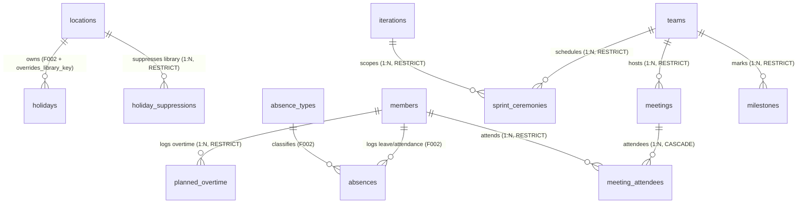

# Physical Data Model: Team Calendar & Availability (F005)

**Branch**: `005-team-calendar-availability` | **Date**: 2026-11-27 | **Spec**: [spec.md](./spec.md)  
**Migration**: `src/persistence/migrations/0004_team_calendar_availability.sql` (additive upgrade from `0003_capacity_engine_planner.sql`)  
**Shared App Version**: `APP_VERSION = '0.5.0'` (`src/persistence/version.ts`, `package.json`, & `package-lock.json`)

---

## 1. Common Conventions

- All new F005 tables inherit F001's `auditColumns()` (`id` UUIDv4 `text` PK, `created_at` UTC timestamp, `updated_at` UTC timestamp, `created_by` default `'local:sm'`, `updated_by` default `'local:sm'`).
- Foreign keys to organizational/member entities use **`ON DELETE RESTRICT`**. Only the join table `meeting_attendees.meeting_id` uses `ON DELETE CASCADE` so deleting a meeting cleanly cleans up its attendee links while `meeting_attendees.member_id` remains `ON DELETE RESTRICT`.
- All new F005 duration fields (`duration_minutes` on `planned_overtime`, `sprint_ceremonies`, and `meetings`) store canonical **integer minutes** in `15`-minute (`0.25`-hour) increments (`duration_minutes > 0 AND duration_minutes <= 1440 AND duration_minutes % 15 = 0`), consistent with `A1` and `A3`.
- All calendar dates are inclusive ISO calendar dates (`YYYY-MM-DD`) stored as `text` with regex SQL `CHECK` constraints, matching F002.
- F005 creates **zero** `PlanVersion`, `PICommitment`, `SprintCommitment`, `SprintClosure`/`Actuals`, `OverheadTicket`, `UnplannedDeduction`, or `CeremonyTemplate` tables (Constitution Principle III).

---

## 2. Schema Changes (`src/persistence/schema/calendar.ts`)

### 2.1 `holidays` (Extended — F002 table)

Adds one nullable column to track which `library` holiday a `manual` override replaces (`A4`), enabling date-change edits (e.g., moving an unconfirmed Islamic holiday to its confirmed date) without mutating the library row or letting refreshes duplicate/resurrect it:

| Column | Type | Nullable | Default | Constraints / Notes |
|---|---|---|---|---|
| `overrides_library_key` *(new)* | `text` | Yes | `null` | Canonical key `<orig_date>\|<lower(trim(orig_name))>`. `CHECK (overrides_library_key IS NULL OR (source = 'manual' AND length(trim(overrides_library_key)) > 0))` |

**New Index**:
- `holidays_manual_override_key_unique`: `UNIQUE (location_id, overrides_library_key) WHERE overrides_library_key IS NOT NULL` (prevents duplicate manual overrides for the same library holiday).

---

### 2.2 `holiday_suppressions` (New)

Records explicitly removed `library` holidays so subsequent `Refresh from public calendars` runs never resurrect them (`A4`):

| Column | Type | Nullable | Default | Constraints / Notes |
|---|---|---|---|---|
| `id` | `text` | No | UUIDv4 | Primary key (`auditColumns()`) |
| `location_id` | `text` | No | — | FK → `locations.id` (`ON DELETE RESTRICT`) |
| `library_source_key` | `text` | No | — | Nonblank canonical key `<date>\|<lower(trim(name))>` |
| `original_date` | `text` | No | — | `CHECK (original_date ~ '^[0-9]{4}-[0-9]{2}-[0-9]{2}$')` |
| `original_name` | `text` | No | — | `CHECK (length(trim(original_name)) > 0)` |
| `created_at` / `updated_at` / `created_by` / `updated_by` | audit | No | defaults | Shared `auditColumns()` |

**Indexes**:
- `holiday_suppressions_location_key_unique`: `UNIQUE (location_id, library_source_key)`
- `holiday_suppressions_location_date_idx`: `INDEX (location_id, original_date)`

---

### 2.3 `planned_overtime` (New — Deprecating `absences.extra_hours`)

Dedicated dated planned-overtime entries in canonical integer minutes (`A3`, `R1`), allowing clean coexistence with a full-day absence on the same `(member_id, date)` without requiring a fake `AbsenceType` or overloading F002's `absences.absence_type_id` (`NOT NULL`). To guarantee a single source of truth, F002's `CreateAbsenceSchema` rejects non-null `extraHours` (`400 VALIDATION_ERROR`), while the legacy nullable `absences.extra_hours` column stays in SQL for non-breaking migration compatibility and is documented as deprecated/unused in `data-dictionary.md` and ADR `0005`.

| Column | Type | Nullable | Default | Constraints / Notes |
|---|---|---|---|---|
| `id` | `text` | No | UUIDv4 | Primary key (`auditColumns()`) |
| `member_id` | `text` | No | — | FK → `members.id` (`ON DELETE RESTRICT`) |
| `date` | `text` | No | — | `CHECK (date ~ '^[0-9]{4}-[0-9]{2}-[0-9]{2}$')`; weekdays, weekends, and holidays all allowed (`A3`) |
| `duration_minutes` | `integer` | No | — | `CHECK (duration_minutes > 0 AND duration_minutes <= 1440 AND duration_minutes % 15 = 0)` (`0.25h`–`24h` in 15-min steps) |
| `note` | `text` | Yes | `null` | Optional operator note |
| `created_at` / `updated_at` / `created_by` / `updated_by` | audit | No | defaults | Shared `auditColumns()` |

**Indexes**:
- `planned_overtime_member_date_unique`: `UNIQUE (member_id, date)` (one planned overtime entry per Member per date; updated via upsert, removed via delete)

---

### 2.4 `sprint_ceremonies` (New)

Per-Team × Iteration ceremonies (`A1`). Supports one recurring Daily stand-up (`is_recurring_daily = true`, `date IS NULL`) plus arbitrary dated ceremonies (`is_recurring_daily = false`, `date IS NOT NULL`). No time-of-day fields; whole Team attends.

| Column | Type | Nullable | Default | Constraints / Notes |
|---|---|---|---|---|
| `id` | `text` | No | UUIDv4 | Primary key (`auditColumns()`) |
| `team_id` | `text` | No | — | FK → `teams.id` (`ON DELETE RESTRICT`) |
| `iteration_id` | `text` | No | — | FK → `iterations.id` (`ON DELETE RESTRICT`) |
| `is_recurring_daily` | `boolean` | No | `false` | `true` for the single Daily stand-up row (`A1`) |
| `date` | `text` | Yes | `null` | `CHECK ((is_recurring_daily = true AND date IS NULL) OR (is_recurring_daily = false AND date ~ '^[0-9]{4}-[0-9]{2}-[0-9]{2}$'))` |
| `name` | `text` | No | — | `CHECK (length(trim(name)) > 0)` |
| `duration_minutes` | `integer` | No | — | `CHECK (duration_minutes > 0 AND duration_minutes <= 1440 AND duration_minutes % 15 = 0)` |
| `created_at` / `updated_at` / `created_by` / `updated_by` | audit | No | defaults | Shared `auditColumns()` |

**Indexes**:
- `sprint_ceremonies_daily_unique`: `UNIQUE (team_id, iteration_id) WHERE is_recurring_daily = true` (at most one Daily stand-up per Team × Iteration)
- `sprint_ceremonies_team_iter_idx`: `INDEX (team_id, iteration_id, date)`
- `sprint_ceremonies_iteration_idx`: `INDEX (iteration_id)` (serves `deleteIteration` guard)

**Application Invariants**:
- `team.train_id === iteration.pi.train_id`; ART, Team, and PI must be `active` on write.
- When `is_recurring_daily = false`, `date` must be a Mon–Fri weekday inside the Team's scheduled Iteration window (`computeTeamIterationSchedule`).
- When `teams.sprint_offset_workdays` is updated in F002 (`organization-service.ts`), the service checks **current and future Iterations** (`scheduledEndDate >= today`) for any non-daily `sprint_ceremonies` that would fall outside the Team's new scheduled window and rejects with `409 CONFLICT` naming the affected ceremony(ies) and Iteration(s) (intentional distinction: `sprint_offset_workdays` is Team-wide, so past Iterations must not permanently lock future offset adjustments).
- When Iteration `start_date` or `end_date` is updated in F002 (`cadence-service.ts`, `updateIteration`), the service checks **every** non-daily `sprint_ceremonies` row for that Iteration across all Teams in the ART against each Team's new `computeTeamIterationSchedule` window and rejects with `409 CONFLICT` if any ceremony would fall outside its Team's new window (intentional distinction: editing an Iteration's dates targets that specific Iteration directly, so its own ceremonies must be protected even if historical).
- As defense-in-depth, `engine.ts` ignores any dated ceremony outside the scheduled window.

---

### 2.5 `meetings` & `meeting_attendees` (New)

Team-associated calendar meetings (`A1`). No time-of-day fields. Whole Team (`whole_team = true`) or selected attendees (`whole_team = false`).

**`meetings`**:

| Column | Type | Nullable | Default | Constraints / Notes |
|---|---|---|---|---|
| `id` | `text` | No | UUIDv4 | Primary key (`auditColumns()`) |
| `team_id` | `text` | No | — | FK → `teams.id` (`ON DELETE RESTRICT`) |
| `date` | `text` | No | — | `CHECK (date ~ '^[0-9]{4}-[0-9]{2}-[0-9]{2}$')` |
| `name` | `text` | No | — | `CHECK (length(trim(name)) > 0)` |
| `duration_minutes` | `integer` | No | — | `CHECK (duration_minutes > 0 AND duration_minutes <= 1440 AND duration_minutes % 15 = 0)` |
| `whole_team` | `boolean` | No | `true` | `true` deducts from all present Team Members; `false` deducts only from `meeting_attendees` |
| `created_at` / `updated_at` / `created_by` / `updated_by` | audit | No | defaults | Shared `auditColumns()` |

**`meeting_attendees`**:

| Column | Type | Nullable | Default | Constraints / Notes |
|---|---|---|---|---|
| `id` | `text` | No | UUIDv4 | Primary key (`auditColumns()`) |
| `meeting_id` | `text` | No | — | FK → `meetings.id` (`ON DELETE CASCADE`) |
| `member_id` | `text` | No | — | FK → `members.id` (`ON DELETE RESTRICT`) |
| `created_at` / `updated_at` / `created_by` / `updated_by` | audit | No | defaults | Shared `auditColumns()` |

**Indexes**:
- `meetings_team_date_idx`: `INDEX (team_id, date)`
- `meeting_attendees_unique`: `UNIQUE (meeting_id, member_id)`
- `meeting_attendees_member_idx`: `INDEX (member_id)` (serves `deleteMember` guard)

**Application Invariants**:
- When `whole_team = false`, `attendeeMemberIds` must be non-empty, unique, and every Member must have a dated `member_team_assignments` row on `team_id` covering `date`.
- When `whole_team = true`, `meeting_attendees` contains zero rows for that meeting.

---

### 2.6 `milestones` (New)

Generic Team-level dated markers (`Brief §2.8`). Zero capacity impact. Multiple milestones permitted per date.

| Column | Type | Nullable | Default | Constraints / Notes |
|---|---|---|---|---|
| `id` | `text` | No | UUIDv4 | Primary key (`auditColumns()`) |
| `team_id` | `text` | No | — | FK → `teams.id` (`ON DELETE RESTRICT`) |
| `date` | `text` | No | — | `CHECK (date ~ '^[0-9]{4}-[0-9]{2}-[0-9]{2}$')` |
| `name` | `text` | No | — | `CHECK (length(trim(name)) > 0)` |
| `scope` | `text` | No | `'team'` | `CHECK (scope IN ('team'))` (`'train'` reserved for F019) |
| `created_at` / `updated_at` / `created_by` / `updated_by` | audit | No | defaults | Shared `auditColumns()` |

**Indexes**:
- `milestones_team_date_idx`: `INDEX (team_id, date)`

---

## 3. Entity Relationship Summary

---

## 4. Reference-Integrity Guard Updates (`FR-014`)

- `deleteTeam` (`organization-service.ts`): detects `sprint_ceremonies`, `meetings`, and `milestones` in addition to F002/F003/F004 references (`409 CONFLICT`).
- `deleteMember` (`organization-service.ts`): detects `planned_overtime` and `meeting_attendees` in addition to F002/F004 references (`409 CONFLICT`).
- `deleteIteration` (`cadence-service.ts`): detects `sprint_ceremonies` in addition to F004 `overhead_deductions` (`409 CONFLICT`).
- `deleteLocation` (`calendar-reference-service.ts`): detects `holiday_suppressions` in addition to `members` and `holidays` (`409 CONFLICT`).
