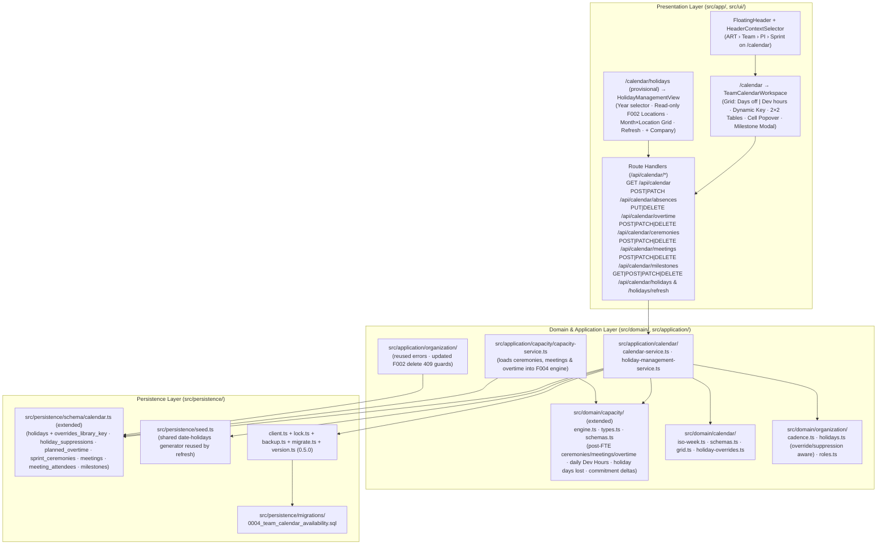

# Implementation Plan: Team Calendar & Availability (F005)

**Branch**: `005-team-calendar-availability` | **Date**: 2026-11-29 (Review Pass 6 — idempotent repeat-cancel & cancelled-entry popover controls, snapshot-roster baseline for `teamVsPiHours`/`teamVsSprintHours` + missing-Iteration `null` handling) | **Spec**: [spec.md](./spec.md)  
**Input**: Feature specification `/specs/005-team-calendar-availability/spec.md`, Feature Brief `/docs/features/005-team-calendar-availability.md` (v0.1), and Design Handoff `/docs/handoffs/azusa-handoff-v2.zip`

---

## Summary

Deliver Azusa's operational **Team Calendar** (`/calendar`) and a decoupled, provisional **Holiday Management** view (`/calendar/holidays`) on top of the local-first Next.js 15 / PGlite / Drizzle foundation (`F001`–`F004`), with **zero new npm dependencies**.

Extend `src/domain/capacity/` (pure TypeScript) to activate F004's ceremony, meeting, and planned-overtime hooks under the operator-confirmed post-FTE clock-time formula (`A1`–`A3`), so **both** `/calendar` and `/capacity` consume one authoritative calculation engine:
- `availableMinutes` = sum of assigned weekday `(workdayMinutes − holidayMinutes − effectiveAbsenceMinutes)` (preserving F004's independent AM/PM and holiday overlap rules).
- `preFteMinutes = max(0, availableMinutes − overheadMinutes)` (emits `'over_deducted'` when negative before clamp).
- `postFteMinutes = preFteMinutes × fteFactor`.
- `effectiveCalendarEventMinutes` = sum over assigned weekdays with `availableDayMinutes > 0` of `min(availableDayMinutes × fteFactor, applicableCeremonyMinutes + attendedMeetingMinutes)` — ceremonies (including a single `is_recurring_daily = true` Daily stand-up per Sprint) and attended meetings deduct actual clock time **after** FTE scaling, and full-day leave/holiday on an event day removes that day's event deduction.
- `devMinutesRaw = max(0, postFteMinutes − effectiveCalendarEventMinutes) + overtimeMinutes` — planned overtime (in `15`-minute integer-minute steps, allowed on weekdays, weekends, and public holidays) adds actual hours **after** FTE scaling.
- `devDaysRaw = devMinutesRaw / workdayMinutes`, `devHours = devMinutesRaw / 60`.
- Sprint-level `OverheadDeduction` stays separate in the Team Calendar presentation (never distributed into daily cells) and reconciles identically with `/capacity`.

Persist new calendar entities via explicit additive SQL migration `0004_team_calendar_availability.sql` (`APP_VERSION = '0.5.0'`): `sprint_ceremonies`, `meetings`, `meeting_attendees`, `milestones`, `planned_overtime` (canonical integer minutes, coexisting cleanly with full-day absences), `holiday_suppressions` (preserving explicit library holiday removals across refreshes), and nullable `holidays.overrides_library_key` (linking `manual` overrides to their original `library` identity).

Replace the `/calendar` placeholder with the v2 prototype layout (`LeaveCalendar.dc.html`, `LeaveCalendar3w.dc.html`, `LeaveCalendar4w.dc.html`) at `1440px` baseline subject to operator-accepted deviations `D1`–`D5`, and mount the decoupled `HolidayManagementView` provisionally at `/calendar/holidays` (reusing `Settings.dc.html` visual design for the Locations & Holidays panels without creating a monolithic `/settings` shell).

---

## Technical Context

- **Language / Runtime**: TypeScript 5.x (`strict: true`, `noUncheckedIndexedAccess: true`), Node.js 22.12+ / 24.x / 26+
- **Framework**: Next.js 15 (App Router), React 19, bound to `127.0.0.1`, `NEXT_TELEMETRY_DISABLED=1`
- **New Dependencies**: **None** (reuses Drizzle ORM, PGlite, Zod v4, `date-holidays` 3.39.2 already installed in F002, Vitest, Playwright, `@axe-core/playwright`)
- **Storage & Locking**: Embedded PGlite + Drizzle ORM (`0004_team_calendar_availability.sql`), reusing F001's `proper-lockfile` locking, `globalThis.__azusaDbState` singleton, automatic pre-migration startup backup, and `db:backup` / `db:restore` CLI workflows (bumping shared `APP_VERSION` in `src/persistence/version.ts`, `package.json`, and `package-lock.json` from `0.4.0` to `0.5.0`)
- **Validation & Testing**: Strict Zod v4 schemas, ESLint, Prettier, Vitest (unit + golden + real PGlite integration + HTTP route tests), Playwright (`port 3100`, `reuseExistingServer: false`, `.next-playwright`, `.azusa/test-playwright/`), `@axe-core/playwright`
- **Visual-Fidelity Mode**: **`Visual-fidelity`**
  - **Prototype / Design Reference**: `docs/handoffs/azusa-handoff-v2.zip` (`prototype/LeaveCalendar.dc.html`, `prototype/LeaveCalendar3w.dc.html`, `prototype/LeaveCalendar4w.dc.html`, `prototype/Settings.dc.html`; `screenshots/10-team-calendar-2w.png`, `10b-team-calendar-3w.png`, `10c-team-calendar-4w.png`, `07-settings-locations-holidays.png`; `AZUSA_HANDOFF_UPDATE_2026-11-20.md` §10 & §13.14; `docs/azusa-sprint-planning-decisions.md`; `docs/azusa-data-model.md` v0.6 §2 & §4). Fidelity guaranteed at `1440px` baseline width; `1024px` and `768px` adapt cleanly (collision-free, usable, accessible under Principle VII).
  - **Planned Deviations (`D1`–`D6`, all operator-accepted across Sessions `2026-11-27` & `2026-11-29`)**:
    - **D1 (Popover/modal on cell click instead of one-click cancel)** *(accepted `2026-11-27`, `A5`)*: Clicking any Member × Day cell opens a compact popover/modal to add/edit absences, manage planned overtime, inspect multiple entries, or explicitly cancel (`status = 'cancelled'`). Clicking an occupied cell never mutates immediately.
    - **D2 (Dynamic `AbsenceType` Key/Legend & authoritative `affects_capacity`)** *(accepted `2026-11-27`, `A5`)*: Legend derives dynamically from F002's `AbsenceType` catalog (`AL`, `SL`, `HD`, `BT`, `WFH`, `ON_SITE`) + Planned Overtime + Cancelled + calendar markers, omitting hardcoded prototype-only `Misc.`/`AWOL`. `BT`, `WFH`, and `ON_SITE` do not reduce capacity (`affects_capacity = false`).
    - **D3 (Post-FTE clock-time ceremonies/meetings & separate Sprint `OverheadDeduction`)** *(accepted `2026-11-27`, `A2`)*: Applies ceremonies and meetings as actual clock-time deductions **after** FTE scaling (`FTE × (Available − OverheadDeduction) − Events + Overtime`), showing Sprint-level `OverheadDeduction` separately before the reconciled Sprint `Dev h` total so `/calendar` and `/capacity` match identically.
    - **D4 (Live commitment chips & hidden `vs PI` / `vs Sprint` before F012/F013)** *(accepted `2026-11-27`, Brief §2.10/§7.7)*: Displays `PI not started · capacity is live` and `Sprint not started` chips and suppresses `vs PI` / `vs Sprint` columns until F012/F013 create real immutable commitments.
    - **D5 (Provisional decoupled Holiday Management view)** *(accepted `2026-11-27`, `A4`)*: Mounts decoupled `HolidayManagementView` provisionally at `/calendar/holidays` (accessible from the Holidays card header), with read-only F002 Locations overview, no `+ Location`, no per-Location `Hours / day`, and no monolithic `/settings` shell. Settings navigation will be finalized post-M0 using Prototype v3.
    - **D6 (Darker milestone red `#D00000` for WCAG AA contrast)** *(accepted `2026-11-29`, `R6`)*: Replaces prototype `#FF0000` (~4.0:1) with `#D00000` with white text (~5.7:1, meeting WCAG AA 4.5:1) everywhere milestone red appears (date header with precedence over `#F8CBAD` ceremony tint, Milestones table swatch, `MilestoneModal` badge, and Key/Legend entry).

---

## Constitution Check

- [x] **I. Purpose & Scope** — 100% local, single-user, no auth/RBAC enforcement, no self-service leave, no paid holiday APIs, no monolithic `/settings`.
- [x] **II. Spec-Driven / Prototype Fidelity** — Strictly scoped to F005; `Visual-Fidelity Mode: Visual-fidelity` targeting `LeaveCalendar*.dc.html` and `Settings.dc.html` (Locations & Holidays panels) at `1440px` baseline with all 6 deviations (`D1`–`D6`) justified and operator-accepted; `1024px`/`768px` verified for usability and accessibility under Principle VII.
- [x] **III. Domain & Historical Integrity** — All capacity, daily Dev Hours, holiday dev-days-lost, and commitment-delta calculations live in single authoritative pure functions in `src/domain/capacity/` and `src/domain/calendar/` (reused by both `/calendar` and `/capacity`); zero `PlanVersion`, `PICommitment`, `SprintCommitment`, `SprintClosure`/`Actuals`, `OverheadTicket`, or `UnplannedDeduction` tables created; dated `member_team_assignments` respected; cancellations preserve `status = 'cancelled'`; `ON DELETE RESTRICT` + updated F002 delete guards protect referential integrity.
- [x] **IV. Architecture & Data Safety** — Clean `src/domain/{capacity,calendar}/` → `src/application/calendar/` → `src/persistence/` → `src/app/api/calendar/` + `src/ui/calendar/` boundaries; zero new npm dependencies; explicit additive SQL migration `0004_team_calendar_availability.sql` verified for F004→F005 upgrade and CLI `db:backup`/`db:restore` round-trip (`APP_VERSION = '0.5.0'`); strict Zod validation and uniform `400`/`404`/`409`/`503` error envelopes.
- [x] **V. Deterministic Testing** — Pure Vitest unit & golden tests (including F004+F005 reconciled capacity scenarios, 0.5 FTE post-FTE clock-time ceremonies/meetings, planned overtime on weekdays/weekends/holidays, library holiday override/suppression resolution, commitment delta / `New` Member), real PGlite service, migration & CLI backup/restore integration tests, dedicated HTTP route tests, Playwright visual geometry tests, and Playwright E2E + `@axe-core/playwright` tests across `1440px`, `1024px`, and `768px`.
- [x] **VI. Documentation** — Updates `docs/architecture/overview.md`, `docs/architecture/domain-model.md`, `docs/architecture/data-dictionary.md`, `docs/operations/database-and-recovery.md`, `docs/REPO_MAP.md`, `CHANGELOG.md`, `README.md`, and adds ADR `docs/architecture/decisions/0005-team-calendar-and-availability.md`. (`docs/feature-roadmap.md` keeps `F005` unchecked until conformance review and operator UAT.)
- [x] **VII. UX & Accessibility** — Warm-light Kumiko tokens, `IBM Plex Mono` tabular numerals, accessible text/badge indicators (never color alone, including `est.` badges and overlap warnings), keyboard-operable cell popovers, date-header milestone modals, and custom pickers, `:focus-visible` `2px solid #E07F24` outlines, clear empty/read-only/error states, zero `@axe-core/playwright` violations.

---

## Architecture



### Layer Rules
1. **`src/domain/capacity/` (extended, pure TypeScript + Zod v4)**: Remains 100% pure (zero Next.js, React, Drizzle, PGlite, or `node:*` imports). Replaces F004's unused `futureAvailability` placeholder with unified top-level optional inputs (`ceremonies?`, `meetings?`, `plannedOvertime?`, `suppressedHolidayKeys?`, `commitments?`) and adds `overridesLibraryKey?` on `Holiday`. Runs `resolveEffectiveLocationHolidays` **before** filtering to `assignedSet.has(date)` (`R2`), emits distinct warning codes (`'over_deducted'`, `'events_exceed_day'`, `'events_exceed_sprint'`, `R3`), and exposes daily Member × CalendarDay breakdowns (`dailyCells`, `null` hours for non-dev roles), Team-level overhead/overtime/clamp reconciliation totals, and FTE-weighted per-Holiday `devDaysLost` (`R4`) so `/calendar` and `/capacity` share one single math engine (`FR-008`, `A2`, `A3`).
2. **`src/domain/calendar/` (pure TypeScript + Zod v4)**: Strict request/query schemas for absences, planned overtime, ceremonies, meetings, milestones, and holiday management/refresh (including weekday checks without hardcoding any `AbsenceType.code`); updates F002's `CreateAbsenceSchema` (`src/domain/organization/schemas.ts`) to reject non-null `extraHours` (`R1`); pure calendar grid layout helpers (contiguous Sprint calendar window `[scheduledStartDate .. calendarEndDate]` extending Friday ends through Sunday, exact per-ISO-week `CW##` span counts for `±1` offsets, month boundary dividers, compact 4-week metrics, dynamic legend derivation from `AbsenceType[]`).
3. **`src/domain/organization/holidays.ts` (extended, pure)**: Extends `resolveEffectiveLocationHolidays` to honor `overridesLibraryKey` (a `manual` override suppresses its referenced library holiday even if moved to another date) and `suppressedLibraryKeys` (explicitly removed library holidays are excluded), while preserving existing same-date `company`/`manual` precedence.
4. **`src/application/calendar/`**:
   - `calendar-service.ts`: Transactional read (`getTeamSprintCalendar`) loading holidays by `(date BETWEEN start AND end) OR (overrides_library_key IS NOT NULL AND left(overrides_library_key, 10) BETWEEN start AND end)` plus `holiday_suppressions` (`R2`), and mutations for dated absences (enforcing weekday date, active Member, and dated assignment covering `date`; no hardcoded `AbsenceType.code`; note archived Team/PI read-only mode is UI-enforced for member-level absences/overtime per `R5`), planned overtime (upsert/delete with `'overlaps_full_day_absence'` and `'outside_sprint_window'` advisory warnings), Sprint ceremonies (single `is_recurring_daily = true` Daily stand-up per Team × Iteration), meetings + attendees (weekday `date`), and Team milestones.
   - `holiday-management-service.ts`: Annual read (`getAnnualHolidays`, returning `suppressions`), company/manual holiday creation, library-holiday edit-to-manual-override (`409` if override already exists), `DELETE` (reverting manual override unless `?suppressLibrary=true`; on a library holiday, **keeping the library row**, deleting any linked manual override, and inserting a suppression), `DELETE /api/calendar/holidays/suppressions/[id]` restore, and offline `date-holidays` refresh for selected Location(s) and year(s) retaining suppressed library rows in storage (filtered by `resolveEffectiveLocationHolidays`) so post-refresh restore works cleanly while preserving all `company`, `manual`, and `holiday_suppressions` rows (`A4`).
5. **`src/application/capacity/capacity-service.ts` (updated)**: Loads holidays with the same moved-override `OR left(overrides_library_key, 10) BETWEEN start AND end` filter (`R2`), plus `sprint_ceremonies`, `meetings` + `meeting_attendees`, `planned_overtime`, and `holiday_suppressions` for the PI's Iterations, and passes them into `calculateTeamPiCapacity()` so `/capacity` and `/calendar` always report identical reconciled dev days, dev hours, and Forecast SP (`A2`).
6. **`src/application/organization/` (updated)**: Updates `deleteTeam`, `deleteMember`, `deleteIteration`, and `deleteLocation` conflict checks (`FR-014`); updates `updateTeam` so changing `sprint_offset_workdays` rejects (`409 CONFLICT`) if any dated `sprint_ceremonies` in **current or future Iterations** (`scheduledEndDate >= today`) would fall outside the Team's new scheduled window; updates `updateIteration` (`cadence-service.ts`) so changing Iteration `startDate`/`endDate` rejects (`409 CONFLICT`) if any dated `sprint_ceremonies` for that Iteration would fall outside their Team's new scheduled window.
7. **`src/ui/capacity/` (targeted update, `R3`)**: Updates `BreakdownPopover.tsx` and `MemberCapacityTable.tsx` to display `Ceremonies & meetings` and `Planned overtime` rows, the full equation `max(0, max(0, Days − Leaves − deductions) × FTE − Events) + Overtime = Dev`, and distinct warning messages for `'over_deducted'`, `'events_exceed_day'`, and `'events_exceed_sprint'`.
8. **`src/ui/shell/` (minimal targeted extension)**: Extends `OrganizationContext` + `HeaderContextSelector` + `FloatingHeader` to support an optional `iterationId` selection rendered as the 4th breadcrumb picker (`ART › Team › PI › Sprint`) on `/calendar` (matching `LeaveCalendar.dc.html`), leaving `/capacity` and `/organization` headers unchanged.
9. **`src/ui/calendar/`**: Focused client components for `/calendar` and the decoupled provisional `HolidayManagementView` mounted at `/calendar/holidays` (with seeded year pills + `‹`/`›` stepper across `2000–2100`, `D5`, `A4`).

---

## Data Flow

### 1. Read Team Sprint Calendar (`GET /api/calendar?teamId=<uuid>&piId=<uuid>&iterationId=<uuid>`)
1. `/calendar` checks URL search params (`teamId`, `piId`, `iterationId`):
   - Active ART/Team/PI/Iteration deep link → atomically syncs `OrganizationContext.setSelection({ teamId, piId, iterationId })` and clears URL params (`router.replace('/calendar')`).
   - Archived ART/Team/PI deep link → URL params take precedence over header selector, header keeps active selection, page renders read-only banner (`"Viewing archived <Team> · <PI> (read-only)"` + `"Return to active selection"`) and disables mutations.
   - Invalid/mismatched deep link → clears URL params, keeps current selection, shows dismissible notice.
2. `getTeamSprintCalendar()` validates `team`, `pi`, and `iteration` exist (`404`) and belong to the same ART/PI (`409`).
3. Loads Team, ART, PI, Iteration (computes Team-scheduled boundaries via `computeTeamIterationSchedule()` and contiguous calendar window `[calendarStartDate .. calendarEndDate]` extending Friday ends through Sunday `+2` days clipped before the next Iteration per `R4`/`R7`), overlapping `member_team_assignments` and `planned_overtime` over `[calendarStartDate .. calendarEndDate]` (identical bounds in `capacity-service.ts` so trailing-weekend overtime and weekend-starting assignments reconcile identically across `/calendar` and `/capacity`), Members (both eligible `Team member`s and non-dev roles `Admin`/`RTE`/`SM`/`PO`), Locations, effective Holidays (loaded by `(date BETWEEN start AND end) OR (overrides_library_key IS NOT NULL AND left(overrides_library_key, 10) BETWEEN start AND end)`) + `holiday_suppressions`, `AbsenceType` catalog, `Absences` (active + cancelled) in the Sprint window, `overhead_deductions` (F004), `sprint_ceremonies`, `meetings` + `meeting_attendees`, and `milestones`.
4. Delegates all capacity, daily Dev Hours, deduplicated same-date holiday `devDaysLost` (`R7`), and optional commitment-delta math to `src/domain/capacity/engine.ts` (`calculateTeamSprintCalendarCapacity`), returning one authoritative `TeamSprintCalendarView`.

### 2. Calendar Mutations & Live Recalculation
- **Absence (`POST /api/calendar/absences`, `PATCH /api/calendar/absences/[id]`, `R5`)**: Member-level records (archived Team/PI read-only mode is UI-enforced when `readOnly === true`). **Create** and **active edit/move/reactivate** validate active Member (`409`), required Mon–Fri weekday ISO date (`400`), valid `absenceTypeId` (`404`), portion `full | am | pm`, dated `member_team_assignments` covering `date` (`409`), and non-overlapping active capacity-affecting absences on `(memberId, date)` (`409`). **Cancel-only** (`{ status: 'cancelled', note? }` with no `date`/`absenceTypeId`/`portion`/`planned` fields) validates active Member (`409`) and **skips** the dated-assignment and overlap checks; on an already-cancelled row, `{ status: 'cancelled' }` is a `200 OK` idempotent no-op and `{ status: 'cancelled', note }` returns `200 OK` updating `note` only. **Combining `status: 'cancelled'` with `date`, `absenceTypeId`, `portion`, or `planned` is rejected (`400 VALIDATION_ERROR`).** **Any other edit on an already-cancelled absence without setting `status: 'active'` is rejected (`409 CONFLICT`).** Cancellation sets `status = 'cancelled'` (never hard-deletes). After mutation, UI re-fetches `GET /api/calendar` so daily Dev Hours and Sprint totals recalculate immediately.
- **Planned Overtime (`PUT /api/calendar/overtime`, `DELETE /api/calendar/overtime`)**: Member-level upsert on `(memberId, date)` with `durationMinutes` (`15..1440` step `15`) and optional note (rejects archived Member with `409`). Allowed on weekdays, weekends, and holidays. Returns non-blocking advisory warnings `'overlaps_full_day_absence'` and/or `'outside_sprint_window'` (`A3`, `R9`).
- **Ceremonies (`POST /api/calendar/ceremonies`, `PATCH /api/calendar/ceremonies/[id]`, `DELETE /api/calendar/ceremonies/[id]`)**: Validates active ART/Team/PI, Iteration in Team's ART, `durationMinutes` (`15..1440` step `15`). For `isRecurringDaily = true`, enforces `date === null` and uniqueness per `(teamId, iterationId)` (`409` if a Daily stand-up already exists). For `isRecurringDaily = false`, enforces `date` is a weekday within the Team's scheduled Iteration window.
- **Meetings (`POST /api/calendar/meetings`, `PATCH /api/calendar/meetings/[id]`, `DELETE /api/calendar/meetings/[id]`)**: Validates active ART/Team, weekday `date` (`400` on Sat/Sun), `durationMinutes` (`15..1440` step `15`), and `wholeTeam` vs non-empty `attendeeMemberIds` assigned to `teamId` on `date`.
- **Milestones (`POST /api/calendar/milestones`, `PATCH /api/calendar/milestones/[id]`, `DELETE /api/calendar/milestones/[id]`)**: Validates active ART/Team, `date`, nonblank `name`, `scope = 'team'`. Multiple milestones allowed per date.

### 3. Holiday Management & Override-Preserving Refresh (`A4`, `R8`)
- `GET /api/calendar/holidays?year=YYYY`: Returns read-only active F002 Locations (with member counts, weekday/total effective holiday counts, `lastRefreshedAt`), effective annual holidays, and `suppressions[]` for the year.
- `POST /api/calendar/holidays`: Creates a `company` or `manual` holiday for an active Location (manual overrides of library holidays are created via `PATCH /api/calendar/holidays/[id]`, not `POST`).
- `PATCH /api/calendar/holidays/[id]`: If target is `company` or `manual`, updates it in place; if target is `library`, returns `409 CONFLICT` if a `manual` override for `makeLibrarySourceKey(lib.date, lib.name)` already exists, otherwise atomically creates a `manual` override with `overrides_library_key` without modifying the library row (`A4`).
- `DELETE /api/calendar/holidays/[id]` (optional `?suppressLibrary=true`): Deletes `company` rows; for `manual` overrides with `overrides_library_key`, reverts to the library holiday unless `?suppressLibrary=true` (which deletes the override AND inserts a `holiday_suppressions` row); for `library` rows, deletes any linked `manual` override AND inserts a `holiday_suppressions` row (`A4`).
- `DELETE /api/calendar/holidays/suppressions/[id]`: Deletes the `holiday_suppressions` row for an active Location and inspects the stored `library` row directly (no regeneration step, since refresh retains suppressed rows). Returns `effective: true` if the stored library row is now effective, `effective: false, effectiveReason: 'overridden_by_company_or_manual'` if a `company`/`manual` row takes precedence on that date, or `libraryRowAvailable: false, effective: false, effectiveReason: 'library_row_missing', warning: 'library_holiday_no_longer_generated'` if the stored library row no longer exists — preserving all overrides and other suppressions (`R8`).
- `POST /api/calendar/holidays/refresh`: Accepts `{ year, locationId? }`. For each targeted active Location, queries offline `date-holidays` for `year` (respecting `library_seed_cutoff_date`), replaces **only** `source = 'library'` rows for that year (**retaining suppressed library rows in storage**, filtered out by `resolveEffectiveLocationHolidays` on every read so post-refresh restore works cleanly), leaves all `company`, `manual`, and `holiday_suppressions` rows completely untouched, and updates `locations.last_refreshed_at` and `seeded_years`.

---

## Project Structure

```text
src/
├── domain/
│   ├── organization/
│   │   └── holidays.ts                       # Extend resolveEffectiveLocationHolidays for overridesLibraryKey & suppressions
│   ├── calendar/
│   │   ├── iso-week.ts                       # Existing pure ISO-week helpers
│   │   ├── holiday-overrides.ts              # Pure makeLibrarySourceKey() & override/suppression resolution helpers
│   │   ├── grid.ts                           # Pure Sprint grid builder (CW## weeks, month dividers, compact 4w mode, dynamic legend)
│   │   └── schemas.ts                        # Strict Zod v4 schemas for all /api/calendar/* payloads & queries
│   └── capacity/
│       ├── types.ts                          # Extend CapacityEngineInput & outputs with ceremonies, meetings, overtime, dailyCells, holidayDevDaysLost, optional commitments
│       └── engine.ts                         # Activate post-FTE clock-time ceremonies/meetings, post-FTE overtime, daily Dev Hours, holiday dev days lost, commitment deltas
├── application/
│   ├── calendar/
│   │   ├── calendar-service.ts               # Transactional calendar read + absence, overtime, ceremony, meeting, milestone mutations
│   │   └── holiday-management-service.ts     # Annual holiday read, company/manual CRUD, library edit→override, library suppress, offline refresh
│   ├── capacity/
│   │   └── capacity-service.ts               # Load ceremonies, meetings, planned_overtime & holiday_suppressions into F004 engine
│   └── organization/
│       ├── organization-service.ts           # Update deleteTeam & deleteMember 409 guards for F005 tables
│       ├── cadence-service.ts                # Update deleteIteration 409 guard for sprint_ceremonies
│       └── calendar-reference-service.ts     # Update deleteLocation 409 guard & listLocationHolidays for suppressions/overrides
├── persistence/
│   ├── version.ts                            # Bump APP_VERSION to '0.5.0'
│   ├── seed.ts                               # Export reusable offline date-holidays year generator for refresh
│   ├── schema/
│   │   └── calendar.ts                       # Add overrides_library_key on holidays; add holiday_suppressions, planned_overtime, sprint_ceremonies, meetings, meeting_attendees, milestones
│   └── migrations/
│       ├── 0004_team_calendar_availability.sql
│       └── meta/
│           ├── _journal.json                 # Add 0004 entry
│           └── 0004_snapshot.json            # Drizzle snapshot for 0004
├── app/
│   ├── calendar/
│   │   ├── page.tsx                          # Replace F001 placeholder with server health + TeamCalendarWorkspace
│   │   └── holidays/
│   │       └── page.tsx                      # Provisional route mounting decoupled HolidayManagementView (D5, A4)
│   └── api/
│       └── calendar/
│           ├── route.ts                      # GET Team × Sprint calendar view
│           ├── absences/
│           │   ├── route.ts                  # POST create dated absence
│           │   └── [id]/route.ts             # PATCH edit/move/cancel absence
│           ├── overtime/
│           │   └── route.ts                  # PUT upsert / DELETE remove planned overtime
│           ├── ceremonies/
│           │   ├── route.ts                  # POST create ceremony (daily or dated)
│           │   └── [id]/route.ts             # PATCH edit / DELETE remove ceremony
│           ├── meetings/
│           │   ├── route.ts                  # POST create meeting (whole team or attendees)
│           │   └── [id]/route.ts             # PATCH edit / DELETE remove meeting
│           ├── milestones/
│           │   ├── route.ts                  # POST create Team milestone
│           │   └── [id]/route.ts             # PATCH rename / DELETE remove milestone
│           └── holidays/
│               ├── route.ts                  # GET annual holiday view / POST company or manual holiday
│               ├── [id]/route.ts             # PATCH edit (library→manual override) / DELETE (library→suppress)
│               └── refresh/route.ts          # POST refresh library holidays from date-holidays
└── ui/
    ├── shell/
    │   ├── OrganizationContext.tsx           # Add optional iterationId selection & setIterationId
    │   ├── HeaderContextSelector.tsx         # Render 4th 'Sprint' picker on sprint-scoped routes (/calendar)
    │   └── FloatingHeader.tsx                # Wire Sprint picker open/close state cleanly
    └── calendar/
        ├── TeamCalendarWorkspace.tsx         # Page orchestrator: header links, Days off | Dev hours switch, chips, grid, key, 2×2 tables
        ├── CalendarGrid.tsx                  # Member × Day grid (2w/3w/4w compact, CW## headers, month dividers, today/ceremony/milestone headers, Team totals)
        ├── CalendarKey.tsx                   # Dynamic legend from F002 AbsenceType[] + Overtime + Cancelled + markers (D2, A5)
        ├── CellEntryPopover.tsx              # Compact popover/modal for add/edit/cancel absence, overtime (+overlap warning), multi-entry inspection (D1, A3, A5)
        ├── MilestoneModal.tsx                # Add / inline-edit / remove milestones modal (date header & table + Add)
        ├── CalendarTables.tsx                # 2×2 tables: Holidays, Milestones, Scrum ceremonies (with inline/modal add/edit), Meetings (with attendee picker)
        ├── HolidayManagementView.tsx         # Decoupled provisional holiday management UI (year selector, read-only Locations, Month×Location grid, refresh, + company)
        └── calendar.module.css               # Kumiko styles matching LeaveCalendar*.dc.html & Settings.dc.html
```

---

## Risks and Tradeoffs

| Risk | Impact | Mitigation |
|---|---|---|
| **Extending F004's capacity engine could regress F004 golden tests** | Existing F004 `Palawan` / `PI-2027.1` golden tests expect exact Baseline (`291.25` / `268 SP`) and Adjusted (`291.75`) numbers when ceremonies/meetings/overtime are empty. | Default `ceremonies`, `meetings`, and `overtime` inputs to `[]` so zero-event inputs reproduce F004's exact bit-for-bit numbers; add new F005 golden tests verifying post-FTE ceremonies, meetings, and overtime alongside unchanged F004 tests. |
| **Daily Dev Hours sum vs. Sprint `Dev h` total when `OverheadDeduction > 0`** | Because Sprint-level `OverheadDeduction` (`A2`) is not distributed across daily cells, summing daily cells directly exceeds reconciled Sprint `Dev h` by `OverheadDeduction × FTE` (and diverges further if pre-FTE overhead or Sprint-level events clamp to `0`). | Display a clear `Overhead` reconciliation column at **both** Member and Team total rows (`teamSprintOverheadHours` / `teamSprintOverheadPostFteHours` / `teamHasClampedMember`) and surface the exact clamped equation `max(0, max(0, available − overhead) × FTE − effectiveEvents) + overtime` in Member/Team tooltips and `/capacity`'s updated `BreakdownPopover`. |
| **Editing a library holiday's date across a Sprint or PI boundary (`R2`)** | Filtering holidays to `[start, end]` before resolving overrides misses a `manual` override whose new date falls outside the window, leaving the original `library` row deducting capacity. | Load holidays matching `(date BETWEEN start AND end) OR (overrides_library_key IS NOT NULL AND left(overrides_library_key, 10) BETWEEN start AND end)` plus `holiday_suppressions`, and run `resolveEffectiveLocationHolidays` **before** filtering to `assignedSet.has(date)` (`T001`, `T003`, `T009`). |
| **Overloading F002's `absences` table for planned overtime (`R1`)** | `absences.absence_type_id` is `NOT NULL` and absence overlap checks conflict with coexisting full-day absence + overtime (`A3`); leaving `CreateAbsenceSchema.extraHours` active would create two sources of truth. | Persist planned overtime in a dedicated `planned_overtime` table (`duration_minutes` integer in `15`-min steps), deprecate `absences.extra_hours` (rejecting non-null `extraHours` in `CreateAbsenceSchema` while leaving existing legacy values untouched), and record the operator-approved (`2026-11-29`) Brief §2.9 departure in ADR `0005`. |
| **Provisional `/calendar/holidays` route before Prototype v3 Settings** | Route URL may relocate when post-M0 Settings architecture is finalized (`A4`). | Keep `HolidayManagementView.tsx` completely decoupled from route/navigation chrome and omit `/calendar/holidays` from the main logo menu so relocation is a one-file mount swap. |

---

## Validation Approach

1. **Pure Domain & Engine Unit Tests (`tests/unit/` via `npm run test:run`)**:
   - `tests/unit/calendar-domain.test.ts`: Tests `makeLibrarySourceKey`, `resolveEffectiveLocationHolidays` with `overridesLibraryKey` (including moved dates) and `holiday_suppressions`, Sprint grid builder (2w/3w/4w, `±1` offsets, CW## week grouping, month dividers, compact mode), dynamic legend builder from `AbsenceType[]`, and strict Zod schemas (rejecting undated absences, off-step `10`-minute durations, unknown keys).
   - `tests/unit/capacity-engine.test.ts` (extended) + `tests/unit/capacity-golden.test.ts` (preserved): Verifies F004 baseline/adjusted golden fixtures remain 100% intact, plus new F005 golden cases: `0.5` FTE Member with post-FTE clock-time `Sprint planning` (`2 h`) + recurring `Daily` (`15 min`) + attended `Meeting` (`1 h`), full-day `AL` or holiday removing that day's ceremony/meeting deductions, half-day `HD` + ceremony clamping, post-FTE planned overtime on weekday/weekend/holiday, separate Sprint `OverheadDeduction` reconciliation matching `/capacity`, non-dev role (`SM`/`PO`) exclusion from Team totals, holiday `devDaysLost`, and optional PI/Sprint commitment deltas + `New` Member label.
2. **Real PGlite Service, Migration & CLI Backup Tests (`tests/integration/` via `npm run test:run`)**:
   - `tests/integration/calendar-migration-backup.test.ts`: F004→F005 upgrade (`0003` → `0004`), direct SQL `CHECK`/`UNIQUE`/`ON DELETE RESTRICT` checks, and CLI `db:backup` → `db:restore` round-trip (`APP_VERSION = '0.5.0'`).
   - `tests/integration/calendar-persistence.test.ts`: Real PGlite service tests covering absence create/edit/move/cancel (`status = 'cancelled'`), undated rejection, `affects_capacity` (`BT`/`WFH`/`ON_SITE` = 0), planned overtime create/edit/delete + full-day absence overlap warning, single recurring Daily stand-up enforcement + dated ceremonies, whole-Team vs specific-attendee meetings, multiple milestones on one date, `/calendar` ↔ `/capacity` reconciled capacity equality, holiday refresh preserving `company`/`manual` overrides & suppressions idempotently, and updated F002 delete `409` guards.
   - `tests/integration/calendar-routes.test.ts`: Direct Next.js Route Handler contract tests for all `/api/calendar/*` endpoints (`200`/`201`, `Cache-Control: no-store`, `400`/`404`/`409`/`503`, unknown keys, actor-injection rejection).
3. **Playwright Visual Geometry, E2E & Accessibility Tests (`npm run test:visual`, `npm run test:e2e`)**:
   - `tests/visual/team-calendar.spec.ts`: Verifies `/calendar` (2w, 3w, 4w layouts, `Days off` & `Dev hours`, dynamic Key, 2 × 2 tables) and `/calendar/holidays` geometry across `1440px`, `1024px`, and `768px` with zero page-level horizontal overflow.
   - `tests/e2e/team-calendar.spec.ts`: Walks US1–US5 end-to-end (header Sprint switching, 2/3/4-week Sprints, cell popover add/edit/move/cancel without auto-cancel, overtime on weekday/weekend + overlap warning, recurring Daily + dated ceremonies, whole-Team & attendee meetings, date-header & table milestones with red precedence over ceremony tint, `Dev hours` reconciliation with `/capacity`, provisional `/calendar/holidays` add company / edit library→manual override / remove library→suppress / refresh idempotency, zero external network requests, and zero `@axe-core/playwright` violations across `1440px`, `1024px`, and `768px`).

---

## Affected Areas

### Files / Components to Be Inspected (Read-Only Reference)
- `.specify/memory/constitution.md`
- `docs/features/005-team-calendar-availability.md`
- `docs/handoffs/azusa-handoff-v2.zip` (`prototype/LeaveCalendar*.dc.html`, `prototype/Settings.dc.html`, `screenshots/10*.png`, `07-settings-locations-holidays.png`, `AZUSA_HANDOFF_UPDATE_2026-11-20.md`, `docs/azusa-sprint-planning-decisions.md`, `docs/azusa-data-model.md` v0.6)
- `specs/005-team-calendar-availability/spec.md`
- `src/domain/organization/{cadence.ts,roles.ts,context.ts}`
- `src/persistence/{schema/common.ts,schema/organization.ts,schema/capacity.ts,client.ts,migrate.ts,backup.ts}`
- `src/application/organization/errors.ts`
- `src/app/api/organization/http.ts`
- `src/ui/shell/{AppShell.tsx,nav-config.ts,page-health.ts}`

### Files / Components to Be Created or Modified
- **Version / Config**: `src/persistence/version.ts` (modify — `0.5.0`), `package.json` (modify — `0.5.0`), `package-lock.json` (modify — `0.5.0`)
- **Domain**: `src/domain/organization/{holidays.ts,schemas.ts}` (modify — support `overridesLibraryKey` & `suppressedLibraryKeys`; deprecate `extraHours` in `CreateAbsenceSchema`), `src/domain/calendar/{holiday-overrides.ts,grid.ts,schemas.ts}` (create), `src/domain/capacity/{types.ts,engine.ts}` (modify — unify top-level inputs replacing `futureAvailability`, add `overridesLibraryKey` on `Holiday`, resolve holidays before date filtering, post-FTE ceremonies/meetings/overtime, distinct warning codes `'over_deducted' | 'events_exceed_day' | 'events_exceed_sprint'`, daily Dev Hours, Team overhead totals, holiday `devDaysLost`, optional commitment deltas)
- **Application**: `src/application/calendar/{calendar-service.ts,holiday-management-service.ts}` (create), `src/application/capacity/capacity-service.ts` (modify — load moved-override holidays, ceremonies, meetings, overtime & holiday suppressions into F004 engine), `src/application/organization/{organization-service.ts,cadence-service.ts,calendar-reference-service.ts}` (modify — update delete `409` guards, `updateTeam` offset-vs-ceremony `409` guard, & effective holiday reads)
- **Persistence**: `src/persistence/schema/calendar.ts` (modify — add `overridesLibraryKey` on `holidays`; add `holidaySuppressions`, `plannedOvertime`, `sprintCeremonies`, `meetings`, `meetingAttendees`, `milestones`), `src/persistence/seed.ts` (modify — export reusable offline year holiday generator), `src/persistence/migrations/0004_team_calendar_availability.sql` + `meta/_journal.json` + `meta/0004_snapshot.json` (create/modify)
- **API Routes**: `src/app/api/calendar/{route.ts,absences/route.ts,absences/[id]/route.ts,overtime/route.ts,ceremonies/route.ts,ceremonies/[id]/route.ts,meetings/route.ts,meetings/[id]/route.ts,milestones/route.ts,milestones/[id]/route.ts,holidays/route.ts,holidays/[id]/route.ts,holidays/refresh/route.ts,holidays/suppressions/[id]/route.ts}` (create)
- **UI**: `src/ui/shell/{OrganizationContext.tsx,HeaderContextSelector.tsx,FloatingHeader.tsx}` (modify — add Sprint picker on `/calendar`), `src/ui/capacity/{BreakdownPopover.tsx,MemberCapacityTable.tsx}` (modify — add `Ceremonies & meetings` + `Planned overtime` rows, full equation, and distinct event warning badges per `R3`), `src/app/calendar/page.tsx` (modify — replace F001 placeholder), `src/app/calendar/holidays/page.tsx` (create — provisional decoupled Holiday Management route), `src/ui/calendar/{TeamCalendarWorkspace.tsx,CalendarGrid.tsx,CalendarKey.tsx,CellEntryPopover.tsx,MilestoneModal.tsx,CalendarTables.tsx,HolidayManagementView.tsx,calendar.module.css}` (create)
- **Documentation**: `docs/architecture/{overview.md,domain-model.md,data-dictionary.md}` (modify), `docs/architecture/decisions/0005-team-calendar-and-availability.md` (create), `docs/operations/database-and-recovery.md` (modify), `docs/REPO_MAP.md` (modify), `CHANGELOG.md` (modify), `README.md` (modify) *(note: `docs/feature-roadmap.md` keeps `F005` unchecked until conformance review and operator UAT)*

### Tests to Be Added or Updated
- **Add**: `tests/unit/calendar-domain.test.ts`
- **Add**: `tests/integration/{calendar-migration-backup.test.ts,calendar-persistence.test.ts,calendar-routes.test.ts}`
- **Add**: `tests/visual/team-calendar.spec.ts`
- **Add**: `tests/e2e/team-calendar.spec.ts`
- **Update**: `tests/unit/capacity-engine.test.ts` (add F005 post-FTE ceremonies/meetings/overtime/commitment-delta/same-date-holiday cases), `tests/integration/capacity-migration-backup.test.ts` (assert against `APP_VERSION` constant instead of hardcoded `'0.4.0'` so Phase 06 version bump stays green across all phases), `tests/e2e/foundation-smoke.spec.ts` & `tests/visual/shell-fidelity.spec.ts` (update `/calendar` expectation from F001 placeholder to live Team Calendar), `tests/integration/migration-upgrade.test.ts` (if journal entry count is asserted), `tests/unit/docs-completeness.test.ts` (if ADR/doc index is checked)

### Explicitly Out of Scope
- Organization, ART, Team, Member, PI, Iteration, or Location registry CRUD (`F002`)
- Per-Location workday-hours editing (`Brief §2.5, §6`)
- Monolithic `/settings` application or finalized Settings navigation (`A4`, deferred to Prototype v3)
- Floating/undated absences or absence-movement audit log (`Brief §2.2`)
- Reusable fixed-day `CeremonyTemplate`s, time-of-day fields, or clock-interval overlap detection (`A1`)
- Independent `OverheadDeduction` editing on `/calendar` or persisting daily overhead deductions (`A2`, `/capacity` owns editing)
- `OverheadTicket` ("T" cells), `Buffer`/`BufferDraw`, Sprint Planning, `Start Sprint`, `Close Sprint`, or `UnplannedDeduction` (`F009`, `F013`–`F015`)
- `PlanVersion`, `PICommitment`, or `SprintCommitment` creation or provisional commitment tables (`F012`, `F013`)
- ART-level milestones (`scope = 'train'`) or Story/Bug milestone linking (`F007`, `F019`)
- Authentication, RBAC, self-service leave entry, or external paid holiday APIs
